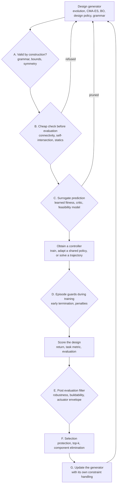

# Design Filtering in Design and Policy Co-Optimisation

Written 2026-11-13. A literature survey of how published design and policy co-optimisation systems keep unviable designs out of their search and out of their controller's training, read against the failure observed in run `copt_moral/2026-11-12_06-55-42`. The survey describes, it does not prescribe, and the implementation that this repository already carries is recorded in [../plans/design_filtering.md](../plans/design_filtering.md).

## 1. Introduction

A co-optimisation system searches over robot bodies and, for each body it proposes, obtains a controller and a score. The body proposed is not always one that can be controlled at all. Some cannot be assembled, some intersect themselves, some cannot carry their own weight, and some are merely so poor that the controller wastes its experience on them. A recent survey of the field classifies these systems by how they couple the body search to the control search, into bi-level, single-level, generative and open-ended co-design [1], and every class meets the same question of what to do with a body that should never have been proposed.

The question has been answered in many ways since the first evolved virtual creatures, which were checked for interpenetrating parts before they were ever simulated [2]. Later work found that a change of body tends to degrade the controller that had adapted to the previous one, so that a promising body may look unviable only because its controller has not yet caught up [3]. A filter must therefore separate two cases, a body that is unviable whatever the controller, and a body that is viable but not yet well controlled. The first should be removed as early and as cheaply as possible, the second should be protected.

This document proceeds in four steps. Section 2 states the problem as the run in this repository records it, since the evidence narrows which kinds of filter matter here. Section 3 sets out the common shape of a co-optimisation loop and marks the points at which a filter can act. Section 4 summarises each surveyed system so that its filter can be understood without the paper. Section 5 then examines the filtering mechanisms themselves, grouped by where they act, each with pseudocode and with the effect on training that its paper reports. Section 6 maps the mechanisms onto the failures of section 2.

## 2. The problem in this workspace

### 2.1 The run

Run `copt_moral/2026-11-12_06-55-42` co-optimised the TRON1 solefoot biped under `BipedCMAESCfg` with `design_search: actuator_leg_geometry`, searching two link length scales, two pose offsets and one actuator per joint group from a catalogue of fifteen (`params/cmaes.yaml`). It trained 6400 environments, held each population for 400 iterations, and drew populations at random before iteration 6000 and from CMA-ES after it (`ea_update_interval: 400`, `ea_late_start: 6000`, `randomise_before_late_start: true`). The random phase population held 100 designs, so 64 environments per design, and the CMA-ES population 80 designs, so 80 environments per design, as the row counts of `designs/design_parameters_<it>.csv` show. Every candidate passed through the standing filter of `co_optimisation/co_optimisation/utils/filters.py:283-397` before it was converted, with 16 stances, 16 torque ceilings between 0.5 and 1.0 of each motor's force range, and refusal above a failed share of 0.25, its support criterion being the static stability margin of McGhee and Frank [4]. The control step is 0.02 s and an episode lasts 20 s, so 1000 steps (`params/env.yaml`, `dt: 0.005`, `decimation: 4`, `episode_length_s: 20`).

### 2.2 What the training curves show

The user observed that, once actuator swapping began, the locomotion rewards fell towards zero and the penalties rose. The scalar record confirms the pattern and dates it. Table 1 gives, for each 400 iteration window, the mean over its second half of three logged quantities, drawn from `artefacts/copt_moral-2026-11-12_06-55-42-design-viability/generation_bins.txt`.

| Window | Designs | `Train/mean_episode_length` | `Episode_Reward/rew_lin_vel_xy` | `Episode_Termination/leg_contact` |
|---|---|---|---|---|
| 0 to 399 | 100 | 690.4 | 12.481 | 0.283 |
| 400 to 799 | 100 | 864.1 | 18.936 | 0.166 |
| 800 to 1199 | 100 | 24.2 | 0.393 | 0.677 |
| 2000 to 2399 | 100 | 8.7 | 0.152 | 0.649 |
| 4400 to 4799 | 100 | 180.5 | 3.339 | 0.465 |
| 5600 to 5999 | 100 | 10.9 | 0.197 | 0.614 |
| 6000 to 6399 | 80 | 37.6 | 0.720 | 0.410 |
| 6400 to 6799 | 80 | 738.5 | 15.350 | 0.322 |
| 6800 to 7199 | 80 | 73.1 | 1.501 | 0.272 |
| 7200 to 7599 | 80 | 70.0 | 1.536 | 0.241 |
| 7600 to 7999 | 80 | 841.6 | 17.938 | 0.239 |

Table 1. Second half means per population window, run `copt_moral/2026-11-12_06-55-42`.

The collapse is a step at a population swap rather than a drift. At 50 iteration resolution the logged episode length reads 868.7 over iterations 750 to 799 and 122.5 over 800 to 849, and in the CMA-ES phase it reads 752.7 over 6750 to 6799 and 42.8 over 6800 to 6849 (`transitions_50_iteration_bins.txt`). It recovers just as abruptly, from 41.1 over 6350 to 6399 to 470.2 over 6400 to 6449. Generation 1, iterations 400 to 799, trained normally although 95 of its 100 designs already carried at least one actuator other than the base robot's, so the swapping of an actuator is not in itself what breaks training.

### 2.3 Why one design can collapse the logged statistics

Two logged quantities are averaged over episodes, not over environments. `Train/mean_episode_length` and the runner's mean reward are the means of the last hundred completed episodes (`co_optimisation/co_optimisation/runners/copt_on_policy_runner.py:387-398`), and every `Episode_Reward/<term>` is the mean episodic sum over the environments reset at a given step, divided by the episode duration (`IsaacLab/source/isaaclab/isaaclab/managers/reward_manager.py:119-120`). `Episode_Termination/<term>` is different, the fraction of all environments whose most recent episode ended by that term (`IsaacLab/source/isaaclab/isaaclab/managers/termination_manager.py:144-147`).

An episode weighted mean is dominated by whichever environments reset most often. Let $E$ be the number of environments, $N$ the number of designs, $m = E/N$ the environments per design, $k$ the number of designs whose environments end their episode at every step, and $L_h$ the episode length in steps of every other environment. Each step then completes $k m$ episodes of length one and about $(E - k m)/L_h$ episodes of length $L_h$, so the logged mean episode length is

$$\bar{L} = \frac{E}{k m + (E - k m)/L_h}.$$

With $E = 6400$, $m = 80$ and $L_h = 850$, the healthy level of Table 1, one such design gives $\bar{L} = 73.2$ steps and two give $38.2$, against the 73.1, 70.0 and 37.6 logged. The same weighting acts on every `Episode_Reward` term, since a one step episode carries an episodic sum near zero. The policy's own batch is not weighted this way, each environment contributing the same 25 transitions to every iteration (`params/agent.yaml`, `num_steps_per_env: 25`), so such a design holds $m/E = 1.25$ per cent of the batch while it supplies about 91.5 per cent of the completed episodes.

The controlled evaluation confirms that the policy itself did not collapse in the CMA-ES phase. The populations trained over iterations 6800 to 7199 and 7200 to 7599, whose logged episode length reads 73.1 and 70.0, kept 0.9668 and 0.9666 of their instances alive over the 4 s evaluation, against 0.8887 and 0.9560 for the two populations before them, the second of which trained in the healthy window 6400 to 6799 (`designs/cmaes_history.csv`).

### 2.4 The designs that end at every step

Each CMA-ES generation is evaluated, so its failing designs can be named. Of the 400 evaluated designs of generations 15 to 19, five carried the ODrive-D5065-DD on the hip, a direct drive unit of 5 Nm and 50 mm diameter against the 60 Nm and 96.6 mm of TRON1-HIP (`design_generator/biped/catalogs/actuators.json`). Four of the five scored a survival of zero and a return between −0.67 and −0.10, the reward of a single step, and they are exactly the designs in the collapsed windows of Table 1. The fifth, which paired the same hip with an ANYdrive-3 on the abduction and a HEBI-X8-16 on the knee, survived 0.515. Among the other 395 designs the mean survival was 0.962 and only five fell below one half (`gains_and_survival.txt`).

The four share one geometric defect. The leg's actuator cluster is laid out from the radii of its housings, and with the narrow ODrive housing between the TRON1-ABAD and TRON1-KNEE housings the abduction housing overlaps the knee housing by 3.3 mm at the nominal pose, on both legs, while the base robot and the other swaps tested show no contact (`self_intersection_by_window.txt`, measured in MuJoCo on the Isaac Lab document with the base lifted clear of the ground). The asset enables self collision (`environments/environments/assets/config/solefoot_identified_cfg.py:80`, recorded as `enabled_self_collisions: true` in the run's `params/env.yaml`) and the `leg_contact` termination fires on any contact force above 1 N on `thigh_.*`, `shank_.*` or `.*_act` (`environments/environments/tasks/locomotion/cfg/SF/limx_base_env_cfg.py:1097-1105`). An overlap of two housings in contact therefore ends the episode on its first step. That PhysX reports the overlap as a contact on those bodies is inferred rather than observed, but the inference predicts the zero survival, the one step returns and, through the formula of section 2.3, the logged episode lengths of every CMA-ES window to within 3.2 steps.

The overlap test of every population on the scene, rebuilt from its design record, finds such designs in five random phase windows as well, 5 in 2000 to 2399, 3 in 2400 to 2799, 1 in 3600 to 3999, 1 in 5200 to 5599 and 8 in 5600 to 5999, every one of them carrying a narrow housing on the hip, the 60 mm TRON1-ANKLE in most and the 50 mm ODrive in some of the last window (`self_intersection_by_window.txt`). Those three windows hold the three shortest logged episode lengths of the random phase, 8.7, 10.4 and 10.9 steps. The standing filter passed all of them, the four of the CMA-ES phase at a failed share of 0.1875, under the threshold of 0.25, because the filter tests whether the robot can hold a stance under statics with its feet the only bodies on the ground (`filters.py:355-370`), and an overlap between two housings of one leg is not among the conditions it tests.

### 2.5 The random phase is not wholly explained

Overlap does not explain the windows from 800 to 1999 or from 2800 to 5199, where no design overlaps and yet the logged episode length lies between 19.8 and 180.5. These windows also degrade in the environment weighted record, `Episode_Termination/leg_contact` rising from 0.166 in window 400 to 799 to between 0.465 and 0.677, so in them a large share of all environments, and not a single design, was falling.

The onset coincides with a second change in the population. Every catalogue actuator carries its own servo gains, filled for an unidentified entry from its nearest identified TRON1 or A1 actuator ([../plans/design_filtering.md](../plans/design_filtering.md), its ninth step), so an actuator moved to another joint brings that actuator's gains with it. Nine of the fifteen actuators the run drew carry a stiffness of 10 Nm/rad and a damping of 0.5, the TRON1 ankle's values, against 55 to 80 Nm/rad for the other six (`design_parameters_<it>.csv`, columns `<group>_actuator_stiffness` and `<group>_actuator_damping`). From window 800 to 1199 onwards between 34 and 85 of the 100 designs drove the hip or the knee through one of those nine, where the base robot's knee runs at 60 Nm/rad, against none in the two windows before it (`gains_and_survival.txt`). The random phase is never evaluated, so its failures cannot be assigned to designs, and the coincidence is not proof. The CMA-ES evaluations also show that such a design is a handicap rather than a death sentence once the policy has met it, 64 designs with a hip or knee stiffness of 10 Nm/rad surviving 0.916 on average against 0.973 for the 292 at 60 Nm/rad. The random phase degradation is therefore recorded here as unattributed, with the transplanted servo gains as its leading candidate.

### 2.6 What the problem asks of a filter

The evidence separates three failure modes, each needing a different kind of test. A design whose bodies intersect at its nominal pose fails at every step whatever the controller, and only a geometric test can see it. A design whose actuators cannot produce the speed or the stiffness a gait needs may stand under statics and still fall in motion, and only a dynamic or an operating envelope test can see it. And a design that is merely new to the policy may look like either of the others until the policy adapts, which argues for protection rather than removal. Section 5 is organised so that the mechanisms answering each of these can be found.

## 3. The shape of a co-optimisation loop

Every system surveyed here runs some form of the loop in Figure 1. A design generator proposes candidates, a controller is obtained for each, by training it, by adapting a shared policy, or by solving a trajectory optimisation, each candidate is scored, and the scores update the generator. The survey of Wang and colleagues distinguishes the bi-level form, in which the controller is optimised in an inner loop for each design, from the single-level form, in which design and control are optimised together in one loop, and adds generative co-design, which draws candidates from a learned or rule based prior, and open-ended co-design, which also evolves the task [1].



Figure 1. The generic co-optimisation loop, with the seven points at which the surveyed systems filter. The letters label the subsections of section 5.

The figure shows that filtering is not one step but a family of steps placed at different costs. A test before evaluation costs little beside the training run it spares, a surrogate costs a forward pass, a guard inside an episode costs nothing but acts only after the design is already in training, and a filter after evaluation acts only on what the search has already paid for. Where a shared policy is trained across a population, as in this workspace, the position matters twice, because a design that enters training also consumes the shared policy's experience.

## 4. The surveyed systems

This section describes each system briefly, enough that its filter in section 5 can be read without the paper. The systems are grouped by the family of Figure 1 they belong to, and Table 2 at its end summarises them.

### 4.1 Evolutionary search with a controller per design

Sims evolved directed graph genotypes that describe both the body, a tree of rigid boxes connected by joints, and its neural controller, under a genetic algorithm with populations of typically 300 and a survival ratio of one fifth, scoring each creature by swimming, walking, jumping or following in a physical simulation [2].

Cheney and colleagues co-evolved bodies and controllers and argued that a mutation to the body tends to degrade a controller adapted to the old body, which traps the search in local optima, and they proposed to protect a newly mutated body for as long as its controller needs to readapt [3].

Gupta and colleagues, in DERL, evolved bodies in the UNIMAL design space, a kinematic tree of a spherical head and cylindrical limbs joined by motor driven hinges, through asynchronous tournaments of four drawn from a population of 576, each child learning its controller from scratch with PPO for 5 million interactions and scored by its mean reward over roughly the last 100,000 of them, the experiments searching over and training about 4000 bodies across 1152 CPUs [5].

Bhatia and colleagues built Evolution Gym, a benchmark of two dimensional soft robots made of rigid, soft and actuated voxels, and coupled three design optimisers, a genetic algorithm, Bayesian optimisation and CPPN-NEAT, to PPO as the controller optimiser [6].

Zhao and colleagues, in RoboGrammar, generated robot structures from a recursive graph grammar over a set of components, searched them with Graph Heuristic Search, which learns a function from partial designs to their best achievable performance, and evaluated each structure with model predictive control in a Bullet simulation [7].

Kriegman and colleagues designed reconfigurable organisms from contractile and passive cells by an evolutionary algorithm run 100 times from different random populations, then passed the best designs through a sequence of filters before building them from frog cells [8]. Strgar and Kriegman pretrained one morphology agnostic controller across many voxel bodies in a differentiable simulator and then evolved bodies scored zero shot or after few shot fine tuning by that controller [9]. Ringel and colleagues, in Text2Robot, generated quadruped meshes from text with a text to 3D model and co-optimised the resulting bodies and controllers by evolution while accounting for electronics and manufacturability [10].

### 4.2 Search guided by a learned surrogate

Wang and colleagues, in Neural Graph Evolution, represented each body as a graph and its controller as a graph neural network, so that a child inherits its parent's controller weights, and between generations proposed many mutated candidates and kept only those a learned fitness model ranked highest [11].

Luck and colleagues co-adapted body and behaviour with Soft Actor-Critic, training a critic conditioned on the design parameters and using that critic, rather than new rollouts, as the objective of the design optimisation, so that only one body need be built or simulated at a time [12].

Gelbart and colleagues extended Bayesian optimisation to problems whose constraints are unknown in advance and observed only by evaluation, modelling each constraint so that the optimiser seeks the best expected objective subject to a minimum probability of feasibility [13].

### 4.3 A shared design conditioned policy and a design distribution

Schaff and colleagues maintained a distribution over designs, a Gaussian mixture, and trained one policy that receives the design parameters with its state across designs drawn from it, updating the distribution by a policy gradient on the returns of the sampled designs [14]. Schaff and Walter, in N-LIMB, extended this to topologies by defining the valid designs with a context free graph grammar and parameterising the design distribution as an autoregressive model over its expansion rules [15].

Ha optimised the design parameters of an agent jointly with its policy by the same population based search, the Ant, the bipedal walker and its hardcore variant each gaining a learned body [16]. Yuan and colleagues, in Transform2Act, made design part of the episode itself, a single conditional policy first transforming the skeleton, then the joint attributes, and then controlling the resulting body, all trained by PPO [17].

Belmonte-Baeza and colleagues trained a meta reinforcement learning policy that adapts to a quadruped design in a few updates and used it to score each candidate of a CMA-ES search over the thigh and shank lengths, later adding the hip and knee gear ratios [18]. Bjelonic and colleagues trained a design conditioned policy over a predefined range of parallel elastic knee parameters and then chose the design by Bayesian optimisation using that policy [19].

Yue and colleagues, in RoboCraft, pretrained one fall recovery policy across several humanoid designs, kept for each design a priority buffer of its best morphologies under that policy, and fine tuned the policy on those morphologies so that it became a sharper evaluator as the search proceeded [20]. Joshi and Roy, in GLAMDRING, trained one morphology conditioned central pattern generator policy per group of four candidate quadruped geometries in Isaac Lab, logged the joint torque and speed each design demanded, and resolved the link lengths and the actuator of each joint from a catalogue of eleven after training [21]. Boekel and colleagues trained one universal quadruped policy across a broad design space with reinforcement learning, then fixed it and selected task specific designs by Bayesian optimisation [22].

### 4.4 Co-design through trajectory optimisation

A separate line replaces the learned controller with a motion planner. Vitruvio, by Chadwick and colleagues, generates motion plans with a single rigid body trajectory optimiser, derives the joint torques and speeds those plans demand of a leg, and searches the leg design with a genetic algorithm [23]. Desai and colleagues co-optimised the form and the motion of user designed legged robots with the adjoint method, under constraints that make the generated motion stable [24]. Dinev and colleagues nested a differentiable motion planner inside a nonlinear program over morphology, payload distribution and actuator parameters, so that design constraints and costs can be stated directly [25]. Ghansah and colleagues co-designed the thigh and shin of a humanoid with its gait by extending the virtual constraints of hybrid zero dynamics to the design parameters [26].

| System | Design space | Design optimiser | Controller | Score | Filter stages of Figure 1 |
|---|---|---|---|---|---|
| Sims [2] | Graph of boxes and joints | Genetic algorithm | Evolved neural network | Task speed or height | B, D |
| Cheney [3] | Body and controller | Evolution with age and fitness | Evolved | Task fitness | F |
| DERL [5] | UNIMAL kinematic tree | Tournament evolution | PPO per body | Late training reward | A, B, D |
| Evolution Gym [6] | Voxel grid | GA, BO, CPPN-NEAT | PPO per body | Return | B, D |
| RoboGrammar [7] | Grammar of components | Graph Heuristic Search | MPC | Return | A, B, C |
| Kriegman [8] | Voxel organism | Evolution, 100 runs | Fixed actuation | Displacement | E |
| Strgar [9] | Voxel body | Evolution | Pretrained universal | Zero or few shot return | B |
| Text2Robot [10] | Generated mesh | Evolution | Learned | Return | B |
| NGE [11] | Body graph | Evolution | Inherited GNN | Return | C |
| Luck [12] | Link lengths | PSO or CMA-ES | SAC, design conditioned | Critic value | C |
| Gelbart [13] | Any | Bayesian optimisation | Any | Objective | C |
| Schaff [14] | Link sizes | Mixture distribution | Shared, design conditioned | Return | A, F |
| N-LIMB [15] | Grammar topology | Autoregressive distribution | Shared, design conditioned | Return | A |
| Ha [16] | Part sizes | Population search with policy | Joint with design | Return | A |
| Transform2Act [17] | Skeleton and attributes | Design policy, PPO | Same policy | Return | A, D |
| Belmonte-Baeza [18] | Leg lengths, gears | CMA-ES | Meta-RL, adapted | Tracking and effort cost | A, D |
| Bjelonic [19] | Knee spring | Bayesian optimisation | Shared, design conditioned | Efficiency | A, C |
| RoboCraft [20] | Humanoid links | ES, BO or RL | Pretrained, fine tuned | Return | A, F |
| GLAMDRING [21] | Leg lengths, actuators | Latin hypercube sample | CPG policy per group | Speed, CoT or payload | A, B, D, E |
| Boekel [22] | Leg geometry, springs | Bayesian optimisation | Universal, fixed | Task metric | A, C |
| Vitruvio [23] | Leg design | Genetic algorithm | Trajectory optimisation | Torque, energy, CoT | E |
| Desai [24] | Form | Adjoint method | Trajectory optimisation | Task cost | A |
| Dinev [25] | Morphology, actuators | Nonlinear program | Motion planner | Energy | A |
| Ghansah [26] | Thigh, shin | Nonlinear program | HZD gait | Mechanical CoT | A |

Table 2. The surveyed systems, with the stages of Figure 1 at which each filters. A stage is listed only where the paper describes a mechanism there.

## 5. Filtering mechanisms

Each subsection below takes one stage of Figure 1. For each mechanism it states what is tested, gives pseudocode, and records the effect on training the paper reports. Where a paper reports no ablation of its filter, this is said, so that the absence of a number is not mistaken for the absence of an effect. Identifiers inside the pseudocode are local to their block.

### 5.1 Stage A, validity by construction

The cheapest filter is a design space that contains no invalid design. Its cost is paid once, by whoever writes the space, and its risk is that it excludes good designs along with bad ones.

RoboGrammar and N-LIMB define the valid designs as the strings of a graph grammar [7] [15]. Every design is produced by expanding rules until only terminal symbols, which denote real components, remain, and N-LIMB states that the grammar lets the user incorporate fabrication constraints and structural biases such as left-right symmetry into its symbols and rules [15].

```text
design := start_symbol
while design contains a nonterminal:
    rule := sample(rules applicable to that nonterminal)    # learned search or distribution
    design := apply(rule, design)
# every completed design is buildable from the component set by construction
```

DERL builds its validity into the mutation operators [5]. It permits only paired mutations that preserve bilateral symmetry, lets a limb grow only downwards from its parent, draws every joint parameter from a predetermined list, and records that symmetry places the centre of mass of every agent on the sagittal plane, which it states reduces the control needed to learn left-right balance.

Several parametric systems bound each parameter. Ha lets each body part scale within plus or minus 75 per cent of its original value so that each part keeps the sign and direction of the intended structure [16], Schaff and colleagues limit each parameter to a reasonable range as a proxy for fabrication constraints [14], Transform2Act normalises each joint attribute within a loosely defined range and limits the number of children each joint may have to three in two dimensions and two in three [17], and Bjelonic and colleagues train their policy only over a predefined design range [19].

GLAMDRING computes its box from the task rather than choosing it [21]. The admissible link geometry is a rectangle in upper and lower leg length computed from geometry and statics alone. Its lower bound requires that the foot clear the hip gimbal by a fixed margin at the deepest commanded knee flexion. Its upper bound requires that the torque to hold the robot's weight at the worst case horizontal leg moment arm, plus a reserve for swing acceleration, not exceed the stall torque of the strongest actuator in the library, capped at 0.75 of the body length, which for its quadruped gives 0.118 to 0.540 m for both segments.

```text
lower := smallest length with foot clearing the hip gimbal at deepest knee flexion by margin
upper := largest length with
         weight * horizontal_leg_moment_arm(length) + swing_reserve <= max(stall_torque over library)
upper := min(upper, 0.75 * body_length)
sample candidate geometries only inside [lower, upper]^2
```

The trajectory optimisation systems of section 4.4 obtain validity from their solver rather than from their design space. Dinev and colleagues state design constraints such as collision avoidance between robot components in the upper level nonlinear program, while the lower level planner respects the full dynamics, the joint limits and the actuation limits [25]. Desai and colleagues constrain the centre of mass and end effector kinematics and the relation of contact forces to the body's accelerations, so that the generated motion is stable [24], and Ghansah and colleagues impose the hybrid invariance conditions of hybrid zero dynamics on the joint design and gait together [26]. A design such a solver returns is feasible for the planned motion by construction, the price being that it is feasible only for that motion.

Impact on training. Ha reports that the learned Ant body raised the average score from 3447 ± 251 to 5789 ± 479 over 100 trials within the bounded space [16], and DERL estimates that its design space, despite the symmetry constraint, holds about $10^{18}$ possible bodies [5]. None of these papers ablates its bounds or its grammar, so their effect on training is not measured.

### 5.2 Stage B, a cheap check before evaluation

The second family draws a design and tests it before any training is spent on it, redrawing or discarding it on failure. This is the stage at which the workspace's standing filter acts.

Sims performed simple viability checks before any creature was simulated for fitness [2]. A creature with more than a specified number of parts was removed, and a creature whose parts initially interpenetrated was given a short simulation with collision detection and response to repel them, those with persistent interpenetration being discarded. Removed creatures received a fitness of zero, and if an initial population held fewer creatures of positive fitness than the number due to survive, another round of seed genotypes replaced those of zero fitness.

```text
for creature in population:
    if parts(creature) > max_parts:
        fitness[creature] := 0; continue
    if interpenetrating(creature):
        short_simulation_with_collision_response(creature)
        if still_interpenetrating(creature):
            fitness[creature] := 0; continue
    fitness[creature] := simulate_and_score(creature)
if count(fitness > 0) < survivors_needed:
    replace zero fitness creatures with new random seeds
```

DERL applies the check to each mutation rather than to each creature [5]. A limb addition is accepted only if, after attachment, the centre of mass lies on the sagittal plane and there are no self intersections, which it determines by running a short simulation and detecting collisions between limbs. If the new limb collides with another limb anywhere other than its attachment site, the mutation is discarded.

```text
child := copy(parent)
child.add_limb_pair(sampled_location, sampled_parameters)
if not on_sagittal_plane(centre_of_mass(child)): discard child
if any_limb_collision(short_simulation(child), excluding attachment_sites): discard child
```

RoboGrammar discards every graph describing a robot that self collides in its initial configuration, and when a simulation fails to give a valid result, including for that reason, its search tries another random design by rejection sampling [7].

Evolution Gym requires that a body be connected and contain at least one actuator [6]. The paper states the two constraints, and its released code enforces them by rejection, `sample_robot` drawing whole voxel grids until one is connected and actuated, and `mutate` retrying a mutation up to a given number of attempts, which the genetic algorithm sets to 50, before returning nothing (`evogym/utils.py` and `examples/utils/algo_utils.py` of the EvolutionGym repository, retrieved 2026-11-13). The genetic algorithm also refuses a child whose voxel grid has already been evaluated.

```text
def mutate(parent, rate=0.1, attempts=50):
    for _ in range(attempts):
        child := each voxel of parent replaced with probability rate by a random type
        if connected(child) and has_actuator(child): return child
    return None
while len(children) < needed:
    child := mutate(random survivor)
    if child is not None and hash(child) not in evaluated: accept child
```

Strgar and Kriegman repair rather than reject [9]. After mutation or recombination they retain only the largest connected component of the body and centre it at the bottom of the workspace, discard a result that duplicates an earlier design, and repeat until the number of offspring equals the recombination group, 75 per cent of the population.

GLAMDRING resamples inside its admissible box any geometry that admits no stance centring solution or whose segments exceed an aspect ratio of 1.27 to 1 [21]. Text2Robot filters its generated meshes by hand before any simulation, keeping only meshes that are continuous without disjoint bodies, bilaterally symmetric and four legged [10].

This repository's standing filter belongs to the same family. It tests every candidate at 16 Latin hypercube stances against 16 torque ceilings, counts a pair as failed when the stance leaves something other than the feet on the ground, puts the centre of mass outside the support, or needs a static joint torque above the ceiling, and refuses a design whose failed share exceeds 0.25 (`co_optimisation/co_optimisation/utils/filters.py:283-386`), its support criterion being the static stability margin of McGhee and Frank [4]. A refused design is redrawn from the search distribution for up to 100 rounds, after which it is kept (`co_optimisation/co_optimisation/runners/usd_generator.py:589-591`, `:745-782`).

Impact on training. Sims reports that computation is conserved, without a number [2], and none of DERL, RoboGrammar, Evolution Gym or Strgar and Kriegman ablates its check [5] [7] [6] [9]. The surveyed papers treat the check as a precondition of a meaningful search rather than as a measured improvement. In this repository the standing filter refused no design before iteration 3999 and between 0 and 63 per generation from then on (`cmaes/filter/refused/StandingFilter` in the run's event file), and it passed every self-intersecting design of section 2.4.

### 5.3 Stage C, a learned surrogate before training

The third family predicts a design's score before spending a training run on it and discards the designs predicted to be poor. It filters poor designs as well as invalid ones, and it is only as good as its model.

Neural Graph Evolution trains, after each generation, a graph neural network that regresses a species' fitness from its attribute graph [11]. It proposes many more mutated candidates than it can train, between 200 and 400 in its grid, samples a single dropout mask as an approximate draw from the model's posterior, which makes the selection a form of Thompson sampling, and keeps only the candidates with the highest predicted fitness.

```text
train surrogate f_psi on (graph, fitness) of all evaluated species with an L2 loss
candidates := [mutate(uniform(survivors)) for _ in range(C)]      # C >> population size
mask := sample_dropout_mask(f_psi)                                 # one posterior sample
keep the population-size candidates with highest f_psi(candidate; mask)
```

RoboGrammar's Graph Heuristic Search learns a function from a partial design to the best performance reachable from it and uses it to prune the search tree, the paper attributing its efficiency to the heuristic's ability to generalise from explored designs to untested ones [7].

Luck and colleagues use the design conditioned critic itself as the score [12]. The objective of the design search is the critic's value of the policy's action, averaged over a batch of start states, so a candidate is ranked without a rollout.

```text
score(xi) := mean over s0 in start_state_batch of Q(s0, pi(s0, xi), xi)
xi_next := argmax over xi of score(xi)          # by PSO or CMA-ES
```

Bjelonic and colleagues and Boekel and colleagues likewise score candidates with a fixed design conditioned policy inside Bayesian optimisation [19] [22], and Belmonte-Baeza and colleagues with a meta learned policy after a few adaptation steps [18].

Gelbart and colleagues give the probabilistic form of the same idea for constraints that are only observed by evaluation [13]. Each constraint $k$ is modelled from the evaluations made so far, and the optimiser accepts a point only where the predicted probability that the constraint holds is at least $1 - \delta_k$ for a user chosen tolerance $\delta_k$. They cite earlier work in which the constraint violation is a failure of the objective itself, a simulation crashing or failing to terminate, handled by weighting expected improvement by the predicted probability of feasibility.

```text
fit model of objective f and of each constraint c_k on all evaluations so far
acquire x maximising acquisition(f, x) subject to Pr(c_k(x) holds) >= 1 - delta_k for all k
evaluate f(x) and observe each c_k(x)        # a crashed or failed run is an observed violation
```

Impact on training. Neural Graph Evolution reports that its uncertainty based pruning outperforms greedy pruning on both the fish and walker environments, and that random graph search finds no meaningful design after evaluating 12,800 graphs [11]. Luck and colleagues report in their appendix that averaging the critic over a batch of start states increases performance considerably (workspace literature register, cluster 36). RoboGrammar reports 2000 iterations of its search in about 31 hours on a 32 core machine [7].

### 5.4 Stage D, guards inside the episode

The fourth family accepts the design and limits what a failing body costs once it is in training, by ending its episodes early or by pricing its failure.

DERL ends an episode early when the head falls below half of its initial height, the same condition by which it measures passive stability, an agent being passively stable if its head stays above that height for 400 of 1000 steps without control [5]. Transform2Act terminates a two dimensional episode when the root height falls below 0.7 and gives no environment reward during its transform stages, so that the design actions learn only from the rewards the transformed body later collects [17].

Evolution Gym checks during every episode whether the body has folded into itself, counting a fold when the number of colliding non-adjacent surface voxel pairs exceeds the number of surface voxels, and then penalises the robot with a one time reward of −3 and resets the environment [6].

```text
each step:
    pairs := colliding non-adjacent surface voxel pairs of the robot
    if len(pairs) > number_of_surface_voxels:
        reward := reward - 3; reset_environment()
```

Sims stops the simulation of a creature early when its periodically estimated fitness shows that it is either not moving at all or doing somewhat worse than the minimum fitness of the previously surviving individuals, and on land first lets every creature settle with no friction and no effector forces until its centre of mass reaches a stable minimum, so that falling over is not rewarded as speed [2].

Belmonte-Baeza and colleagues penalise collisions of the robot's other parts in the reward [18], and GLAMDRING adds penalties for violating the velocity band and the power budget whose weights ramp up during training so that they do not dominate early exploration, stating that these guide learning but do not replace the final feasibility check [21].

Impact on training. None of these papers ablates its guard. A guard has one consequence the papers do not discuss and which section 2.3 measured. An early termination raises the reset rate of exactly the designs that fail, and in a batch shared across designs any statistic averaged over completed episodes is then dominated by them.

### 5.5 Stage E, a filter after evaluation

The fifth family lets the search run and filters what it returns, typically for properties the search objective does not measure.

Kriegman and colleagues pass the most performant designs of their 100 runs through two filters in sequence [8]. A robustness filter admits only designs that sustain the desired behaviour when their contractile cells are randomly phase modulated, on the ground that noise resistance in simulation predicts whether a design keeps its behaviour when built, and a build filter removes designs unsuited to the current build method or unlikely to scale, scalability depending on the design's proportion of passive tissue.

```text
designs := best design of each of 100 evolutionary runs
designs := [d for d in designs if behaviour_under_noise(d) is retained]   # robustness filter
designs := [d for d in designs if buildable(d) and scalable(d)]           # build filter
build the survivors
```

GLAMDRING's decisive filter is applied after training [21]. Its policies log the joint torque and speed each design demands, and a design is feasible only if it meets the velocity band and the per actuator power limit and if each joint type can be assigned an actuator from the library whose torque speed envelope covers all logged operating points with a 15 per cent safety margin. The lowest cost qualifying actuator is then assigned to each joint, the robot rebuilt with those actuator masses, and the policy fine tuned, and if no candidate admits a feasible assignment the specification is reported infeasible for the library.

```text
for design in candidates:
    points := logged (|joint speed|, |joint torque|) of design over evaluation rollouts
    feasible := velocity_in_band(design) and power_within_budget(design)
    for joint_type in joint_types:
        options := [a in library if envelope(a, margin=0.15) covers points[joint_type]]
        feasible := feasible and options nonempty
if no feasible design: report the specification infeasible
best := argmax objective over feasible designs
assign each joint type the lowest cost covering actuator, rebuild with its mass, fine tune the policy
```

Vitruvio rejects designs that cannot fit its predefined motion plan, legs too long or too short, as Belmonte-Baeza and colleagues describe it [18] [23].

Impact on training. GLAMDRING gives the clearest evidence in the survey that locomotion success does not imply actuator feasibility. In its payload test the gap between designs that walk and designs that walk within their actuator envelopes widens with payload until only 3 of 32 variants trained without payload remain actuator feasible at 115 per cent payload, and at its default specification policies of high power often violate the torque speed envelope and are marked infeasible [21]. Kriegman and colleagues report that the built organisms moved in the direction the filtered design predicted [8].

### 5.6 Stage F, selection that protects or discards

The sixth family acts through selection, deciding which designs keep a place in the population or in the policy's training data. It can protect a new body from premature rejection or withdraw a poor body from the shared policy's experience.

Cheney and colleagues protect [3]. Each individual carries a morphological age, the number of generations since its body last mutated, and selection is multi-objective on age and fitness, an individual being removed when another has both higher fitness and lower morphological age. A new body with a poorly adapted controller is therefore not displaced by older, better adapted ones until a younger body outperforms it.

```text
for each individual: morph_age := generations since last body mutation
remove x if exists y with fitness(y) > fitness(x) and morph_age(y) < morph_age(x)
```

Schaff and colleagues discard [14]. They begin with a design distribution of high entropy, warm up the policy alone with the distribution fixed, then update the distribution by its policy gradient, and every fixed number of iterations sample and evaluate 100 designs from each mixture component and remove the half of the components with the lowest average reward. They state that rather than reduce the search space by expert intuition they let the framework discover and reject impractical designs automatically.

```text
init mixture p_phi with 8 high variance components; warm up the policy with phi fixed
loop:
    sample designs from p_phi; train the design conditioned policy on them with PPO
    update phi by the gradient of mean log p_phi(design) * return(design)
    every N iterations, if components > 1:
        evaluate 100 designs per component; remove the half with lowest mean reward
```

RoboCraft keeps for each initial design a priority buffer of its top-k morphologies under the current policy, reevaluates the buffer at every iteration so that the ranking reflects the improved policy, and fine tunes the shared policy only on the top ranking morphologies [20].

```text
policy := pretrain on several initial designs
for each design n: buffer[n] := top-k morphologies of n by policy rollouts
loop:
    reevaluate buffer[n] under the current policy; propose new morphologies by ES, BO or RL
    buffer[n] := top-k of buffer[n] and the proposals
    fine tune the policy on trajectories of buffer[n] morphologies only
```

Impact on training. Schaff and colleagues report that eliminating poor designs lets the policy network specialise, using its capacity on a narrower design set, so that the variance of the design distribution falls and the expected reward rises as training progresses [14]. RoboCraft reports an average gain of 44.55 per cent over seven humanoids and an ablation showing the fine tuning of the pretrained policy to be significant [20]. Cheney and colleagues report that protection avoids local optima and converges to similarly fit bodies from widely varying initial conditions [3].

### 5.7 Stage G, constraint handling inside the evolution strategy

The last family is not specific to co-design. It is the treatment of constraints within the evolutionary optimiser itself, which decides what an infeasible sample does to the search distribution.

The survey of Coello Coello ranges from penalty function variants to approaches inspired by the immune system, culture and ant colonies, with a comparison against a dominance based technique [27], and Kramer's review names penalty and multi-objective approaches as the best known techniques for evolution strategies [28]. Kramer also notes that constrained problems often bring premature stagnation of an evolution strategy, which the alignment of covariance matrix adaptation to the constraint boundary can relieve [28]. Deb's feasibility rules replace penalty weights in a tournament, preferring a feasible solution to an infeasible one and, between two infeasible solutions, the one with smaller constraint violation [29]. Arnold and Hansen extend the (1+1)-CMA-ES with one constraint vector per constraint, accumulating the steps that violate it and shrinking the mutation variance along that direction, so that the strategy approaches the boundary without losing its ability to search along it [30].

```text
# resampling, the treatment this repository's filter loop applies
repeat: x := sample N(m, sigma^2 C) until feasible(x)

# Deb's comparison inside a tournament
better(a, b) := a if feasible(a) and not feasible(b)
                else smaller violation if neither is feasible
                else higher fitness

# Arnold and Hansen, for each violated constraint j
v_j := (1 - c) v_j + c * step;  C := C - beta * (v_j v_j^T) / (v_j^T C^-1 v_j)    # schematic
```

Hansen's guidance for CMA-ES states that simple resampling works fine in benign cases where the optimum is not very close to the constraint, that a penalty by the distance to the feasible domain might often work better, and that the implementations resample automatically when the objective returns NaN [31]. Chotard, Auger and Hansen analyse a (1, λ) evolution strategy that handles a linear constraint by resampling, under constant and cumulative step size adaptation, and so give resampling a theoretical footing [32].

Impact on training. These works measure the optimiser and not a controller. Their bearing on co-design is indirect but real, since the treatment decides whether the search distribution learns where the infeasible region lies. Resampling teaches it nothing, a penalty or a feasibility rule teaches it something, and a constraint vector teaches it the direction.

## 6. Bearing on this workspace

The three failure modes of section 2.6 can now be set against the mechanisms of section 5.

The self-intersecting designs of section 2.4 are the failure the oldest filters were built for. Sims and DERL test for interpenetration with a short simulation before evaluation [2] [5], and RoboGrammar discards any design that collides with itself in its initial configuration [7]. The repository's standing filter sits at the same stage but tests statics, and the overlap passed it. The MuJoCo forward pass of `artefacts/copt_moral-2026-11-12_06-55-42-design-viability/self_intersection_by_window.py` is a test of the published kind, needing one kinematic evaluation per design rather than a simulation, and on this run it flags all 4 zero-survival designs of the CMA-ES phase and the 18 random phase designs that carried the same defect. The same pass would not have caught the designs of section 2.5, whose defect lies in the servo gains that nine of the fifteen catalogue actuators bring to any joint they drive.

The actuator failures of section 2.5 are the failure GLAMDRING addresses, at two stages [21]. Its admissible box bounds geometry by the worst case static torque against the strongest actuator, and its envelope filter checks every logged operating point against each actuator's torque speed curve. Vitruvio applies the same idea through a motion plan [23]. The repository's filter covers the static half of this, through its torque ceilings, but not speed, and nothing in the surveyed literature tests the servo gains an actuator brings with it, since no surveyed system moves an actuator between joints together with its gains. That absence is recorded as a negative result of the search.

The question of protection against removal remains open in this workspace and divides the literature. Cheney and colleagues argue for protecting new bodies [3], while Schaff and colleagues and RoboCraft withdraw poor designs from the shared policy's data [14] [20]. Section 2.4 shows that in this run the zero-survival designs were not new bodies awaiting adaptation, failing at every step under a policy whose whole population survived at 0.967, whereas the low gain designs of section 2.5 recovered to 0.916 under the later policy, which is the profile protection is meant for. The repository already evaluates every design at each CMA-ES generation, which is the measured counterpart of the surrogates of section 5.3, so the evidence a selection mechanism would need is collected but not used to filter.

Two observations of section 2 have no counterpart in the surveyed literature. No surveyed paper discusses that an episode weighted training statistic is dominated by the designs that reset most often in a batch shared across designs, so that one design among 80 can make the logged rewards collapse while the policy improves. And every surveyed early termination guard of section 5.4 raises exactly that reset rate.

## 7. Conclusion

The surveyed systems filter at seven points, from the design space itself to the optimiser's treatment of constraints, and the cheap early checks are the oldest and the most common. Sims, DERL, RoboGrammar and Evolution Gym all reject bodies that intersect or fail to connect before any controller is trained [2] [5] [7] [6]. GLAMDRING is the only surveyed system that both selects actuators from a catalogue and filters by each actuator's operating envelope [21], and Schaff and colleagues, RoboCraft and Cheney and colleagues show that a shared policy or a population can be protected from poor designs, or new designs protected from premature judgement, through selection [14] [20] [3].

The run of section 2 meets two of these needs directly. Its CMA-ES phase collapse is fully accounted for by four designs whose actuator housings overlap at the nominal pose, which the standing filter passed and which a pre-evaluation self-intersection test of the published kind would have refused, and whose effect on the logged statistics is magnified about seventy fold by the episode weighting of section 2.3. Its random phase degradation coincides with actuators carrying another joint's servo gains onto the hip and knee, a failure that no surveyed filter tests and that remains unattributed until those designs are evaluated.

## 8. Addendum, the overlap defect over the whole run to iteration 20399 (2026-11-16)

Section 2.4 read the run to iteration 7999, and the run has since continued to iteration 20399, so the question whether the housing overlap was ever repaired was put to the whole of it. The test is the one of section 6, applied to the emitted document and not to a rebuild. Each `copt_usds/gen_NNNN/individual_KKKK.xml` of the run was loaded in MuJoCo with every joint at zero and the base two metres up, and the bodies in contact were listed. The file to row mapping was confirmed by the inertial mass of every one of the 2800 evaluated designs agreeing with `total_mass` of its row in `designs/cmaes_generation_NNNN.csv`, and none of the documents was missing (`artefacts/copt_moral-2026-11-12_06-55-42-design-viability/overlap_evaluated_designs.txt`).

The defect was not repaired. Of the 2800 designs evaluated in generations 15 to 49, 19 overlap at the nominal pose, every one by the abduction housing against the knee housing on both legs, every one carrying the 50 mm ODrive-D5065-DD on the hip, and every one scoring a survival of 0.0 with a return between −0.67 and −0.07, the return of a single step. No overlapping design survived, and no design that survived overlapped. The last of them is individual 9 of generation 46, trained over iterations 18400 to 18799, so the defect was still being drawn in the final fifth of the run, at a rate of one or two designs in 80 per generation (`artefacts/copt_moral-2026-11-12_06-55-42-design-viability/overlap_every_generation.txt`). Counting the random phase, in which no design is evaluated, 37 designs of the populations placed on the scene overlap, 18 of them before iteration 6000 in the windows named in section 2.4, whose counts of 5, 3, 1, 1 and 8 this test reproduces exactly from the emitted documents.

The cause is in the tree and not only in the data. The only filter the run enabled is `StandingFilter`, as its `params/cmaes.yaml` records, and it is the only class `make_filters` registers (`co_optimisation/co_optimisation/utils/filters.py:283`, `:403`). The geometry guard of the builder, `check_geometry`, refuses a hip or abduction housing that is too large for the trunk and the abduction offset, and tests nothing for a narrow one (`design_generator/biped/builder.py:278-296`). That file has not been modified since 2026-10-06, before the run began, and no plan or context document of this repository or of the workspace records an intersection filter as implemented, `plans/design_filtering.md` having implemented the standing filter alone. The defect of section 2.4 therefore stands in the tree as it stood in the run, and a configuration that wishes to refuse these designs has no class to name. The measurement is kinematic, and that PhysX reports the overlap as a contact that ends the episode remains an inference, which the zero survival and the single step returns of all 19 designs support.

Twelve other evaluated designs scored a survival below one half without overlapping at the nominal pose, which the overlap does not explain. Seven survived between 0.28 and 0.49, four of them in generation 15 and the others in generations 16, 44 and 47, and five survived 0.0 with a return between −3.00 and −0.40, which is longer than one step, one in generation 29 and four in generation 48. All five pair the TRON1 hip with a wide ankle housing, the 98 mm TMotor-AK10-9 in two, the 96.6 mm TRON1-ABAD in two and the 96.6 mm TRON1-HIP in one, against the 60 mm TRON1-ANKLE, which is a coincidence of the logged picks and not a demonstrated cause. These twelve are unattributed here, and a contact at a pose other than the nominal one has not been excluded.

## 9. The builders' housing clearance and trunk width rules (2026-11-16)

Correction of 2026-11-16, superseding the third paragraph of section 8, which recorded that no intersection filter existed and that the defect stood in the tree. The user directed that the defect be repaired in the design builders and not by a filter, so that every design is feasible and only torque and pose tests filter designs, the CMA-ES feasibility pipeline being left as it is. A raising check in the builder was weighed and set aside, since a builder `ValueError` is caught by `_build_xml`, which substitutes the last feasible design while CMA-ES is still credited with the substitute's fitness (`co_optimisation/co_optimisation/runners/usd_generator.py:873-877`, `:725`), and nothing in `update_with_fitness` masks an infeasible individual.

The repair is two rules in each builder. Rule 6 places the hip at least the knee's radius plus `HOUSING_MARGIN` of 0.5 mm from the abduction face, since the knee housing shares the hip's x and so reaches its radius towards the abduction housing (`design_generator/biped/builder.py:369-371`, `design_generator/quadruped/builder.py:398-399`). The gap `r_hip + clearance - clearance_hipAct2kneeAct_x - r_knee` separated the 37 overlapping designs of the run from the other 4264 without exception, the first lying between −8.5 and −3.0 mm and none of the second below +1.0 mm, which is why the margin lies below 1 mm. Rule 5 sets the trunk width to twice the abduction actuator's diameter plus a constant, 0.0668 m for the biped and 0.012 m for the quadruped, the values that reproduce each baseline exactly. Each has a second term that keeps apart the housings the first would bring together, the hip and abduction housings in the biped, where one pair of the shelf, a 50 mm abduction with a 107 mm hip, left the hip fit check infeasible, and the two hip housings of an axle in the quadruped, which the contact test found touching in 56 of 2744 combinations under the first term alone (`design_generator/biped/builder.py:289-303`, `design_generator/quadruped/builder.py:182-199`).

The quadruped's housing radii and lengths, until now the fixed constants `ABD_RADIUS` and its five companions of 0.046 and 0.020 m, come from the catalogue entry each joint picks, as the biped's do. The eleven quadruped entries that stated no size were given the diameter and length of the same named biped entries, and the three A1 entries state the former constants (`design_generator/quadruped/catalogs/actuators.json`). The layout is computed once by `_cluster_layout` in each builder and read by the emitter and by the in place editor's link dict (`usd_generator.py:153-256`), which now also carries the trunk, whose size, mass and inertia follow the abduction pick through `trunk_body`, and the quadruped's housing parents. The editor reaches an entry named for the root body at the root prim itself (`co_optimisation/co_optimisation/utils/update.py:276`, `:352`), no earlier entry set containing the root.

Of the 4380 design records of the run, rebuilt through the generator, the 2677 with a 0.0966 m abduction and a knee that clears emit documents identical to the former builder's, and none of that kind differs. The 37 overlapping designs, 19 with that abduction and 18 with another, show no contact after the change, and the remaining 1666 differ through the trunk width alone (`artefacts/copt_moral-2026-11-12_06-55-42-design-viability/rebuild_with_housing_rules.txt`). The suites `design_generator_test.py`, `design_filter_test.py` and `catalog_fill_test.py` pass, 120 tests with 10 skipped, 8 of them for the unset `ORIGINAL_USD_GENERATOR`. Ten are new and build every abduction, hip and knee combination of each shelf, 3375 of the biped's and 2744 of the quadruped's, finding none refused and none with two bodies in contact at the zero pose (`co_optimisation/tests/design_generator_test.py:812-890`). The fallback test that used `trunk_width` as its infeasible example now uses a 1 cm thigh, the field being inert (`:536`).

Not verified here. The in place edit of the trunk is new editor behaviour and needs Isaac Sim, which this host lacks. The checks `sim_asset_equivalence_check.py` and `sim_nominal_pose_check.py`, and one that writes a population of different abduction picks and reads back the trunk box, its mass and the housing positions, have to be run in the training container, which also needs `co_optimisation` and `design_generator` reinstalled, before a run trains on the change. Respawning the population at each change of abduction pick is the fallback if the trunk edit does not take effect. The quadruped's baseline equals the committed asset, which `test_the_baseline_emits_the_committed_asset` pins.

Consequences. The trunk's width, and the quadruped's height by Rule 4, follow the abduction pick, so the leg track and the trunk inertia vary with it, an ODrive abduction giving the biped a trunk 0.1668 m wide and a B1 one 0.2808 m, and replays of earlier designs with an abduction other than the baseline's differ. The housing sizes of the quadruped's other eleven entries are the biped catalogue's, whose masses differ for five of them.

Where to change the code when other leg placements are explored. The rules assume that the abduction cylinder lies along x, that the hip and knee cylinders lie along y, that the knee shares the hip's x, and that the abduction and knee housings are the only non adjacent pair of one leg, parent and child bodies not colliding. A placement that alters any of these needs `_cluster_layout` and `trunk_width` of the builder changed together with `trunk_body`, the links of `usd_generator.py`, the constants of `constant_params.json` and the contact test, whose pass over every pick of the shelf is the check that the change is complete. The same notes stand under Rules 5 and 6 of each family's `GEOMETRY_RULES.md`.

## 10. The generator builds its own filters (2026-11-16)

The filters of a run were until now built by the training script, which called `make_filters` and assigned the result to the generator's `filters` attribute after construction, so that any other script building a generator had to repeat the wiring or run unfiltered. The generator now builds them itself. `DesignGeneratorBase.__init__` and `CMAESDesignGenerator.__init__` take two optional arguments, `filters`, a list of names as `make_filters` takes them, and `filter_params`, the keyword arguments of each filter keyed by its name, and the base constructor builds the filters from them when the list is not empty (`co_optimisation/co_optimisation/runners/usd_generator.py:614`, `:1047`). `make_filters` stays with the rest of the filtering code in `co_optimisation/co_optimisation/utils/filters.py:403`, and `usd_generator.py` imports that function alone, by a plain package import with no fallback (`usd_generator.py:64`).

Both arguments default to `None`, which leaves the class attribute `filters` empty (`usd_generator.py:624`), so `RandomDesignGenerator`, `FixedDesignGenerator` and the CMA-ES subclasses build every population as before unless a caller names a filter. The training script passes `CMAESCfg.filters` and `CMAESCfg.filter_params` through the keyword arguments it gives every generator class (`scripts/rsl_rl/train.py:258`), and an empty list builds nothing, as the removed guard did. `play.py` and the tests keep the unfiltered default, and the tests that set `filters` after construction still may. Neither constructor builds a population, so building the filters inside `__init__` rather than just after it changes no draw and no seed.

The two simulator-free suites load `usd_generator.py` by its path with a bare `isaaclab` stub, under which the package `__init__` cannot be imported. Each therefore registers the path-loaded `filters.py` as `co_optimisation.utils.filters` beneath stub parent packages before loading the generator (`co_optimisation/tests/design_filter_test.py:52`, `co_optimisation/tests/design_generator_test.py:172`), and `test_generator_builds_its_filters` checks the constructor route (`design_filter_test.py:239`). Run in the gpu0 container, the filter suite gave 32 passed and 8 skipped, the skips being the comparisons against `ORIGINAL_USD_GENERATOR`, which was not set, and the generator suite gave 83 passed and 2 skipped.

## Notation

| Symbol | Meaning | Unit | Introduced |
|---|---|---|---|
| $E$ | Number of environments trained in parallel, 6400 in the run | count | 2.3 |
| $N$ | Number of designs in a population, 100 in the random phase and 80 in the CMA-ES phase | count | 2.3 |
| $m$ | Environments per design, $E/N$ | count | 2.3 |
| $k$ | Number of designs whose environments end their episode at every step | count | 2.3 |
| $L_h$ | Episode length of every other environment, taken as 850 from the healthy windows | steps | 2.3 |
| $\bar{L}$ | Logged mean episode length, `Train/mean_episode_length` | steps | 2.3 |
| $\delta_k$ | Tolerated probability that constraint $k$ is violated, in Gelbart and colleagues | dimensionless | 5.3 |

The identifiers inside the pseudocode blocks of section 5 are local to their block and are excluded from this chart.

## References

[1] Wang, Y., Chen, Z., Zhang, T., Yin, Q., Chang, Y., Li, Z., Wang, L., Wang, X. Embodied Co-Design for Rapidly Evolving Agents, Taxonomy, Frontiers, and Challenges. arXiv preprint, 2025. arXiv:2512.04770.

[2] Sims, K. Evolving Virtual Creatures. Proceedings of SIGGRAPH 94, ACM, pages 15 to 22, 1994. ISBN 0-89791-667-0.

[3] Cheney, N., Bongard, J., SunSpiral, V., Lipson, H. Scalable co-optimization of morphology and control in embodied machines. Journal of the Royal Society Interface 15(143), 20170937, 2018. arXiv:1706.06133.

[4] McGhee, R. B., Frank, A. A. On the stability properties of quadruped creeping gaits. Mathematical Biosciences 3, pages 331 to 351, 1968. DOI not retrieved.

[5] Gupta, A., Savarese, S., Ganguli, S., Fei-Fei, L. Embodied intelligence via learning and evolution. Nature Communications 12, 5721, 2021. DOI 10.1038/s41467-021-25874-z. arXiv:2102.02202.

[6] Bhatia, J. S., Jackson, H., Tian, Y., Xu, J., Matusik, W. Evolution Gym, A Large-Scale Benchmark for Evolving Soft Robots. Advances in Neural Information Processing Systems 34, 2021. arXiv:2201.09863.

[7] Zhao, A., Xu, J., Konaković-Luković, M., Hughes, J., Spielberg, A., Rus, D., Matusik, W. RoboGrammar, Graph Grammar for Terrain-Optimized Robot Design. ACM Transactions on Graphics 39(6), Article 188, 2020. DOI 10.1145/3414685.3417831.

[8] Kriegman, S., Blackiston, D., Levin, M., Bongard, J. A scalable pipeline for designing reconfigurable organisms. Proceedings of the National Academy of Sciences 117(4), pages 1853 to 1859, 2020. DOI 10.1073/pnas.1910837117.

[9] Strgar, L., Kriegman, S. Accelerated co-design of robots through morphological pretraining. arXiv preprint, 2025, accepted at ICLR 2026 according to the workspace literature register. arXiv:2502.10862.

[10] Ringel, R. P., Charlick, Z. S., Liu, J., Xia, B., Chen, B. Text2Robot, Evolutionary Robot Design from Text Descriptions. arXiv preprint, 2024, venue not established by the retrieved source. arXiv:2406.19963.

[11] Wang, T., Zhou, Y., Fidler, S., Ba, J. Neural Graph Evolution, Towards Efficient Automatic Robot Design. International Conference on Learning Representations, 2019. arXiv:1906.05370.

[12] Luck, K. S., Ben Amor, H., Calandra, R. Data-efficient Co-Adaptation of Morphology and Behaviour with Deep Reinforcement Learning. Conference on Robot Learning 2019, PMLR 100, pages 854 to 869, 2020. arXiv:1911.06832.

[13] Gelbart, M. A., Snoek, J., Adams, R. P. Bayesian Optimization with Unknown Constraints. Conference on Uncertainty in Artificial Intelligence, 2014. arXiv:1403.5607.

[14] Schaff, C., Yunis, D., Chakrabarti, A., Walter, M. R. Jointly Learning to Construct and Control Agents using Deep Reinforcement Learning. IEEE International Conference on Robotics and Automation, 2019. arXiv:1801.01432.

[15] Schaff, C., Walter, M. R. N-LIMB, Neural Limb Optimization for Efficient Morphological Design. arXiv preprint, 2022. arXiv:2207.11773.

[16] Ha, D. Reinforcement Learning for Improving Agent Design. Artificial Life 25(4), pages 352 to 365, 2019. arXiv:1810.03779.

[17] Yuan, Y., Song, Y., Luo, Z., Sun, W., Kitani, K. Transform2Act, Learning a Transform-and-Control Policy for Efficient Agent Design. International Conference on Learning Representations, 2022. arXiv:2110.03659.

[18] Belmonte-Baeza, Á., Lee, J., Valsecchi, G., Hutter, M. Meta Reinforcement Learning for Optimal Design of Legged Robots. IEEE Robotics and Automation Letters 7(4), pages 12134 to 12141, 2022. DOI 10.1109/LRA.2022.3211785. arXiv:2210.02750.

[19] Bjelonic, F., Lee, J., Arm, P., Sako, D., Tateo, D., Peters, J., Hutter, M. Learning-based Design and Control for Quadrupedal Robots with Parallel-Elastic Actuators. IEEE Robotics and Automation Letters 8(3), pages 1611 to 1618, 2023. DOI 10.1109/LRA.2023.3234809. arXiv:2301.03509.

[20] Yue, B., Xu, S., Jia, K., Liu, G. Toward Humanoid Brain-Body Co-design, Joint Optimization of Control and Morphology for Fall Recovery. arXiv preprint, 2025. arXiv:2510.22336.

[21] Joshi, A., Roy, K. GLAMDRING, Gait Learning And Morphology co-Design via Reinforcement LearnING of CPGs. arXiv preprint, 2026. arXiv:2609.19452.

[22] Boekel, F., Ding, J., Della Santina, C. Learning Purposeful Co-designs of Bio-inspired Quadrupedal Robots. arXiv preprint, 2026, venue not established by the retrieved source. arXiv:2611.02462.

[23] Chadwick, M., Kolvenbach, H., Dubois, F., Lau, H. F., Hutter, M. Vitruvio, An Open-Source Leg Design Optimization Toolbox for Walking Robots. IEEE Robotics and Automation Letters, 2020. DOI not retrieved. Its full text was not retrieved, and its rejection of designs is cited as described by [18].

[24] Desai, R., Li, B., Yuan, Y., Coros, S. Interactive Co-Design of Form and Function for Legged Robots using the Adjoint Method. arXiv preprint, 2018, venue not established by the retrieved source. arXiv:1801.00385.

[25] Dinev, T., Mastalli, C., Ivan, V., Tonneau, S., Vijayakumar, S. A Versatile Co-Design Approach For Dynamic Legged Robots. arXiv preprint, 2021, venue not established by the retrieved source. arXiv:2103.04660.

[26] Ghansah, A. B., Kim, J., Tucker, M., Ames, A. D. Humanoid Robot Co-Design, Coupling Hardware Design with Gait Generation via Hybrid Zero Dynamics. arXiv preprint, 2023, a conference paper whose venue the retrieved records do not name. arXiv:2308.10962.

[27] Coello Coello, C. A. Theoretical and numerical constraint-handling techniques used with evolutionary algorithms, a survey of the state of the art. Computer Methods in Applied Mechanics and Engineering 191(11-12), pages 1245 to 1287, 2002. DOI 10.1016/S0045-7825(01)00323-1. Bibliographic record and abstract only were retrieved.

[28] Kramer, O. A Review of Constraint-Handling Techniques for Evolution Strategies. Applied Computational Intelligence and Soft Computing 2010, Article 185063, 2010. DOI 10.1155/2010/185063. Abstract only was retrieved.

[29] Deb, K. An efficient constraint handling method for genetic algorithms. Computer Methods in Applied Mechanics and Engineering 186(2-4), pages 311 to 338, 2000. DOI not retrieved. The rules are given as the abstract and secondary sources state them, the full text not having been retrieved.

[30] Arnold, D. V., Hansen, N. A (1+1)-CMA-ES for Constrained Optimisation. Genetic and Evolutionary Computation Conference, pages 297 to 304, 2012. HAL hal-00696268. Abstract and secondary descriptions only were retrieved, so the update in the pseudocode is schematic.

[31] Hansen, N. The CMA Evolution Strategy, source code page, constraint handling section. https://cma-es.github.io/cmaes_sourcecode_page.html, retrieved 2026-11-12.

[32] Chotard, A., Auger, A., Hansen, N. Markov Chain Analysis of Cumulative Step-size Adaptation on a Linear Constrained Problem. Evolutionary Computation 23(4), 2015. arXiv:1510.04409.
