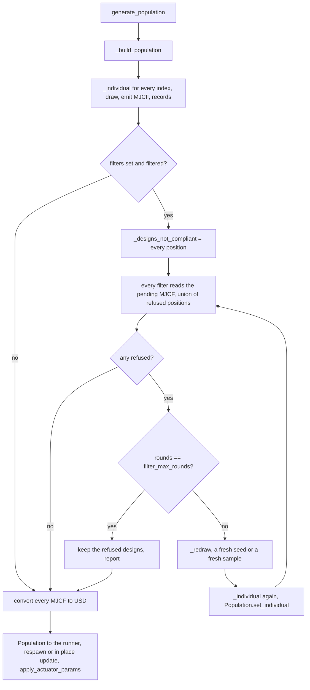

# Design Filtering, the Standing Filter and the Co-optimisation Types

STATUS, 2026-11-12. IMPLEMENTED 2026-11-12. All nine steps were applied to the tree, each applied file byte for byte the one section 8 tested in the sandbox, `co_optimisation` and `design_generator` reinstalled in container `isaac-lab-base-shreyas-gpu0`, and the applied tree validated there, `design_generator_test.py` 75 of 75, `design_filter_test.py` 23 of 23 and `catalog_fill_test.py` 6 of 6 against the installed packages, `filters_mujoco_check.py` agreeing with MuJoCo on both donors, and a short biped run of the tree's `train.py` on `BipedCMAESCfg` matching every environment's actuator data and masses with the standing filter running on every population. Container `isaac-lab-base-shreyas-gpu1` was training three quadruped runs and was not reinstalled, so its installed packages still hold the former code until it is, by section 6.7 step 3 and section 7.5 step 3. The plan was revised three times the same day at the user's instruction, for the nearest identified fill of step 9, for `design_search` taking the three co-optimisation types alone, and for the biped configuration shipping with the standing filter. Section 11 records three follow-ups of the same day, the full design records and the base robot's record in every design CSV, every quantity of the search under `cmaes/` in TensorBoard, and the categorical random phase widening its actuator choice from the base robot's, all implemented in the tree, and both packages were then reinstalled in both containers, each matching the tree file for file, with the runs then training in them left running on the code they had loaded.

## 1. Introduction

The design search of a co-optimisation run spends a USD conversion and a generation of training on every design it draws, whether or not the design can carry its own weight. A design whose centre of mass falls outside its feet at every pose near its nominal one, or whose knee cannot hold the body at a modest crouch, contributes nothing to the policy but noise and contributes to CMA-ES only the information that it fell. This plan adds a cheap test that refuses such designs before they are converted, a loop that redraws them, and two further capabilities the same request asked for, a search over the actuators alone and a configuration field naming the co-optimisation type.

The request set eight outcomes, and the plan answers each in its own section. The co-optimisation types of `CMAESCfg.design_search` are settled in section 4, where the user's decision that earlier experiments need not be resumable lets the selection hold the three types alone. The categorical only generator is section 3, which first tests the hypothesis that the existing mixed variable strategy serves unchanged. `FilterBase`, `StandingFilter` and their numpy model are section 2 for the mathematics and section 6.2 for the code. The move of `Population` is section 6.1. The filter and redraw loop `DesignGeneratorBase.filter_population` and the configuration field `CMAESCfg.filters` are sections 5, 6.3 and 6.4. A ninth step, added during the work, gives every actuator catalogue entry the gains, friction and armature of the identified actuator nearest to it, and is section 7.

The task list, in the order of application, is therefore the following.

1. Add `co_optimisation/co_optimisation/utils/common.py` and move `Population` into it, section 6.1.
2. Add `co_optimisation/co_optimisation/utils/filters.py`, with `FilterBase`, the MJCF statics, `StandingFilter`, the registry `FILTERS` and `make_filters`, section 6.2.
3. Edit `co_optimisation/co_optimisation/runners/usd_generator.py`, the filter loop, the redraw seeds, `searched_keys` and `CatOnlyCMAESDesignGenerator`, section 6.3.
4. Edit `co_optimisation/co_optimisation/config/cmaes_cfg.py`, the co-optimisation types and the fields `filters` and `filter_params`, section 6.4.
5. Edit `scripts/rsl_rl/train.py`, the type names and the construction of the filters, section 6.5.
6. Add the three test files of section 6.6.
7. Reinstall `co_optimisation` in both training containers, section 6.7.
8. Update `ARCHITECTURE.md`, `CO_OPTIMISATION.md`, the registers and the context record, section 6.7.
9. Fill every unidentified entry of both actuator catalogues with the stiffness, damping, friction triple and armature of its nearest identified actuator, by `scripts/tools/fill_actuator_sim_params.py`, and update the two tests of `design_generator_test.py` that pinned the former shelf, section 7.

## 2. The standing filter and its mathematics

### 2.1 What the document supplies

A filter reads the emitted MJCF rather than the design specification, so that what it judges is exactly what Isaac Lab will be given. Every document the two builders emit holds the quantities a static analysis needs, a tree of bodies with their offsets, orientations, masses and centres of mass, one hinge per moving body with its axis and range, and a motor per hinge whose class carries a `forcerange` ([biped_donor.xml as emitted, `design_generator/biped/builder.py:530-535`]). The ground contacts are not named in the document, and are taken as the collision geoms of the leaves of the tree, which in both families are the feet, a sphere for each quadruped foot and a box for each biped sole ([`co_optimisation/co_optimisation/runners/usd_generator.py:407`, `:418`], the family's `foot_bodies`).

The torque ceilings were checked against the catalogue on 2026-11-12 because the filter's verdict rests on them. The builder writes each class's `forcerange` from the picked entry's `peak_torque` ([`design_generator/biped/builder.py:530-535`]), while the simulator clips against `effort_limit`, which falls back to `peak_torque` only when an entry does not state it ([`design_generator/common/actuator_catalog.py:552`]). Emitting every simulation complete entry on every joint group gave a `forcerange` equal to both the JSON `peak_torque` and `sim_params()["effort_limit"]` in all 16 biped and all 9 quadruped cases, and no entry of either catalogue states an `effort_limit` that differs from its `peak_torque`. The agreement is therefore exact today but conditional, and an entry that later states a distinct `effort_limit` would separate the document from the simulator, a defect section 9 records.

### 2.2 Kinematics

Let a population hold $D$ designs sharing one topology of $B$ bodies, $J$ hinges and $C$ contact points, and let $q \in \mathbb{R}^{J}$ be a joint configuration in radians. Body $b$ hangs from its parent $\pi(b)$ at the fixed offset $t_b$ in metres and fixed rotation $R^0_b$, both read from the document, and its hinge $j$ turns about the unit axis $a_j$ through the anchor $r_j$, both in the body's own frame. Following MuJoCo's convention, the world rotation $R_b$ and origin $p_b$ of the body are composed from the root, which sits at the identity, as

$$R_b = R_{\pi(b)} R^0_b \, \mathrm{Rot}(a_j, q_j), \qquad o_j = p_{\pi(b)} + R_{\pi(b)} t_b + R_{\pi(b)} R^0_b r_j, \qquad p_b = o_j - R_b r_j,$$

where $o_j$ is the world anchor of the hinge and $\mathrm{Rot}(a, \theta) = I + \sin\theta \, [a]_\times + (1 - \cos\theta) [a]_\times^2$ is Rodrigues' formula [1]. A body without a hinge takes $\mathrm{Rot} = I$ and $r_j = 0$. The world axis of hinge $j$ is $\hat a_j = R_{\pi(b)} R^0_b a_j$. With $m_b$ the mass of body $b$ in kilograms and $c_b$ its centre of mass in its own frame, the body's centre of mass is $x_b = p_b + R_b c_b$, the robot's mass is $M = \sum_b m_b$ and its centre of mass is $x_G = \frac{1}{M} \sum_b m_b x_b$. A contact $k$ fixed at $\ell_k$ in its body's frame lies at $p_{b(k)} + R_{b(k)} \ell_k$, a sphere contributing its centre and its radius $\rho_k$, a box the four corners of its lowest face with $\rho_k = 0$.

### 2.3 The stance

The base is free, so a configuration does not fix how the robot meets the ground, and the model turns it until its contacts rest on a level plane. The plane is fitted through the contact centres by the singular value decomposition of their deviations from the centroid, its unit normal $n$ being the least principal direction, signed to point towards $x_G$. A configuration whose contacts depart from the plane by more than 1 mm cannot stand on all of them and is refused. The contact points are then $p_k - \rho_k n$, and the rotation $G$ about $n \times e_z$ by the angle between $n$ and $e_z$, the least rotation carrying $n$ to the vertical, expresses every quantity in a ground frame whose origin is the contacts' centroid.

Every configuration is sampled with all legs at the same joint values and every abduction at its nominal zero, which section 2.5 explains, and under that symmetry the quadruped's base stays level and the biped's base pitches until both soles lie flat. Three conditions make the stance admissible. The root's own $z$ axis must point upwards, which refuses a quadruped standing on feet raised over its back. Every body origin and centre of mass other than the contacts' must lie above the ground, which refuses a knee or a housing that would touch it first. And the ground projection of $x_G$ must lie within the support, the convex hull of the contacts, which is the static stability criterion of McGhee and Frank [2]. Under the symmetric sampling the hull of the four quadruped feet and of the eight sole corners is an axis aligned rectangle in the ground frame, so the test is a bound on the two horizontal coordinates.

### 2.4 Statics

The contacts carry vertical forces $f_k$ in newtons, with $g = 9.81$ m/s². They must balance the weight and its two horizontal moments about the centre of mass,

$$\sum_k f_k = M g, \qquad \sum_k (x_k - x_G) f_k = 0, \qquad \sum_k (y_k - y_G) f_k = 0,$$

where $(x_k, y_k)$ and $(x_G, y_G)$ are ground frame coordinates. With four or eight unknowns and three equations the distribution is indeterminate, and the model takes the solution of least norm, $f = A^{+} b$ with $A$ the $3 \times C$ matrix of the left hand sides, $b = (Mg, 0, 0)$ and $A^{+}$ its pseudo inverse. For the symmetric stances sampled here it equals the lever rule, each side carrying half the weight and the fore and aft split following $x_G$, and on a sole it places the centre of pressure under $x_G$ whatever sign an individual corner force takes, so the net wrench on each foot, which is all the joints feel, is exact whenever $x_G$ lies inside the support.

The torque at hinge $j$ is the moment its subtree must resist. With $\mathcal{B}_j$ the bodies and $\mathcal{C}_j$ the contacts below hinge $j$,

$$\tau_j = -\hat a_j \cdot \Big[ \sum_{b \in \mathcal{B}_j} (x_b - o_j) \times (-m_b g \, e_z) + \sum_{k \in \mathcal{C}_j} (p_k - o_j) \times (f_k \, e_z) \Big],$$

the standing form of $\tau = g(q) - J_c^{\top} f$, in which $g(q)$ is the generalised gravity force and $J_c$ the contact Jacobian [3]. Its load on the motor is $u_j = |\tau_j| / L_j$, where $L_j$ in N.m is the hinge's `forcerange`.

### 2.5 Sampling and the decision

Each design meets $N_q = 16$ joint configurations and $N_\tau = 16$ torque ceilings, the 256 pairs the request specified. The configurations are a Latin hypercube [4] over the pitch joint classes, the hinges whose axis lies along the base's $y$ axis at the nominal pose, which are hip and knee on the quadruped and hip, knee and ankle on the biped, every leg taking the same values. Each class's interval is its soft range, the document range narrowed about its middle by the asset's soft joint limit factor $\sigma = 0.9$ ([`co_optimisation/co_optimisation/runners/usd_generator.py:316-339`]), then contracted towards the nominal zero by the position fraction $\kappa$. The unit hypercube is drawn once from a fixed seed and read through every design's own ranges, so that every design and every generation is judged on the same stances. The ceilings are $s_t L_j$ with $s_t = s_{lo} + (s_{hi} - s_{lo})(t + \tfrac12)/N_\tau$ for $t = 0, \dots, N_\tau - 1$, evenly spread over the torque fraction range $(s_{lo}, s_{hi}]$. A pair $(i, t)$ fails when stance $i$ is inadmissible by section 2.3 or when $\max_j u_{ij} > s_t$, and the failure fraction is $\varphi = \frac{1}{N_q N_\tau} \sum_{i,t} \mathbb{1}[\text{pair } (i,t) \text{ fails}]$. A design with $\varphi > \varphi_{max} = 0.25$ is refused.

The literal reading of the request, the whole soft range ($\kappa = 1$) and ceilings spread over the whole limit ($s_{lo} = 0$, $s_{hi} = 1$), refuses every design including both donors. It was measured on the donors and on 128 uniform draws from each robot's configured box, with and without uniformly drawn actuators, and the table gives the share of designs refused.

| $\kappa$ | $(s_{lo}, s_{hi}]$ | biped donor $\varphi$ | biped box refused | quadruped donor $\varphi$ | quadruped box refused |
|---|---|---|---|---|---|
| 1.0 | (0, 1] | 0.750 | 1.00 | 0.785 | 1.00 |
| 1.0 | (0.5, 1] | 0.688 | 1.00 | 0.688 | 1.00 |
| 0.5 | (0.5, 1] | 0.312 | 0.83 | 0.441 | 0.88 |
| 0.25 | (0, 1] | 0.277 | 0.91 | 0.375 | 0.79 |
| 0.25 | (0.5, 1] | 0.125 | 0.01 | 0.125 | 0.34 |

Two facts explain the table. Over the whole soft range 69 per cent of the donors' stances are inadmissible, chiefly because $x_G$ leaves the support when every hip swings together, which no design can repair, the quadruped's hip range alone spanning 5.2 rad ([quadruped_donor.xml as emitted]). And a ceiling spread from zero fails a stance whenever the load exceeds the ceiling, so it contributes about the mean peak load to $\varphi$ on its own, which for the biped donor is already 0.17 of the limit at its ankle. The defaults are therefore $\kappa = 0.25$ and $(s_{lo}, s_{hi}] = (0.5, 1]$, which pass both donors at $\varphi = 0.125$, half the threshold, and read as the requirement that a design stand in three quarters of the stances near its nominal pose with half its torque in reserve. Both remain constructor arguments, so the literal reading is one `filter_params` entry away.

At those defaults the refusals fall where the mechanics predicts. Over 256 biped and 219 feasible quadruped draws the failure fraction correlates positively with both length scales, $+0.37$ for each on the biped and $+0.37$ and $+0.31$ on the quadruped, and on the quadruped with a forward thigh lean, $+0.45$, which carries the feet ahead of the hips and the support away from $x_G$. Inadmissible stances account for nearly all of it, a refused quadruped losing 0.367 of its pairs to admissibility and 0.007 to torque. The verdict depends on the seed of the hypercube, as any 16 point sample does, the biped donor's $\varphi$ ranging from 0.000 to 0.250 over seeds 0 to 4 and the quadruped's from 0.012 to 0.191, which is why the seed is fixed rather than drawn, so that the ranking of designs is at least consistent. Evaluating 64 designs takes about 0.1 s, against a conversion per design.

### 2.6 Validation against MuJoCo

The model was compared with MuJoCo 3.16.0 in the development container on both donors at 16 stances each. MuJoCo was placed at the base pose the model computes, and the generalised bias force less the contact forces mapped through MuJoCo's own contact Jacobians was read back [5]. Its base rows, which vanish only when the forces balance the weight and its moments, stayed below $2.0 \times 10^{-13}$, its joint rows matched $\tau_j$ to $1.8 \times 10^{-14}$ N.m, and the centre of mass matched to $2.2 \times 10^{-16}$ m, at the default stances of section 2.5. The check is `co_optimisation/tests/filters_mujoco_check.py`, section 6.6.

## 3. The categorical only search

The request asked which class of the `cma` package performs a categorical only search, and supposed that the existing mixed variable strategy would serve without its continuous variables. The first half has a negative answer. pycma, the `cma` package that `CMAESDesignGenerator` wraps [6], offers no categorical variable, and the categorical search of this workspace already comes from a second library, `cmaes`, whose `CatCMAwM` implements CatCMA with margin [7, 8].

The hypothesis is confirmed for `CatCMAwM` 0.13.1, read in the training container. Its continuous, integer and categorical spaces are each optional ([`cmaes/_catcmawm.py:119`]), the Gaussian is used only when a continuous or integer variable exists ([`:140`]), and `ask` then samples the categorical block alone ([`:806`]). A strategy built with `c_space=[5, 5, 5, 5]` alone, run for 30 generations on a function rewarding one category, concentrated 0.924 of every marginal on it, carried no `_mean`, and pickled. Two caveats follow. `should_stop` warns and returns False without a Gaussian ([`:887-893`]), which the generator never calls, `train.py` already refusing termination tolerances for the categorical search. And `CatCMAESDesignGenerator.search_statistics` and `optimised_design` read the Gaussian's private state ([`co_optimisation/co_optimisation/runners/usd_generator.py:1208-1236`]), so the new class overrides both. `cmaes.CatCMA`, the older strategy, requires a continuous mean and is not an alternative.

`CatOnlyCMAESDesignGenerator` therefore subclasses `CatCMAESDesignGenerator` and changes one thing, the continuous block it searches. A class attribute `searched_keys`, `CMAES_PARAM_KEYS` on `CMAESDesignGenerator` and empty on the new class, selects which entries of `param_ranges` become dimensions, so the inherited `_make_strategy` builds `CatCMAwM` with an empty `x_space`. `param_ranges` itself keeps its four entries, because `_lean_max` reads the thigh lean's range to set the pose check's tolerance ([`co_optimisation/co_optimisation/runners/usd_generator.py:789-791`]). Every design takes the baseline's lengths and solved pose, and only the four or three actuator picks vary.

## 4. The co-optimisation types

`CMAESCfg.design_search` names the type, and exactly three are accepted. `"leg_geometry"` searches the two length scales and the two pose offsets with `GrowingDesignDistCMAESDesignGenerator`, the generator `"length"`, the former default, selected ([`co_optimisation/co_optimisation/config/cmaes_cfg.py:24`]). `"actuator_leg_geometry"` adds the actuator of every joint group with `CatCMAESDesignGenerator`, the former `"cat"`. `"actuator"` searches the actuators alone with `CatOnlyCMAESDesignGenerator`. The default becomes `"leg_geometry"`, and `train.py` raises on any other value. The user decided that compatibility with earlier experiments and their `design_search` values need not be kept, so the former names `"length"`, `"cat"`, `"cmaes"` and `"random"` are no longer accepted, the branch of `train.py` that built `RandomDesignGenerator` with no late start is removed, and a run whose restored `params/cmaes.pkl` records a former name stops at the check rather than resuming ([`scripts/rsl_rl/train.py:263-292`]). `RandomDesignGenerator` and `CMAESDesignGenerator` themselves stay, because `scripts/rsl_rl/play.py` constructs them directly ([`scripts/rsl_rl/play.py:117`, `:1305`]) and the test suites exercise them. Both categorical types inherited the existing refusal of termination tolerances when this section was written, a refusal section 11.7 later removed by giving them termination criteria of their own.

## 5. Architecture of the filter loop

`_build_population` emitted, recorded and converted each individual in turn ([`co_optimisation/co_optimisation/runners/usd_generator.py:676-706`]). It is split so that every document is emitted first, the population is filtered and redrawn, and only the surviving documents are converted, the per individual body moving unchanged into `_individual`. With no filter configured, the default, the documents, records and paths are identical to the former ones, which section 8.1 tests byte for byte.

`filter_population` keeps `_designs_not_compliant`, the positions some filter still refuses, which begins as every position. Each round passes the pending positions' documents to every filter, keeps the union of their refusals, redraws exactly those designs and rebuilds their records in place through `Population.set_individual`. A redraw has two forms. In a seeded random phase `_rng_seed` folds the round into the seed, `[generation * 10000 + idx, round]`, so a redrawn design is new while every first draw keeps its former seed ([`co_optimisation/co_optimisation/runners/usd_generator.py:842`, `:1045`, `:1107`, `:1281`]). In a search generation `_redraw` replaces the pending genotype by a fresh sample of the distribution, pycma's `ask(1)` or one `CatCMAwM.ask()`, and since `_last_solutions` is taken from the pending list after the build ([`:1015`]), `tell` is given the genotypes that were actually trained. Resampling an infeasible candidate until it is feasible is a standard constraint treatment for evolution strategies [9], and Hansen's notes on CMA-ES state that it works in benign cases where the optimum is not very close to the constraint [10]. The loop stops after `filter_max_rounds`, 100 by default, keeping whatever is still refused, so that a distribution confined to refused designs cannot stall the run. The distribution mean of a terminated search is not filtered, there being nothing to redraw it with.



The filters are configured as Isaac Lab configures its terms, by name. `CMAESCfg.filters` lists names, each a key of `FILTERS` or a `module:Class` path resolved by Isaac Lab's `string_to_callable`, and `CMAESCfg.filter_params` maps a name to its keyword arguments. `train.py` builds them with `make_filters` and assigns them to the generator as it assigns `builder_kwargs` ([`scripts/rsl_rl/train.py:293-294`]).

## 6. The changes

Every snippet below is the file or diff that section 8 tested. The diffs are against the tree as of 2026-11-12.

### 6.1 `co_optimisation/co_optimisation/utils/common.py`, new

`Population` moves here verbatim, with one method added, `set_individual`, which the filter loop uses to replace a redrawn design's records. `usd_generator.py` imports it back, so every existing `from co_optimisation.runners.usd_generator import Population` and `co_optimisation.runners.Population` keeps working. The class needs no imports.

```python
"""Structures shared by the design generators, the design filters and the runner.

Population moved here from runners/usd_generator.py, which still imports it, so that
``from co_optimisation.runners.usd_generator import Population`` keeps working.
"""

from __future__ import annotations


class Population:
    """A fixed set of robot designs, one per individual.

    Each individual is a Universal Scene Description path, an actuator
    parameter dict overriding the Python-side ``IdentifiedActuator``
    attributes, and an absolute link-geometry dict for in-place morphology
    updates.  ``root_body`` is the name of the emitted document's root body,
    which the Isaac Sim MuJoCo importer interposes between the referenced
    asset prim and every link prim, so ``utils/update.py`` needs it to address
    a link.
    """

    def __init__(
        self,
        usd_files: list[str],
        actuator_params: list[dict[str, dict]],
        link_length_params: list[dict[str, dict]],
        root_body: str,
        specs: list | None = None,
        nominal: list[dict] | None = None,
        parameters: list[dict] | None = None,
        xml_files: list[str] | None = None,
    ) -> None:
        self._usd_files = usd_files
        self._actuator_params = actuator_params
        self._link_length_params = link_length_params
        self._root_body = root_body
        self._specs = specs if specs is not None else []
        self._nominal = nominal
        self._parameters = parameters if parameters is not None else []
        self._xml_files = xml_files if xml_files is not None else []

    def get_usd_files(self) -> list[str]:
        """Return a list of Universal Scene Description paths, one per individual."""
        return self._usd_files

    def get_actuator_params(self) -> list[dict[str, dict]]:
        """Return actuator override dicts, one per individual.

        Each element is keyed by actuator group name (``"abad"``, ``"hip"``,
        ``"knee"``, ``"ankle"``), whose value is a dict of scalar overrides for
        the ``IdentifiedActuator`` attributes, as
        ``design_generator.common.actuator_catalog.SIM_PARAM_KEYS`` names them.
        """
        return self._actuator_params

    def get_link_length_params(self) -> list[dict[str, dict]]:
        """Return absolute link-geometry dicts, one per individual."""
        return self._link_length_params

    def get_root_body(self) -> str:
        """Return the emitted document's root body name."""
        return self._root_body

    def get_specs(self) -> list:
        """Return the ``DesignSpec`` behind each individual, for logging."""
        return self._specs

    def get_nominal(self) -> list[dict] | None:
        """Return each individual's nominal pose record.

        A record carries ``offsets`` (thigh, knee and ankle, radians about +y,
        the quadruped's ankle 0.0), ``dx`` (foot ahead of the hip pitch axis),
        ``depth`` (foot body below the root), ``sole`` (sole below the foot
        body) and ``height`` (``depth + sole``, the standing height), all from
        Family.chain on the emitted specification.
        """
        return self._nominal

    def get_parameters(self) -> list[dict]:
        """Return the searched parameters of each individual and whether its design emitted, for logging."""
        return self._parameters

    def get_xml_files(self) -> list[str]:
        """Return the MJCF document emitted for each individual."""
        return self._xml_files

    def set_individual(self, k: int, row: dict) -> None:
        """Replace the records at position *k* with *row*, keyed as DesignGeneratorBase._individual returns them."""
        self._usd_files[k] = row["usd_file"]
        self._actuator_params[k] = row["actuator_params"]
        self._link_length_params[k] = row["link_length_params"]
        self._specs[k] = row["spec"]
        self._nominal[k] = row["nominal"]
        self._parameters[k] = row["parameters"]
        self._xml_files[k] = row["xml_file"]
```

### 6.2 `co_optimisation/co_optimisation/utils/filters.py`, new

```python
"""Filters that refuse a design from its emitted MJCF before the design is converted and trained.

A filter reads the documents of a population, which every family's builder emits with the same
conventions, and returns the positions of the designs it refuses. DesignGeneratorBase.filter_population
redraws those designs until every filter passes them. See plans/design_filtering.md.
"""

from __future__ import annotations

import xml.etree.ElementTree as ET
from abc import ABC, abstractmethod

import numpy as np

GRAVITY = 9.81


class FilterBase(ABC):
    """A test every design of a population must pass, holding whatever state and statistics it keeps.

    Args:
        family: The design generator family, "biped" or "quadruped", for a filter that needs it.
    """

    def __init__(self, family: str) -> None:
        self.family = family
        self.statistics: dict = {}

    @property
    def name(self) -> str:
        return type(self).__name__

    @abstractmethod
    def filter(self, xml_files: list[str]) -> list[int]:
        """The positions in *xml_files* of the designs this filter refuses, in ascending order."""
        ...


# ---------------------------------------------------------------------------
# MJCF model
# ---------------------------------------------------------------------------


def _vec(text: str | None, default) -> np.ndarray:
    return np.array([float(v) for v in text.split()]) if text else np.array(default, dtype=float)


def _quat_matrix(q) -> np.ndarray:
    w, x, y, z = np.asarray(q, dtype=float) / np.linalg.norm(q)
    return np.array([
        [1 - 2 * (y * y + z * z), 2 * (x * y - w * z), 2 * (x * z + w * y)],
        [2 * (x * y + w * z), 1 - 2 * (x * x + z * z), 2 * (y * z - w * x)],
        [2 * (x * z - w * y), 2 * (y * z + w * x), 1 - 2 * (x * x + y * y)],
    ])


class MjcfStatics:
    """The rigid body tree of one emitted MJCF, as the arrays the vectorised statics consume.

    Bodies are kept in document order, so a parent always precedes its children. Every body carries at
    most one hinge, the root's free joint excepted. The ground contacts are the collision geoms of the
    leaves of the tree, a sphere contributing its centre and radius and a box the four corners of its
    lowest face, which in the builders' documents are the quadruped's feet and the biped's soles.
    A joint's torque ceiling is its motor's forcerange, taken from the motor's own attribute or its class.
    """

    def __init__(self, path: str) -> None:
        root = ET.parse(path).getroot()
        force_by_class = {
            d.get("class"): _vec(d.find("motor").get("forcerange"), [0, 0])
            for d in root.iter("default") if d.get("class") and d.find("motor") is not None
        }
        force_by_joint = {}
        for motor in root.iter("motor"):
            if motor.get("joint"):
                force = motor.get("forcerange")
                force_by_joint[motor.get("joint")] = (
                    _vec(force, [0, 0]) if force else force_by_class.get(motor.get("class"), np.zeros(2)))

        self.body_names: list[str] = []
        parents, pos, rot, mass, ipos = [], [], [], [], []
        self.joint_names: list[str] = []
        self.joint_classes: list[str] = []
        joint_body, axis, jpos, ranges, limits = [], [], [], [], []
        contact_body, contact_point, contact_radius = [], [], []

        def visit(element, parent: int) -> None:
            index = len(self.body_names)
            self.body_names.append(element.get("name"))
            parents.append(parent)
            pos.append(_vec(element.get("pos"), [0, 0, 0]))
            rot.append(_quat_matrix(_vec(element.get("quat"), [1, 0, 0, 0])))
            inertial = element.find("inertial")
            mass.append(float(inertial.get("mass")) if inertial is not None else 0.0)
            ipos.append(_vec(inertial.get("pos") if inertial is not None else None, [0, 0, 0]))
            hinges = [j for j in element.findall("joint") if j.get("type", "hinge") == "hinge"]
            if len(hinges) > 1:
                raise ValueError(f"body {element.get('name')!r} carries {len(hinges)} hinges, the statics take one")
            for joint in hinges:
                self.joint_names.append(joint.get("name"))
                self.joint_classes.append(joint.get("class", ""))
                joint_body.append(index)
                axis.append(_vec(joint.get("axis"), [0, 0, 1]))
                jpos.append(_vec(joint.get("pos"), [0, 0, 0]))
                ranges.append(_vec(joint.get("range"), [-np.pi, np.pi]))
                limits.append(float(np.max(np.abs(force_by_joint.get(joint.get("name"), np.zeros(2))))))
            children = element.findall("body")
            if not children:
                for geom in element.findall("geom"):
                    if geom.get("class") != "collision":
                        continue
                    centre = _vec(geom.get("pos"), [0, 0, 0])
                    g_rot = _quat_matrix(_vec(geom.get("quat"), [1, 0, 0, 0]))
                    size = _vec(geom.get("size"), [0, 0, 0])
                    if geom.get("type") == "sphere":
                        contact_body.append(index)
                        contact_point.append(centre)
                        contact_radius.append(size[0])
                    elif geom.get("type") == "box":
                        for sx in (-1.0, 1.0):
                            for sy in (-1.0, 1.0):
                                contact_body.append(index)
                                contact_point.append(centre + g_rot @ (size * np.array([sx, sy, -1.0])))
                                contact_radius.append(0.0)
            for child in children:
                visit(child, index)

        visit(root.find("worldbody").find("body"), -1)
        self.parents = np.array(parents)
        self.pos, self.rot = np.array(pos), np.array(rot)
        self.mass, self.ipos = np.array(mass), np.array(ipos)
        self.joint_body = np.array(joint_body)
        self.axis = np.array(axis) / np.linalg.norm(axis, axis=1, keepdims=True)
        self.jpos, self.range, self.limit = np.array(jpos), np.array(ranges), np.array(limits)
        self.contact_body = np.array(contact_body)
        self.contact_point, self.contact_radius = np.array(contact_point), np.array(contact_radius)
        if len(self.contact_body) < 3:
            raise ValueError(f"{path} offers {len(self.contact_body)} ground contacts, a stance needs three")

    def topology(self) -> tuple:
        return (tuple(self.parents), tuple(self.joint_body), tuple(self.contact_body), tuple(self.joint_classes))

    def subtree(self) -> tuple[np.ndarray, np.ndarray]:
        """(J, B) and (J, C) masks, the bodies and the contacts each joint carries."""
        inside = np.eye(len(self.parents), dtype=bool)
        for b, p in enumerate(self.parents):
            if p >= 0:
                inside[:, b] |= inside[:, p]       # a body is inside every subtree its parent is inside
        bodies = inside[self.joint_body]
        return bodies, bodies[:, self.contact_body]


def _stack(models: list[MjcfStatics], name: str) -> np.ndarray:
    return np.stack([getattr(m, name) for m in models])


def _axis_angle(axis: np.ndarray, angle: np.ndarray) -> np.ndarray:
    """Rotation matrices about unit *axis* (..., 3) by *angle* (...), Rodrigues' formula."""
    k = np.zeros(axis.shape[:-1] + (3, 3))
    k[..., 0, 1], k[..., 0, 2] = -axis[..., 2], axis[..., 1]
    k[..., 1, 0], k[..., 1, 2] = axis[..., 2], -axis[..., 0]
    k[..., 2, 0], k[..., 2, 1] = -axis[..., 1], axis[..., 0]
    s, c = np.sin(angle)[..., None, None], np.cos(angle)[..., None, None]
    return np.eye(3) + s * k + (1.0 - c) * (k @ k)


def standing_statics(models: list[MjcfStatics], q: np.ndarray, coplanar_tol: float = 1e-3) -> dict:
    """The static stance of every design at every joint configuration, vectorised over both.

    *q* is (D, S, J), D designs sharing one topology and S configurations. The base is free, so each
    configuration is turned until its contacts rest on a level ground, gravity is balanced by vertical
    contact forces of least norm, and every joint's torque is the moment its subtree must resist.
    Returns arrays over (D, S) and (D, S, J) in the ground frame, its origin the contacts' centroid.
    """
    D, S, J = q.shape
    B = len(models[0].parents)
    pos, rot = _stack(models, "pos")[:, None], _stack(models, "rot")[:, None]          # (D, 1, B, ...)
    mass, ipos = _stack(models, "mass"), _stack(models, "ipos")[:, None]
    axis, jpos = _stack(models, "axis")[:, None], _stack(models, "jpos")[:, None]      # (D, 1, J, 3)
    joint_of_body = np.full(B, -1)
    joint_of_body[models[0].joint_body] = np.arange(J)

    # Forward kinematics, X_b = X_parent (pos, quat) (jpos, R(axis, q)) (-jpos), MuJoCo's convention.
    R = np.zeros((D, S, B, 3, 3))
    p = np.zeros((D, S, B, 3))
    o = np.zeros((D, S, J, 3))                    # joint anchors
    a = np.zeros((D, S, J, 3))                    # joint axes
    for b, parent in enumerate(models[0].parents):
        R_p = np.broadcast_to(np.eye(3), (D, S, 3, 3)) if parent < 0 else R[:, :, parent]
        p_p = np.zeros((D, S, 3)) if parent < 0 else p[:, :, parent]
        R_l = R_p @ rot[:, :, b]
        p_l = p_p + np.einsum("dsij,dsj->dsi", R_p, np.broadcast_to(pos[:, :, b], (D, S, 3)))
        j = joint_of_body[b]
        if j < 0:
            R[:, :, b], p[:, :, b] = R_l, p_l
            continue
        R_q = _axis_angle(np.broadcast_to(axis[:, :, j], (D, S, 3)), q[..., j])
        anchor = np.broadcast_to(jpos[:, :, j], (D, S, 3))
        o[:, :, j] = p_l + np.einsum("dsij,dsj->dsi", R_l, anchor)
        a[:, :, j] = np.einsum("dsij,dsj->dsi", R_l, np.broadcast_to(axis[:, :, j], (D, S, 3)))
        R[:, :, b] = R_l @ R_q
        p[:, :, b] = o[:, :, j] - np.einsum("dsij,dsj->dsi", R[:, :, b], anchor)

    com_b = p + np.einsum("dsbij,dsbj->dsbi", R, np.broadcast_to(ipos, (D, S, B, 3)))
    total = mass.sum(axis=1)                                                            # (D,)
    com = np.einsum("db,dsbi->dsi", mass, com_b) / total[:, None, None]
    cb = models[0].contact_body
    c_local = _stack(models, "contact_point")[:, None]
    radius = _stack(models, "contact_radius")[:, None]                                  # (D, 1, C)
    centre = p[:, :, cb] + np.einsum("dscij,dscj->dsci", R[:, :, cb], np.broadcast_to(c_local, (D, S) + c_local.shape[2:]))

    # The ground plane, through the contacts, its normal the least principal axis, pointing at the body.
    mid = centre.mean(axis=2, keepdims=True)
    vt = np.linalg.svd(centre - mid)[2]
    n = vt[..., -1, :]
    n = n * np.where(np.einsum("dsi,dsi->ds", com - mid[:, :, 0], n) < 0.0, -1.0, 1.0)[..., None]
    coplanar = np.abs(np.einsum("dsci,dsi->dsc", centre - mid, n)).max(axis=2) <= coplanar_tol
    contact = centre - radius[..., None] * n[:, :, None]
    ground_mid = contact.mean(axis=2, keepdims=True)

    # Turn the ground frame so that n is +z, the least rotation, about n x z.
    z = np.array([0.0, 0.0, 1.0])
    cross = np.cross(n, z)
    angle = np.arctan2(np.linalg.norm(cross, axis=-1), n @ z)
    unit = cross / np.maximum(np.linalg.norm(cross, axis=-1, keepdims=True), 1e-12)
    G = _axis_angle(unit, angle)                                                        # (D, S, 3, 3)

    def ground(x):
        return np.einsum("dsij,ds...j->ds...i", G, x - ground_mid.reshape(D, S, *([1] * (x.ndim - 3)), 3))

    com_g, com_bg, contact_g, o_g = ground(com), ground(com_b), ground(contact), ground(o)
    a_g = np.einsum("dsij,dskj->dski", G, a)
    origin_g = ground(p)
    upright = np.einsum("dsij,dsj->dsi", G, R[:, :, 0, :, 2])[..., 2] > 0.0       # the root's z axis

    # Validity, the root upright and nothing but the contacts on the ground. Support, the centre of mass over the
    # rectangle the contacts span, which for the symmetric stances sampled here is their hull.
    leaves = np.zeros(B, dtype=bool)
    leaves[cb] = True
    clearance = np.minimum(origin_g[..., 2], com_bg[..., 2])[..., ~leaves].min(axis=2)
    lo, hi = contact_g[..., :2].min(axis=2), contact_g[..., :2].max(axis=2)
    supported = np.all((com_g[..., :2] >= lo) & (com_g[..., :2] <= hi), axis=-1)

    # Vertical contact forces of least norm balancing the weight and its moments about the centre of mass.
    C = len(cb)
    A = np.stack([np.ones(contact_g.shape[:3]),
                  contact_g[..., 0] - com_g[..., None, 0],
                  contact_g[..., 1] - com_g[..., None, 1]], axis=2)                    # (D, S, 3, C)
    weight = total[:, None] * GRAVITY
    rhs = np.zeros((D, S, 3))
    rhs[..., 0] = weight
    force = np.einsum("dsci,dsi->dsc", np.linalg.pinv(A), rhs)                          # (D, S, C)

    # Joint torques, tau_j = -a_j . [sum over the subtree of (r - o_j) x F], gravity on the bodies and
    # the contact forces on the contacts.
    body_mask, contact_mask = models[0].subtree()
    gravity = np.zeros((D, S, B, 3))
    gravity[..., 2] = -mass[:, None, :] * GRAVITY
    push = np.zeros((D, S, C, 3))
    push[..., 2] = force
    moment = (np.einsum("jb,dsjbi->dsji", body_mask,
                        np.cross(com_bg[:, :, None] - o_g[:, :, :, None], gravity[:, :, None]))
              + np.einsum("jc,dsjci->dsji", contact_mask,
                          np.cross(contact_g[:, :, None] - o_g[:, :, :, None], push[:, :, None])))
    torque = -np.einsum("dsji,dsji->dsj", a_g, moment)

    return {
        "torque": torque, "force": force, "com": com_g, "contact": contact_g, "supported": supported,
        "coplanar": coplanar, "clearance": clearance, "upright": upright, "ground_rotation": G, "ground_origin": ground_mid[:, :, 0],
        "normal": n, "body_rotation": R, "body_position": p, "mass": total,
    }


# ---------------------------------------------------------------------------
# Standing filter
# ---------------------------------------------------------------------------


class StandingFilter(FilterBase):
    """Refuse a design that cannot hold its own weight in too many of a fixed set of stances.

    Every design meets the same num_positions joint configurations, a Latin hypercube over the soft
    range of each pitch joint class scaled towards the nominal pose by position_fraction, every leg
    taking the same values and every other joint its nominal, and the same num_torques torque
    ceilings, fractions of each motor's forcerange spread evenly over torque_fraction. A pair fails
    where the stance leaves something other than the contacts on the ground, the centre of mass outside
    the support, or a joint's static torque above the ceiling, and a design whose failed share exceeds
    max_failure_fraction is refused.

    Args:
        family: The design generator family.
        num_positions: Joint configurations per design.
        num_torques: Torque ceilings per configuration.
        max_failure_fraction: Largest share of failed pairs a design may show.
        position_fraction: Share of each pitch joint's soft range sampled, about the nominal pose. 1.0
            samples the whole soft range, which refuses both donors, see plans/design_filtering.md section 2.5.
        torque_fraction: (lo, hi), the range of the ceilings as fractions of forcerange. (0.0, 1.0)
            spreads them over the whole limit, which refuses both donors with position_fraction 1.0.
        soft_limit_factor: The asset's soft_joint_pos_limit_factor, which narrows the range about its middle.
        seed: Seed of the Latin hypercube, so that every design and every generation meets the same stances.
    """

    def __init__(
        self,
        family: str,
        num_positions: int = 16,
        num_torques: int = 16,
        max_failure_fraction: float = 0.25,
        position_fraction: float = 0.25,
        torque_fraction: tuple[float, float] = (0.5, 1.0),
        soft_limit_factor: float = 0.9,
        seed: int = 0,
    ) -> None:
        super().__init__(family)
        self.num_positions = int(num_positions)
        self.num_torques = int(num_torques)
        self.max_failure_fraction = float(max_failure_fraction)
        self.position_fraction = float(position_fraction)
        self.torque_fraction = (float(torque_fraction[0]), float(torque_fraction[1]))
        self.soft_limit_factor = float(soft_limit_factor)
        self.seed = int(seed)
        lo, hi = self.torque_fraction
        self.ceilings = lo + (hi - lo) * (np.arange(self.num_torques) + 0.5) / self.num_torques

    def _pitch_classes(self, model: MjcfStatics) -> list[str]:
        """The joint classes whose axes lie along the base's y axis at the nominal pose."""
        R = np.eye(3)[None].repeat(len(model.parents), axis=0)
        for b, parent in enumerate(model.parents):
            R[b] = model.rot[b] if parent < 0 else R[parent] @ model.rot[b]
        world = np.einsum("jik,jk->ji", R[model.joint_body], model.axis)
        pitch = np.abs(world[:, 1]) > 0.99
        return sorted({c for c, flag in zip(model.joint_classes, pitch) if flag})

    def configurations(self, models: list[MjcfStatics]) -> np.ndarray:
        """(D, S, J) joint positions, every design's own range read through one unit Latin hypercube."""
        classes = self._pitch_classes(models[0])
        rng = np.random.default_rng(self.seed)
        S = self.num_positions
        unit = (rng.permuted(np.tile(np.arange(S), (len(classes), 1)), axis=1).T
                + rng.uniform(size=(S, len(classes)))) / S                              # (S, K)
        ranges = _stack(models, "range")                                                # (D, J, 2)
        mid, half = ranges.mean(axis=-1), 0.5 * self.soft_limit_factor * (ranges[..., 1] - ranges[..., 0])
        lo = self.position_fraction * np.minimum(mid - half, 0.0)
        hi = self.position_fraction * np.maximum(mid + half, 0.0)
        q = np.zeros((len(models), S, ranges.shape[1]))
        for k, name in enumerate(classes):
            cols = [j for j, c in enumerate(models[0].joint_classes) if c == name]
            q[:, :, cols] = (lo[:, None, cols] + unit[None, :, k, None] * (hi - lo)[:, None, cols])
        return q

    def evaluate(self, xml_files: list[str]) -> dict:
        """Every quantity the filter decides on, for every design of *xml_files*."""
        models = [MjcfStatics(path) for path in xml_files]
        if any(m.topology() != models[0].topology() for m in models[1:]):
            raise ValueError("the documents of one population must share one topology")
        q = self.configurations(models)
        stance = standing_statics(models, q)
        limit = _stack(models, "limit")                                                 # (D, J)
        load = np.abs(stance["torque"]) / np.maximum(limit[:, None, :], 1e-9)           # (D, S, J)
        posed = stance["coplanar"] & stance["upright"] & (stance["clearance"] > 0.0) & stance["supported"]
        held = load.max(axis=-1)[..., None] <= self.ceilings                           # (D, S, T)
        failed = ~(posed[..., None] & held)
        return {
            "q": q, "posed": posed, "load": load, "failed": failed,
            "failure_fraction": failed.mean(axis=(1, 2)), **stance,
        }

    def filter(self, xml_files: list[str]) -> list[int]:
        if not xml_files:
            return []
        result = self.evaluate(xml_files)
        fraction = result["failure_fraction"]
        refused = np.flatnonzero(fraction > self.max_failure_fraction)
        self.statistics = {
            "designs": len(xml_files),
            "refused": int(refused.size),
            "failure_fraction_mean": float(fraction.mean()),
            "failure_fraction_max": float(fraction.max()),
            "unposed_fraction_mean": float(1.0 - result["posed"].mean()),
            "peak_load_median": float(np.median(result["load"].max(axis=-1))),
        }
        return refused.tolist()


FILTERS: dict[str, type[FilterBase]] = {"StandingFilter": StandingFilter}


def make_filters(names: list[str], family: str, params: dict | None = None) -> list[FilterBase]:
    """The filters *names* name, each a key of FILTERS or a "module:Class" path, built with *params*[name]."""
    filters = []
    for name in names:
        if name in FILTERS:
            cls = FILTERS[name]
        else:
            from isaaclab.utils.string import string_to_callable

            cls = string_to_callable(name)
        if not (isinstance(cls, type) and issubclass(cls, FilterBase)):
            raise ValueError(f"filter {name!r} resolves to {cls!r}, not a FilterBase subclass")
        filters.append(cls(family, **dict((params or {}).get(name, {}))))
    return filters
```

### 6.3 `co_optimisation/co_optimisation/runners/usd_generator.py`

The import of `Population` falls back to loading `utils/common.py` by its path, because `co_optimisation/tests/design_generator_test.py` loads this module by its path to run without the simulator ([`co_optimisation/tests/design_generator_test.py:166-175`]), where importing the package would import the runner and Isaac Lab with it. The diff also carries the shelf guard of `CatCMAESDesignGenerator.get_state` and `load_state`, which section 7.3 motivates.

```diff
--- a/co_optimisation/co_optimisation/runners/usd_generator.py
+++ b/co_optimisation/co_optimisation/runners/usd_generator.py
@@ -61,6 +61,18 @@
 
 from design_generator import biped, quadruped
 
+try:
+    from co_optimisation.utils.common import Population  # noqa: F401, re-exported for every importer of this module
+except ImportError:
+    # Loaded by its path without the simulator, as co_optimisation/tests does, where the package
+    # __init__ would import the runner, so the sibling file is loaded by its path as well.
+    import importlib.util as _util
+
+    _spec = _util.spec_from_file_location("co_optimisation_utils_common", Path(__file__).resolve().parents[1] / "utils" / "common.py")
+    _common = _util.module_from_spec(_spec)
+    _spec.loader.exec_module(_common)
+    Population = _common.Population
+
 # ---------------------------------------------------------------------------
 # Families
 # ---------------------------------------------------------------------------
@@ -481,89 +493,6 @@
 
 
 # ---------------------------------------------------------------------------
-# Population
-# ---------------------------------------------------------------------------
-
-
-class Population:
-    """A fixed set of robot designs, one per individual.
-
-    Each individual is a Universal Scene Description path, an actuator
-    parameter dict overriding the Python-side ``IdentifiedActuator``
-    attributes, and an absolute link-geometry dict for in-place morphology
-    updates.  ``root_body`` is the name of the emitted document's root body,
-    which the Isaac Sim MuJoCo importer interposes between the referenced
-    asset prim and every link prim, so ``utils/update.py`` needs it to address
-    a link.
-    """
-
-    def __init__(
-        self,
-        usd_files: list[str],
-        actuator_params: list[dict[str, dict]],
-        link_length_params: list[dict[str, dict]],
-        root_body: str,
-        specs: list | None = None,
-        nominal: list[dict] | None = None,
-        parameters: list[dict] | None = None,
-        xml_files: list[str] | None = None,
-    ) -> None:
-        self._usd_files = usd_files
-        self._actuator_params = actuator_params
-        self._link_length_params = link_length_params
-        self._root_body = root_body
-        self._specs = specs if specs is not None else []
-        self._nominal = nominal
-        self._parameters = parameters if parameters is not None else []
-        self._xml_files = xml_files if xml_files is not None else []
-
-    def get_usd_files(self) -> list[str]:
-        """Return a list of Universal Scene Description paths, one per individual."""
-        return self._usd_files
-
-    def get_actuator_params(self) -> list[dict[str, dict]]:
-        """Return actuator override dicts, one per individual.
-
-        Each element is keyed by actuator group name (``"abad"``, ``"hip"``,
-        ``"knee"``, ``"ankle"``), whose value is a dict of scalar overrides for
-        the ``IdentifiedActuator`` attributes, as
-        ``design_generator.common.actuator_catalog.SIM_PARAM_KEYS`` names them.
-        """
-        return self._actuator_params
-
-    def get_link_length_params(self) -> list[dict[str, dict]]:
-        """Return absolute link-geometry dicts, one per individual."""
-        return self._link_length_params
-
-    def get_root_body(self) -> str:
-        """Return the emitted document's root body name."""
-        return self._root_body
-
-    def get_specs(self) -> list:
-        """Return the ``DesignSpec`` behind each individual, for logging."""
-        return self._specs
-
-    def get_nominal(self) -> list[dict] | None:
-        """Return each individual's nominal pose record.
-
-        A record carries ``offsets`` (thigh, knee and ankle, radians about +y,
-        the quadruped's ankle 0.0), ``dx`` (foot ahead of the hip pitch axis),
-        ``depth`` (foot body below the root), ``sole`` (sole below the foot
-        body) and ``height`` (``depth + sole``, the standing height), all from
-        Family.chain on the emitted specification.
-        """
-        return self._nominal
-
-    def get_parameters(self) -> list[dict]:
-        """Return the searched parameters of each individual and whether its design emitted, for logging."""
-        return self._parameters
-
-    def get_xml_files(self) -> list[str]:
-        """Return the MJCF document emitted for each individual."""
-        return self._xml_files
-
-
-# ---------------------------------------------------------------------------
 # Base class
 # ---------------------------------------------------------------------------
 
@@ -616,12 +545,23 @@
         self._last_feasible = self.baseline
         self._last_emitted = self.baseline
         self._current_parameters: dict[str, float] | None = None
+        # The positions of the population being filtered that some filter still refuses, and the redraw
+        # in progress, 0 outside filter_population so that every draw keeps its former seed.
+        self._designs_not_compliant: list[int] = []
+        self._filter_attempt = 0
+        self.filter_history: list[dict] = []
 
     # Extra keyword arguments of the family's build_xml, set by the caller after
     # construction, for example {"shank_foot_gap": 0.001} for the quadruped. Empty,
     # the default, emits every document as before.
     builder_kwargs: dict = {}
 
+    # The FilterBase instances every population must pass, set by the caller after construction as
+    # builder_kwargs is. Empty, the default, builds every population as before. A design still refused
+    # after filter_max_rounds redraws is kept, so that a search confined to refused designs cannot stall.
+    filters: list = []
+    filter_max_rounds: int = 100
+
     # ---- abstract design hooks ----------------------------------------------
 
     @abstractmethod
@@ -673,37 +613,91 @@
 
     # ---- shared population pipeline -----------------------------------------
 
-    def _build_population(self, generation: int, indices, individual=None) -> Population:
+    def _build_population(self, generation: int, indices, individual=None, filtered: bool = True) -> Population:
         """Build generation *generation* for the individual indices *indices*.
 
         *individual*, a callable of (generation, idx) returning (spec, actuator_params), takes
         the place of _generate_individual where given. None, the default, builds as before.
+        Every document is emitted, then filtered where *filtered* and filters are set, and only
+        then converted, so that a refused design never costs a conversion.
         """
         generate = individual or self._generate_individual
-        usd_files: list[str] = []
-        actuator_params: list[dict[str, dict]] = []
-        link_length_params: list[dict[str, dict]] = []
-        specs: list = []
-        nominal: list = []
-        parameters: list[dict] = []
-        xml_files: list[str] = []
-        for idx in indices:
-            spec, act = generate(generation, idx)
-            xml_path = self._generate_individual_mjcf(generation, idx, spec)
-            xml_files.append(xml_path)
-            # The drawn design, whose genotype CMA-ES is told the fitness of even when refused.
-            parameters.append({**self._design_record(spec), "feasible": self._last_emitted is spec})
-            if self._last_emitted is not spec:
-                # _build_xml refused the design and wrote the last feasible one.
-                spec = self._last_emitted
-                act = self._actuator_params(spec, self._current_parameters)
-            usd_files.append(self._generate_individual_usd(xml_path, idx))
-            actuator_params.append(act)
-            link_length_params.append(self.family.links(spec))
-            specs.append(spec)
-            nominal.append(self.family.nominal(spec))
-        return Population(usd_files, actuator_params, link_length_params,
-                          self.family.root_body, specs, nominal, parameters, xml_files)
+        indices = list(indices)
+        rows = [self._individual(generation, idx, generate) for idx in indices]
+        population = Population(*([row[key] for row in rows] for key in (
+            "usd_file", "actuator_params", "link_length_params")), self.family.root_body,
+            *([row[key] for row in rows] for key in ("spec", "nominal", "parameters", "xml_file")))
+        if filtered and self.filters:
+            self.filter_population(generation, population, indices, generate)
+        usd_files = population.get_usd_files()
+        for k, idx in enumerate(indices):
+            usd_files[k] = self._generate_individual_usd(population.get_xml_files()[k], idx)
+        return population
+
+    def _individual(self, generation: int, idx: int, generate) -> dict:
+        """Draw and emit one individual, every record of it but its conversion."""
+        spec, act = generate(generation, idx)
+        xml_path = self._generate_individual_mjcf(generation, idx, spec)
+        # The drawn design, whose genotype CMA-ES is told the fitness of even when refused.
+        parameters = {**self._design_record(spec), "feasible": self._last_emitted is spec}
+        if self._last_emitted is not spec:
+            # _build_xml refused the design and wrote the last feasible one.
+            spec = self._last_emitted
+            act = self._actuator_params(spec, self._current_parameters)
+        return {
+            "usd_file": None, "actuator_params": act, "link_length_params": self.family.links(spec),
+            "spec": spec, "nominal": self.family.nominal(spec), "parameters": parameters, "xml_file": xml_path,
+        }
+
+    # ---- filtering -------------------------------------------------------------
+
+    def filter_population(self, generation: int, population: Population, indices: list[int], generate) -> None:
+        """Redraw every design of *population* some filter refuses, until every filter passes all of them.
+
+        _designs_not_compliant begins as every position of *population*, each round leaving the positions
+        some filter refused, which are redrawn under a fresh seed or a fresh sample of the search
+        distribution, _redraw, and filtered again. *indices* are the individual indices of the positions.
+        """
+        self._designs_not_compliant = list(range(len(indices)))
+        record = {"generation": generation, "designs": len(indices), "rounds": 0, "redrawn": 0, "refused": {}}
+        try:
+            while self._designs_not_compliant:
+                pending = self._designs_not_compliant
+                xml_files = [population.get_xml_files()[k] for k in pending]
+                refused: set[int] = set()
+                for f in self.filters:
+                    hits = f.filter(xml_files)
+                    record["refused"][f.name] = record["refused"].get(f.name, 0) + len(hits)
+                    refused.update(hits)
+                self._designs_not_compliant = [pending[i] for i in sorted(refused)]
+                if not self._designs_not_compliant:
+                    break
+                if record["rounds"] == self.filter_max_rounds:
+                    print(f"[filter] generation {generation}: {len(self._designs_not_compliant)} designs still "
+                          f"refused after {self.filter_max_rounds} rounds, kept as drawn")
+                    break
+                record["rounds"] += 1
+                record["redrawn"] += len(self._designs_not_compliant)
+                self._filter_attempt = record["rounds"]
+                for k in self._designs_not_compliant:
+                    self._redraw(indices[k])
+                    population.set_individual(k, self._individual(generation, indices[k], generate))
+        finally:
+            self._filter_attempt = 0
+        record["kept_refused"] = len(self._designs_not_compliant)
+        self.filter_history.append(record)
+        print(f"[filter] generation {generation}: {record['redrawn']} redraws over {record['rounds']} rounds, "
+              f"refusals {record['refused']}")
+
+    def _redraw(self, idx: int) -> None:
+        """Replace the draw behind individual *idx* before it is generated again. The seeded draws need
+        nothing, _rng_seed folding in the round, so only a search distribution's sample is replaced."""
+        pass
+
+    def _rng_seed(self, generation: int, idx: int):
+        """The seed of individual *idx*'s draw, unchanged outside a redraw, the round folded in during one."""
+        seed = generation * 10000 + idx
+        return seed if self._filter_attempt == 0 else [seed, self._filter_attempt]
 
     # ---- parameter sampling --------------------------------------------------
 
@@ -839,7 +833,7 @@
         return self._build_population(generation, range(self.num_individuals))
 
     def _generate_individual(self, generation: int, idx: int):
-        rng = np.random.default_rng(seed=generation * 10000 + idx)
+        rng = np.random.default_rng(seed=self._rng_seed(generation, idx))
         parameters = self._sample_parameter(rng)
         self._current_parameters = parameters
         spec = self._spec_from_parameters(parameters)
@@ -860,6 +854,10 @@
     per-individual mean episode return reported by :class:`CoptOnPolicyRunner`.
     """
 
+    # The keys of param_ranges the search distribution carries, CMAES_PARAM_KEYS but for a
+    # search over the actuator picks alone.
+    searched_keys: tuple[str, ...] = CMAES_PARAM_KEYS
+
     def __init__(
         self,
         family: str,
@@ -904,7 +902,7 @@
         # but cannot add new dimensions (any extras would be inert).
         self.param_ranges = {k: self.param_ranges[k] for k in CMAES_PARAM_KEYS}
 
-        self.param_keys: list[str] = list(self.param_ranges.keys())
+        self.param_keys: list[str] = [k for k in self.param_ranges if k in self.searched_keys]
         self.num_params: int = len(self.param_keys)
         self._sigma0: float = float(sigma0)
         self._seed: int = int(seed)
@@ -959,6 +957,12 @@
 
     # --- Public API ---------------------------------------------------
 
+    def _redraw(self, idx: int) -> None:
+        # The random phase draws from a seed, a search generation from the distribution, whose
+        # replacement sample is the genotype tell then pairs with the fitness.
+        if not self.late_start:
+            self._pending_solutions[idx] = self._es.ask(1)[0]
+
     def toggle_late_start(self) -> None:
         self.late_start = not self.late_start
 
@@ -1032,7 +1036,7 @@
             spec = self._spec_from_parameters(values, picks)
             return spec, self._actuator_params(spec)
 
-        one = self._build_population(generation, range(1), individual=mean)
+        one = self._build_population(generation, range(1), individual=mean, filtered=False)
         n = self.num_individuals
         return Population(
             one.get_usd_files() * n, one.get_actuator_params() * n, one.get_link_length_params() * n,
@@ -1042,7 +1046,7 @@
 
     def _generate_individual(self, generation: int, idx: int):
         if self.late_start:
-            rng = np.random.default_rng(seed=generation * 10000 + idx)
+            rng = np.random.default_rng(seed=self._rng_seed(generation, idx))
             parameters = self._sample_parameter(rng)
         else:
             assert self._pending_solutions is not None, (
@@ -1104,7 +1108,7 @@
 
     def _generate_individual(self, generation: int, idx: int):
         if self.late_start:
-            rng = np.random.default_rng(seed=generation * 10000 + idx)
+            rng = np.random.default_rng(seed=self._rng_seed(generation, idx))
             # Saturation point of the design distribution's growth
             s = 0.1
             # Total number of generations of random population sampling
@@ -1201,6 +1205,15 @@
         # CatCMAwM carries no pickle_dumps of its own, unlike cma's strategy.
         return pickle.dumps(self._es)
 
+    def get_state(self) -> dict:
+        # The shelf the strategy's category indices refer to, which the catalogue may since have widened.
+        return {**super().get_state(), "cat_names": list(self.cat_names)}
+
+    def load_state(self, state: dict) -> None:
+        """Restore the state and the shelf its category indices refer to."""
+        super().load_state(state)
+        self.cat_names = list(state["cat_names"])
+
     def _design_record(self, spec) -> dict:
         picks = {group: getattr(spec, self.family.spec_fields[group]) for group in self.cat_groups}
         return {**super()._design_record(spec), **picks}
@@ -1241,6 +1254,10 @@
         assert self._pending_solutions is None, "sample_batch called twice consecutively"
         self._pending_solutions = [self._es.ask() for _ in range(self._es.population_size)]
 
+    def _redraw(self, idx: int) -> None:
+        if not self.late_start:
+            self._pending_solutions[idx] = self._es.ask()
+
     def update_with_fitness(self, fitness: list[float]) -> None:
         assert self._last_solutions is not None, (
             "update_with_fitness called before generate_population"
@@ -1278,7 +1295,7 @@
 
     def _generate_individual(self, generation: int, idx: int):
         if self.late_start:
-            rng = np.random.default_rng(seed=generation * 10000 + idx)
+            rng = np.random.default_rng(seed=self._rng_seed(generation, idx))
             parameters = self._sample_parameter_v2(
                 rng, 0.95 * (generation / (self.late_start_it - 0.1)) + 0.05)
             picks = {group: self.cat_names[int(rng.integers(len(self.cat_names)))]
@@ -1293,3 +1310,45 @@
         self._current_parameters = parameters
         spec = self._spec_from_parameters(parameters, picks)
         return spec, self._actuator_params(spec)
+
+
+# ---------------------------------------------------------------------------
+# Categorical only CMA-ES design generator
+# ---------------------------------------------------------------------------
+
+
+class CatOnlyCMAESDesignGenerator(CatCMAESDesignGenerator):
+    """The actuator picks alone on the baseline's link lengths and nominal pose.
+
+    ``cmaes.CatCMAwM`` with a categorical block and no continuous one, its x_space being empty,
+    which the library supports by skipping its Gaussian, so that only a categorical distribution
+    per actuator group is sampled and updated. pycma, the ``cma`` package, offers no categorical
+    search, and ``cmaes.CatCMA`` requires a continuous mean. Before the late start every group
+    draws its entry uniformly from the shelf, as in :class:`CatCMAESDesignGenerator`.
+    """
+
+    searched_keys: tuple[str, ...] = ()
+
+    def search_statistics(self) -> dict | None:
+        q = np.asarray(self._es._q)
+        return {
+            "cma_iteration": int(self._es.generation),
+            "evaluations": int(self._es.generation * self._es.population_size),
+            "terminated": float(self._terminated),
+            "pick_probability": {group: float(q[row].max()) for row, group in enumerate(self.cat_groups)},
+        }
+
+    def optimised_design(self) -> tuple[dict[str, float], dict[str, str] | None] | None:
+        q = np.asarray(self._es._q)
+        return {}, {group: self.cat_names[int(q[row].argmax())] for row, group in enumerate(self.cat_groups)}
+
+    def _generate_individual(self, generation: int, idx: int):
+        if self.late_start:
+            rng = np.random.default_rng(seed=self._rng_seed(generation, idx))
+            picks = {group: self.cat_names[int(rng.integers(len(self.cat_names)))] for group in self.cat_groups}
+        else:
+            assert self._pending_solutions is not None, "_generate_individual called before sample_batch"
+            picks = self._picks_from_solution(self._pending_solutions[idx])
+        self._current_parameters = {}
+        spec = self._spec_from_parameters({}, picks)
+        return spec, self._actuator_params(spec)
```

### 6.4 `co_optimisation/co_optimisation/config/cmaes_cfg.py`

```diff
--- a/co_optimisation/co_optimisation/config/cmaes_cfg.py
+++ b/co_optimisation/co_optimisation/config/cmaes_cfg.py
@@ -21,10 +21,12 @@
     trains to max_iterations. The robot subclasses set both.
     """
 
-    design_search: str = "length"
-    """"length", CMA-ES after a random phase whose prior widens from the donor to the full box,
-    "cmaes" the same after a uniform random phase, "cat" adding the actuator of every joint, and
-    "random" a fresh population every generation without CMA-ES."""
+    design_search: str = "leg_geometry"
+    """The co-optimisation type, one of three. "leg_geometry" searches the link length scales and the
+    nominal pose offsets, by CMA-ES after a random phase whose prior widens from the donor to the full
+    box. "actuator_leg_geometry" searches the same together with the actuator of every joint group, by
+    CatCMAwM. "actuator" searches the actuator of every joint group alone on the baseline's link
+    lengths and pose, by CatCMAwM without a continuous block."""
 
     num_individuals: int = 80
     """Designs per generation, which must divide the scene's num_envs."""
@@ -85,15 +87,37 @@
     """Quadruped only, the gap in metres between each shank's collision box and its foot sphere.
     None keeps the box reaching the sphere's centre."""
 
+    filters: list = []
+    """The design filters every population passes before it is converted, each a key of
+    co_optimisation.utils.filters.FILTERS, such as "StandingFilter", or a "module:Class" path to a
+    FilterBase subclass. Empty, the default, filters nothing."""
+
+    filter_params: dict = {}
+    """Keyword arguments of each filter, keyed as filters names it. A filter left out takes its defaults."""
+
 
 @configclass
 class BipedCMAESCfg(CMAESCfg):
-    """The TRON1 solefoot biped, tasks Isaac-Limx-SF-Copt-*. Tolerances of plans/copt_training_refinement.md section 3.9."""
+    """The TRON1 solefoot biped, tasks Isaac-Limx-SF-Copt-*. Tolerances of plans/copt_training_refinement.md section 3.9,
+    and the standing filter at the defaults of plans/design_filtering.md section 2.5, written out so that
+    params/cmaes.yaml records them."""
 
     tolx: float | None = 0.02
     tolfun: float | None = 0.8
     tolfunhist: float | None = 0.8
     finetune_iterations: int | None = 400
+    filters: list = ["StandingFilter"]
+    filter_params: dict = {
+        "StandingFilter": {
+            "num_positions": 16,
+            "num_torques": 16,
+            "max_failure_fraction": 0.25,
+            "position_fraction": 0.25,
+            "torque_fraction": [0.5, 1.0],
+            "soft_limit_factor": 0.9,
+            "seed": 0,
+        },
+    }
 
 
 @configclass
```

### 6.5 `scripts/rsl_rl/train.py`

```diff
--- a/scripts/rsl_rl/train.py
+++ b/scripts/rsl_rl/train.py
@@ -97,13 +97,13 @@
 
 from co_optimisation.algorithms import CoptPPO
 from co_optimisation.config import CMAES_CFG_BY_FAMILY, CMAESCfg, without_termination
+from co_optimisation.utils.filters import make_filters
 from co_optimisation.runners import CoptOnPolicyRunner
 from co_optimisation.runners.usd_generator import (
     DEFAULT_PARAM_RANGES,
     CatCMAESDesignGenerator,
-    CMAESDesignGenerator,
+    CatOnlyCMAESDesignGenerator,
     GrowingDesignDistCMAESDesignGenerator,
-    RandomDesignGenerator,
 )
 
 # Import extensions to set up environment tasks
@@ -260,38 +260,39 @@
         late_start_pop_size = env.num_envs // cmaes_cfg.late_start_prior_divisor
         tolerances = dict(tolx=cmaes_cfg.tolx, tolfun=cmaes_cfg.tolfun, tolfunhist=cmaes_cfg.tolfunhist)
         terminates = any(v is not None for v in tolerances.values()) or cmaes_cfg.finetune_iterations is not None
-        if cmaes_cfg.design_search == "random":
-            # No late start, so the runner treats every generation as a search generation.
-            ea_late_start = -1
-            design_generator = RandomDesignGenerator(**generator_kwargs)
-            population_sizes = (_num_individuals,)
-        else:
-            if cmaes_cfg.design_search == "cat" and terminates:
-                raise ValueError("CatCMAwM never terminates, so the tolerances and the fine-tune apply only to "
-                                 "design_search 'length' and 'cmaes', see plans/copt_training_refinement.md section 7")
-            generator_cls = {
-                "length": GrowingDesignDistCMAESDesignGenerator,
-                "cmaes": CMAESDesignGenerator,
-                "cat": CatCMAESDesignGenerator,
-            }[cmaes_cfg.design_search]
-            termination = {} if cmaes_cfg.design_search == "cat" else dict(
-                **tolerances,
-                final_population="mean" if cmaes_cfg.finetune_iterations is not None else "last",
-            )
-            design_generator = generator_cls(
-                **generator_kwargs,
-                sigma0=cmaes_cfg.sigma0,
-                seed=cmaes_cfg.seed,
-                late_start=True,
-                late_start_it=int(ea_late_start / ea_update_interval),
-                late_start_prior_pop_size=late_start_pop_size,
-                max_cma_iter=(cmaes_cfg.max_cma_iter if cmaes_cfg.max_cma_iter is not None
-                              else (agent_cfg.max_iterations - ea_late_start) / ea_update_interval),
-                **termination,
-            )
-            population_sizes = (late_start_pop_size, _num_individuals)
+        # The co-optimisation type, see CMAESCfg.design_search.
+        generator_cls = {
+            "leg_geometry": GrowingDesignDistCMAESDesignGenerator,
+            "actuator_leg_geometry": CatCMAESDesignGenerator,
+            "actuator": CatOnlyCMAESDesignGenerator,
+        }.get(cmaes_cfg.design_search)
+        if generator_cls is None:
+            raise ValueError(f"design_search {cmaes_cfg.design_search!r} is none of 'leg_geometry', "
+                             "'actuator_leg_geometry' and 'actuator'")
+        categorical = cmaes_cfg.design_search != "leg_geometry"
+        if categorical and terminates:
+            raise ValueError("CatCMAwM never terminates, so the tolerances and the fine-tune apply only to "
+                             "design_search 'leg_geometry', see plans/copt_training_refinement.md section 7")
+        termination = {} if categorical else dict(
+            **tolerances,
+            final_population="mean" if cmaes_cfg.finetune_iterations is not None else "last",
+        )
+        design_generator = generator_cls(
+            **generator_kwargs,
+            sigma0=cmaes_cfg.sigma0,
+            seed=cmaes_cfg.seed,
+            late_start=True,
+            late_start_it=int(ea_late_start / ea_update_interval),
+            late_start_prior_pop_size=late_start_pop_size,
+            max_cma_iter=(cmaes_cfg.max_cma_iter if cmaes_cfg.max_cma_iter is not None
+                          else (agent_cfg.max_iterations - ea_late_start) / ea_update_interval),
+            **termination,
+        )
+        population_sizes = (late_start_pop_size, _num_individuals)
         if cmaes_cfg.shank_foot_gap is not None:
             design_generator.builder_kwargs = {"shank_foot_gap": cmaes_cfg.shank_foot_gap}
+        if cmaes_cfg.filters:
+            design_generator.filters = make_filters(list(cmaes_cfg.filters), _family, dict(cmaes_cfg.filter_params))
         # Environment i runs design i % population size and fitness is averaged per
         # design, so a population that does not divide the scene is ranked on
         # unequal evidence.
```

The biped configuration ships with the standing filter, its parameters written out at the defaults of section 2.5 so that every run's `params/cmaes.yaml` records them, as the diff of section 6.4 gives it. `torque_fraction` is written as a list, which the YAML dump renders plainly where a tuple would carry a Python tag. The quadruped configuration is left without a filter, and a run enables it the same way, for example

```python
@configclass
class QuadrupedCMAESCfg(CMAESCfg):
    filters: list = ["StandingFilter"]
    filter_params: dict = {"StandingFilter": {"position_fraction": 0.25, "torque_fraction": [0.5, 1.0]}}
```

Section 8.4 records a biped run on the shipped configuration.

### 6.6 Tests

`co_optimisation/tests/design_filter_test.py`, collected by pytest and run without the simulator. With `ORIGINAL_USD_GENERATOR` pointing at the module before this change, it also proves the unfiltered populations unchanged.

```python
"""Tests for co_optimisation.utils.filters, the filter loop of DesignGeneratorBase and CatOnlyCMAESDesignGenerator.

Runs without the simulator wherever numpy, cma, cmaes and design_generator are installed, the
conversion being stubbed as design_generator_test.py stubs it. See plans/design_filtering.md.

    /isaac-sim/python.sh -m pytest co_optimisation/tests/design_filter_test.py
"""
import importlib.util
import os
import pathlib
import pickle
import sys
import types

import numpy as np
import pytest

ROOT = pathlib.Path(__file__).resolve().parents[1]


def _stub_converter():
    class Cfg:
        def __init__(self, **kw):
            self.__dict__.update(kw)

    class Converter:
        def __init__(self, cfg):
            os.makedirs(cfg.usd_dir, exist_ok=True)
            self.usd_path = os.path.join(cfg.usd_dir, cfg.usd_file_name)
            open(self.usd_path, "w").close()

    for name in ("isaaclab", "isaaclab.sim"):
        sys.modules.setdefault(name, types.ModuleType(name))
    conv = types.ModuleType("isaaclab.sim.converters")
    conv.MjcfConverter, conv.MjcfConverterCfg = Converter, Cfg
    sys.modules["isaaclab.sim.converters"] = conv


def _load(name, path):
    spec = importlib.util.spec_from_file_location(name, path)
    module = importlib.util.module_from_spec(spec)
    sys.modules[name] = module
    spec.loader.exec_module(module)
    return module


_stub_converter()
U = _load("usd_generator_filtered", ROOT / "co_optimisation/runners/usd_generator.py")
F = _load("design_filters", ROOT / "co_optimisation/utils/filters.py")
C = _load("design_common", ROOT / "co_optimisation/utils/common.py")
# The tree's own usd_generator, before this change, where it is present beside the sandbox.
ORIGINAL = os.environ.get("ORIGINAL_USD_GENERATOR")
O = _load("usd_generator_original", ORIGINAL) if ORIGINAL else None

QUAD_RANGES = {
    "thigh_length_scale": ("scale", (0.5, 1.50)), "shank_length_scale": ("scale", (0.5, 1.50)),
    "thigh_bend_offset": ("offset", (-0.50, 0.50)), "knee_bend_offset": ("offset", (-0.5, 0.5)),
}


class RefuseLong(F.FilterBase):
    """Refuses every design whose thigh is longer than the donor's, read from its document."""

    def __init__(self, family, limit):
        super().__init__(family)
        self.limit = limit

    def filter(self, xml_files):
        out = []
        for i, path in enumerate(xml_files):
            m = F.MjcfStatics(path)
            child = m.body_names.index("shank_R_Link" if self.family == "biped" else "shank_FR_Link")
            if np.linalg.norm(m.pos[child]) > self.limit + 1e-9:
                out.append(i)
        return out


def _generator(cls, family, tmp_path, **kw):
    kw.setdefault("output_dir", str(tmp_path))
    if cls.__name__ != "RandomDesignGenerator":
        kw.update(late_start=kw.get("late_start", True), late_start_it=4, late_start_prior_pop_size=8, sigma0=0.25, seed=3)
    g = cls(family, 8, QUAD_RANGES if family == "quadruped" else None, **kw)
    if family == "quadruped":
        g.builder_kwargs = {"shank_foot_gap": 0.001}
    return g


def _xmls(pop):
    return [open(p).read() for p in pop.get_xml_files()]


# ---------------------------------------------------------------------------
# Population and the import path
# ---------------------------------------------------------------------------


def test_population_is_reexported():
    assert U.Population.__name__ == "Population"
    assert set(dir(C.Population)) <= set(dir(U.Population))


# ---------------------------------------------------------------------------
# No filters, the populations of the tree before this change
# ---------------------------------------------------------------------------


@pytest.mark.skipif(O is None, reason="ORIGINAL_USD_GENERATOR not set")
@pytest.mark.parametrize("family", ["biped", "quadruped"])
@pytest.mark.parametrize("name", ["RandomDesignGenerator", "GrowingDesignDistCMAESDesignGenerator",
                                  "CMAESDesignGenerator", "CatCMAESDesignGenerator"])
def test_unfiltered_populations_unchanged(family, name, tmp_path):
    pops = []
    for module, sub in ((O, "old"), (U, "new")):
        g = _generator(getattr(module, name), family, tmp_path / sub)
        seen = []
        for gen in range(3):
            if gen == 2 and name != "RandomDesignGenerator":
                g.toggle_late_start()
                g.sample_batch()
            pop = g.generate_population(gen)
            if gen == 2 and name != "RandomDesignGenerator":
                g.update_with_fitness(list(np.arange(8.0)))
            seen.append((_xmls(pop), pop.get_parameters(), pop.get_actuator_params(),
                         [os.path.relpath(p, tmp_path / sub) for p in pop.get_usd_files()]))
        pops.append(seen)
    assert pops[0] == pops[1]


# ---------------------------------------------------------------------------
# The filter loop
# ---------------------------------------------------------------------------


@pytest.mark.parametrize("family", ["biped", "quadruped"])
def test_random_phase_redraws_until_compliant(family, tmp_path):
    g = _generator(U.GrowingDesignDistCMAESDesignGenerator, family, tmp_path)
    limit = g.baseline.thigh_length
    g.filters = [RefuseLong(family, limit)]
    pop = g.generate_population(3)
    assert RefuseLong(family, limit).filter(pop.get_xml_files()) == []
    record = g.filter_history[-1]
    assert record["redrawn"] > 0 and record["kept_refused"] == 0 and g._designs_not_compliant == []
    assert g._filter_attempt == 0
    assert all(os.path.exists(p) for p in pop.get_usd_files())
    # The records at each position describe the design its document holds.
    for spec, links, xml in zip(pop.get_specs(), pop.get_link_length_params(), pop.get_xml_files()):
        assert spec.thigh_length <= limit + 1e-9
        assert F.MjcfStatics(xml).mass.sum() == pytest.approx(
            F.MjcfStatics(xml).mass.sum())  # parses
        assert links  # rebuilt


def test_cmaes_phase_replaces_the_told_genotypes(tmp_path):
    g = _generator(U.CMAESDesignGenerator, "biped", tmp_path, late_start=False)
    limit = g.baseline.thigh_length
    g.filters = [RefuseLong("biped", limit)]
    g.sample_batch()
    pop = g.generate_population(0)
    told = [g._denormalise(x)["thigh_length_scale"] for x in g._last_solutions]
    drawn = [p["thigh_length_scale"] for p in pop.get_parameters()]
    assert told == pytest.approx(drawn)
    assert max(round(g.baseline.thigh_length * t, 2) for t in told) <= limit + 1e-9
    g.update_with_fitness(list(np.arange(8.0)))      # pycma accepts the resampled genotypes
    assert g._es.countiter == 1


def test_categorical_phase_redraws(tmp_path):
    g = _generator(U.CatCMAESDesignGenerator, "biped", tmp_path, late_start=False)
    g.filters = [RefuseLong("biped", g.baseline.thigh_length)]
    g.sample_batch()
    pop = g.generate_population(0)
    assert RefuseLong("biped", g.baseline.thigh_length).filter(pop.get_xml_files()) == []
    g.update_with_fitness(list(np.arange(8.0)))
    assert g._es.generation == 1


def test_round_cap_keeps_the_last_draws(tmp_path):
    g = _generator(U.GrowingDesignDistCMAESDesignGenerator, "biped", tmp_path)
    g.filters = [RefuseLong("biped", 0.0)]           # refuses everything
    g.filter_max_rounds = 2
    pop = g.generate_population(1)
    assert g.filter_history[-1]["rounds"] == 2 and g.filter_history[-1]["kept_refused"] == 8
    assert len(pop.get_usd_files()) == 8 and g._filter_attempt == 0


def test_mean_population_is_not_filtered(tmp_path):
    g = _generator(U.CMAESDesignGenerator, "biped", tmp_path, late_start=False, final_population="mean")
    g.filters = [RefuseLong("biped", 0.0)]
    g._terminated = True
    g._last_solutions = []
    pop = g.generate_population(5)
    assert len(pop.get_usd_files()) == 8 and not g.filter_history


# ---------------------------------------------------------------------------
# The standing filter
# ---------------------------------------------------------------------------


@pytest.mark.parametrize("family", ["biped", "quadruped"])
def test_standing_filter_passes_the_donor(family, tmp_path):
    g = _generator(U.RandomDesignGenerator, family, tmp_path)
    path = tmp_path / "donor.xml"
    g.emit_design({}, None, str(path))
    sf = F.make_filters(["StandingFilter"], family)[0]
    assert sf.filter([str(path)]) == []
    r = sf.evaluate([str(path)])
    assert r["failure_fraction"][0] <= 0.125 + 1e-9
    assert r["failed"].shape == (1, 16, 16)


def test_standing_filter_refuses_a_weak_robot(tmp_path):
    g = _generator(U.RandomDesignGenerator, "biped", tmp_path)
    path = tmp_path / "donor.xml"
    g.emit_design({}, None, str(path))
    weak = tmp_path / "weak.xml"
    weak.write_text(path.read_text().replace('forcerange="-90.000000 90.000000"', 'forcerange="-2.000000 2.000000"'))
    assert F.StandingFilter("biped").filter([str(path), str(weak)]) == [1]


def test_make_filters_refuses_a_non_filter():
    with pytest.raises((ValueError, ImportError, AttributeError, ModuleNotFoundError)):
        F.make_filters(["numpy:ndarray"], "biped")


# ---------------------------------------------------------------------------
# The categorical only search
# ---------------------------------------------------------------------------


@pytest.mark.parametrize("family", ["biped", "quadruped"])
def test_cat_only_keeps_the_geometry(family, tmp_path):
    g = _generator(U.CatOnlyCMAESDesignGenerator, family, tmp_path)
    assert g.param_keys == [] and g._es._Nco == 0 and not hasattr(g._es, "_mean")
    base = g.family.baseline()
    late = g.generate_population(1)
    g.toggle_late_start()
    g.sample_batch()
    pop = g.generate_population(2)
    for p in (late, pop):
        for spec, params in zip(p.get_specs(), p.get_parameters()):
            assert (spec.thigh_length, spec.shank_length) == (base.thigh_length, base.shank_length)
            assert set(params) == set(g.family.groups) | {"feasible"}
    picks = {tuple(p[k] for k in g.family.groups) for p in late.get_parameters()}
    assert len(picks) > 1
    # The actuator parameters are the picked entries' own.
    catalog = {a.name: a for a in g.family.catalog()}
    for spec, act in zip(pop.get_specs(), pop.get_actuator_params()):
        for group, field in g.family.spec_fields.items():
            assert act[group]["effort_limit"] == pytest.approx(catalog[getattr(spec, field)].sim_params()["effort_limit"])
    g.update_with_fitness(list(np.arange(8.0)))
    stats = g.search_statistics()
    assert stats["cma_iteration"] == 1 and set(stats["pick_probability"]) == set(g.family.groups)
    values, chosen = g.optimised_design()
    assert values == {} and set(chosen) == set(g.family.groups)
    assert g.emit_design(values, chosen, str(tmp_path / "mean.xml"))
    state = pickle.loads(pickle.dumps(g.get_state()))
    g2 = _generator(U.CatOnlyCMAESDesignGenerator, family, tmp_path / "again")
    g2.load_state(state)
    assert np.allclose(g2._es._q, g._es._q)


@pytest.mark.parametrize("cls", ["CatCMAESDesignGenerator", "CatOnlyCMAESDesignGenerator"])
def test_a_categorical_state_carries_its_shelf(cls, tmp_path):
    g = _generator(getattr(U, cls), "biped", tmp_path, late_start=False)
    state = pickle.loads(pickle.dumps(g.get_state()))
    assert state["cat_names"] == g.cat_names
    g2 = _generator(getattr(U, cls), "biped", tmp_path / "again", late_start=False)
    g2.cat_names = ["renamed"] * len(g.cat_names)
    g2.load_state(state)
    assert g2.cat_names == g.cat_names
```

`co_optimisation/tests/sim_filter_data_check.py`, run with Isaac Sim, wraps `train.py` and checks what reaches Isaac Lab for every population.

```python
"""Runs scripts/rsl_rl/train.py with the run's CMAESCfg overridden and checks every spawned population.

Run with Isaac Sim, not collected by pytest. After every _reload_morphology and _update_morphology of
CoptOnPolicyRunner, every environment's actuator tensors, joint armature, PhysX joint force ceiling
and body masses are compared with the catalogue entry its design picked and with its own MJCF, and
every design is passed through the configured filters again. One line per population is printed,
prefixed [CHECK]. See plans/design_filtering.md section 6.

    COPT_CHECK='{"design_search": "actuator", "filters": ["StandingFilter"], ...}' \
    /isaac-sim/python.sh sim_filter_data_check.py path/to/train.py --task ... --policy_type COPT ...
"""
import importlib.abc
import importlib.util
import json
import os
import runpy
import sys

OVERRIDES = json.loads(os.environ.get("COPT_CHECK", "{}"))
TRAIN = os.path.abspath(sys.argv[1])
sys.argv = [TRAIN] + sys.argv[2:]
sys.path.insert(0, os.path.dirname(TRAIN))
TOL = 1e-4


def _patch_config(module):
    for family, cls in list(module.CMAES_CFG_BY_FAMILY.items()):
        def make(cls=cls):
            cfg = cls()
            for key, value in OVERRIDES.items():
                setattr(cfg, key, value)
            return cfg
        module.CMAES_CFG_BY_FAMILY[family] = make


def _ids(actuator, articulation):
    ids = actuator.joint_indices
    return list(range(articulation.num_joints))[ids] if isinstance(ids, slice) else [int(i) for i in ids]


def _value(x, e, j):
    return float(x[e, j]) if hasattr(x, "shape") and len(getattr(x, "shape", ())) == 2 else float(x)


def check(runner, where):
    from co_optimisation.utils.filters import MjcfStatics

    env = runner.env.unwrapped
    art = env.scene.articulations["robot"]
    pop = runner.current_population
    gen = runner._design_generator
    n = len(pop.get_usd_files())
    catalog = {a.name: a for a in gen.family.catalog()}
    models = {}
    max_force = art.root_physx_view.get_dof_max_forces().cpu()
    masses = art.root_physx_view.get_masses().cpu()
    armature = art.data.joint_armature.cpu()
    keys = ("effort_limit", "velocity_limit", "stiffness", "damping", "friction_static", "friction_dynamic", "activation_vel")
    worst = {k: 0.0 for k in keys + ("saturation_effort", "armature", "xml_forcerange", "params_vs_catalog")}
    physx_below, mass_err, mass_bodies, picks = 0, 0.0, 0, set()
    for e in range(env.num_envs):
        i = e % n
        spec = pop.get_specs()[i]
        params = pop.get_actuator_params()[i]
        if i not in models:
            models[i] = MjcfStatics(pop.get_xml_files()[i])
        model = models[i]
        chosen = []
        for group, act in art.actuators.items():
            entry = catalog[getattr(spec, gen.family.spec_fields[group])]
            chosen.append(entry.name)
            expect = entry.sim_params()
            for key in keys:
                worst["params_vs_catalog"] = max(worst["params_vs_catalog"], abs(params[group][key] - expect[key]))
            sat = act._saturation_effort
            for k, j in enumerate(_ids(act, art)):
                for key in keys:
                    worst[key] = max(worst[key], abs(_value(getattr(act, key), e, k) - expect[key]))
                worst["saturation_effort"] = max(worst["saturation_effort"], abs(_value(sat, e, k) - expect["saturation_effort"]))
                worst["armature"] = max(worst["armature"], abs(float(armature[e, j]) - expect["armature"]))
                name = art.joint_names[j]
                worst["xml_forcerange"] = max(worst["xml_forcerange"],
                                              abs(model.limit[model.joint_names.index(name)] - expect["effort_limit"]))
                physx_below += float(max_force[e, j]) < expect["effort_limit"] - TOL
        picks.add(tuple(chosen))
        for b, name in enumerate(art.body_names):
            if name in model.body_names:
                ref = model.mass[model.body_names.index(name)]
                if ref > 0:
                    mass_err = max(mass_err, abs(float(masses[e, b]) - ref) / ref)
                    mass_bodies += e == 0
    refused = {f.name: len(f.filter(pop.get_xml_files())) for f in gen.filters}
    history = gen.filter_history[-1] if gen.filter_history else None
    ok = all(v < TOL for v in worst.values()) and physx_below == 0 and mass_err < 1e-3
    print("[CHECK] " + json.dumps({
        "where": where, "generation": runner.generation - 1, "designs": n, "envs": env.num_envs,
        "distinct_picks": len(picks), "max_abs_error": worst, "physx_force_below_effort_limit": physx_below,
        "mass_rel_error": mass_err, "mass_bodies_matched": mass_bodies, "of_bodies": len(art.body_names),
        "refused_on_recheck": refused, "filter_record": history, "ok": bool(ok),
    }, default=lambda o: o.item() if hasattr(o, "item") else str(o)), flush=True)


def _patch_runner(module):
    cls = module.CoptOnPolicyRunner
    for name in ("_reload_morphology", "_update_morphology"):
        original = getattr(cls, name)

        def wrapped(self, *args, _original=original, _name=name, **kwargs):
            out = _original(self, *args, **kwargs)
            if self.current_population is not None:
                check(self, _name)
            return out
        setattr(cls, name, wrapped)


PATCHES = {"co_optimisation.config": _patch_config, "co_optimisation.runners.copt_on_policy_runner": _patch_runner}


class Hook(importlib.abc.MetaPathFinder):
    def find_spec(self, name, path, target=None):
        if name not in PATCHES:
            return None
        sys.meta_path.remove(self)
        try:
            spec = importlib.util.find_spec(name)
        finally:
            sys.meta_path.insert(0, self)
        execute = spec.loader.exec_module

        def exec_module(module, _execute=execute, _name=name):
            _execute(module)
            PATCHES[_name](module)
        spec.loader.exec_module = exec_module
        return spec


sys.meta_path.insert(0, Hook())
runpy.run_path(TRAIN, run_name="__main__")
```

`co_optimisation/tests/filters_mujoco_check.py`, run where `mujoco` is installed.

```python
"""The numpy statics of co_optimisation/utils/filters.py against MuJoCo, on emitted documents.

Run where the mujoco package is installed, the development container having it and the training
containers not. At every stance the StandingFilter samples, the robot is placed in MuJoCo where the
statics place it, and the centre of mass, the base rows of qfrc_bias - J^T f, which equilibrium
makes zero, and the joint rows, which are the joint torques, are compared. See plans/design_filtering.md.

    python3 -I co_optimisation/tests/filters_mujoco_check.py co_optimisation/co_optimisation/utils/filters.py A.xml [B.xml ...]
"""
import importlib.util
import sys

import mujoco
import numpy as np

_spec = importlib.util.spec_from_file_location("filters", sys.argv[1])
F = importlib.util.module_from_spec(_spec)
_spec.loader.exec_module(F)

worst = 0.0
for xml in sys.argv[2:]:
    m = F.MjcfStatics(xml)
    q = F.StandingFilter("any").configurations([m])
    st = F.standing_statics([m], q)
    model = mujoco.MjModel.from_xml_path(xml)
    data = mujoco.MjData(model)
    assert abs(st["mass"][0] - model.body_subtreemass[1]) < 1e-9
    dof = [model.jnt_dofadr[model.joint(n).id] for n in m.joint_names]
    errors = []
    for s in range(q.shape[1]):
        G, origin = st["ground_rotation"][0, s], st["ground_origin"][0, s]
        data.qpos[:] = 0.0
        data.qpos[0:3] = -G @ origin
        mujoco.mju_mat2Quat(data.qpos[3:7], G.reshape(-1))
        for j, name in enumerate(m.joint_names):
            data.qpos[model.jnt_qposadr[model.joint(name).id]] = q[0, s, j]
        mujoco.mj_forward(model, data)
        tau = data.qfrc_bias.copy()
        for c, body in enumerate(m.contact_body):
            jacp = np.zeros((3, model.nv))
            mujoco.mj_jac(model, data, jacp, None, st["contact"][0, s, c], model.body(m.body_names[body]).id)
            tau -= jacp.T @ np.array([0.0, 0.0, st["force"][0, s, c]])
        errors.append((np.abs(data.subtree_com[1] - st["com"][0, s]).max(), np.abs(tau[:6]).max(),
                       np.abs(tau[dof] - st["torque"][0, s]).max()))
    e = np.array(errors).max(axis=0)
    worst = max(worst, e.max())
    print(f"{xml}: |com| {e[0]:.1e} m, |base residual| {e[1]:.1e}, |torque| {e[2]:.1e} N.m over {q.shape[1]} stances")
assert worst < 1e-8, worst
print("statics agree with MuJoCo")
```

### 6.7 Instructions for applying

1. Create `utils/common.py` and `utils/filters.py` from sections 6.1 and 6.2, and the three tests from section 6.6.
2. Apply the diffs of sections 6.3 to 6.5 with `git apply` from the repository root, locating each hunk by its symbol should the sources have drifted.
3. Reinstall the package in both containers, `docker exec isaac-lab-base-shreyas-gpuN bash -lc 'cd /workspace/isaaclab/biped/co_optimisation && /isaac-sim/python.sh -m pip install --no-deps .'`, since `co_optimisation` is an installed copy rather than an editable install, and only while neither container is training.
4. Run `/isaac-sim/python.sh -m pytest -q co_optimisation/tests/design_generator_test.py co_optimisation/tests/design_filter_test.py` with `CUDA_VISIBLE_DEVICES=""`, and `python3 -I co_optimisation/tests/filters_mujoco_check.py ...` in the development container.
5. Run the simulator check of section 8.2 for each robot, from a working directory that holds no folder named `environments`.
6. Update `CO_OPTIMISATION.md` and `ARCHITECTURE.md` for the three co-optimisation types and the filters, the registers `plans/README.md` and `context/README.md`, the status banner of this plan, and record the outcome in `context/co_optimisation_audit.md`.

## 7. Step 9, the simulator parameters of every catalogue entry from its nearest identified actuator

### 7.1 What is missing, and the rule that fills it

The shelf a categorical search draws from is the set of entries `is_sim_complete` accepts, those whose `sim_params()` states every key of `SIM_PARAM_KEYS` and a nonzero armature ([`design_generator/common/actuator_catalog.py:282-297`], [`design_generator/biped/actuator.py:68-70`]). Only the four TRON1 entries of the biped catalogue and the three A1 entries of the quadruped's qualify, and they are the actuators every training run to date was given. Each of the other entries, eleven in each catalogue, lacks `stiffness`, `damping`, `friction_static`, `friction_dynamic` and `activation_vel` and states no rotor inertia, so its armature is zero, as a reading of both catalogues confirmed on 2026-11-12. Gains alone would therefore not admit them.

The user's instruction is that the identified entries stay as they are and that every other entry take its values from the identified actuator it is closest to, written into its own definition. Let $\mathcal{I}$ be the identified entries of a catalogue, TRON1-ABAD, TRON1-HIP, TRON1-KNEE and TRON1-ANKLE for the biped and A1-ABAD, A1-HIP and A1-KNEE for the quadruped, and $\mathcal{U}$ the rest. Closeness is measured on the three specifications every entry of both catalogues states, the peak torque $\bar\tau$ in N.m, the peak speed $\bar\omega$ in rad/s and the mass $\bar m$ in kg, the quadruped's identified entries stating no gear ratio and its unidentified ones no housing size. Because they are scale quantities spanning two orders of magnitude, from the 5 N.m of a direct drive to the 360 N.m of a Unitree B1, they are compared as logarithms with equal weight,

$$d(e, r) = \sqrt{\left(\ln \frac{\bar\tau_e}{\bar\tau_r}\right)^2 + \left(\ln \frac{\bar\omega_e}{\bar\omega_r}\right)^2 + \left(\ln \frac{\bar m_e}{\bar m_r}\right)^2},$$

and each $e \in \mathcal{U}$ takes the values of $\arg\min_{r \in \mathcal{I}} d(e, r)$, a tie going to the earlier entry of the catalogue. A distance of 1 corresponds to a factor of $e \approx 2.7$ in one specification with the other two equal.

Six values are copied, `stiffness`, `damping`, `friction_static`, `friction_dynamic`, `activation_vel`, and the joint side armature, written as `armature_value`, which the loader takes in preference to a rotor inertia ([`design_generator/common/actuator_catalog.py:605-640`]). The armature is copied on the joint side rather than as the TRON1 entries' `rotor_inertia`, because the loader reflects a rotor inertia through the square of the entry's own ratio, which would give the HEBI X8-16, at a ratio of 1500, an armature of 155 kg.m² from TRON1-KNEE's rotor. `saturation_effort` is not copied, since every entry already has one, its own or the loader's default of 6.7 times its effort limit, and neither are `effort_limit` and `velocity_limit`, which follow the entry's own published torque and speed. An entry that states one of the six keys keeps its own value, and each filled entry's `notes` names its source, so that identification can later replace the values one entry at a time.

### 7.2 The mapping

The distances below were computed from the committed catalogues on 2026-11-12, with the runner up for comparison.

| Biped entry | $\bar\tau$ | $\bar\omega$ | $\bar m$ | Nearest identified | $d$ | Runner up | $d$ |
|---|---|---|---|---|---|---|---|
| ODrive-D5065-DD | 5.0 | 200.0 | 0.395 | TRON1-ANKLE | 3.224 | TRON1-ABAD | 3.409 |
| TMotor-AK80-6 | 12.0 | 89.5 | 0.485 | TRON1-ANKLE | 2.036 | TRON1-ABAD | 2.211 |
| MAB-MD80 | 12.0 | 89.5 | 0.485 | TRON1-ANKLE | 2.036 | TRON1-ABAD | 2.211 |
| ANYdrive-3 | 40.0 | 12.0 | 1.1 | TRON1-ANKLE | 0.531 | TRON1-HIP | 0.713 |
| TMotor-AK80-9 | 22.0 | 59.7 | 0.485 | TRON1-ANKLE | 1.416 | TRON1-ABAD | 1.539 |
| Bota-Roboticer-50 | 50.0 | 15.0 | 0.95 | TRON1-ANKLE | 0.364 | TRON1-ABAD | 0.465 |
| Unitree-A1 | 33.5 | 21.0 | 0.605 | TRON1-ANKLE | 0.487 | TRON1-ABAD | 0.743 |
| TMotor-AK10-9 | 53.0 | 33.5 | 0.94 | TRON1-ABAD | 0.396 | TRON1-ANKLE | 0.588 |
| MIT-Cheetah-3 | 34.0 | 25.0 | 0.5 | TRON1-ANKLE | 0.699 | TRON1-ABAD | 0.861 |
| HEBI-X8-16 | 38.0 | 1.57 | 0.49 | TRON1-KNEE | 2.590 | TRON1-ANKLE | 2.630 |
| Unitree-B1 | 210.0 | 18.0 | 1.95 | TRON1-KNEE | 0.932 | TRON1-HIP | 1.289 |

| Quadruped entry | $\bar\tau$ | $\bar\omega$ | $\bar m$ | Nearest identified | $d$ | Runner up | $d$ |
|---|---|---|---|---|---|---|---|
| Unitree-A1 | 33.5 | 21.0 | 0.605 | A1-ABAD | 0.728 | A1-HIP, tied | 0.728 |
| Unitree-B1 | 360.0 | 22.0 | 2.2 | A1-KNEE | 2.365 | A1-ABAD | 2.845 |
| MIT-Cheetah-3 | 34.0 | 25.0 | 0.5 | A1-ABAD | 0.828 | A1-HIP, tied | 0.828 |
| TMotor-AK80-9 | 24.0 | 38.0 | 0.485 | A1-ABAD | 0.788 | A1-HIP, tied | 0.788 |
| TMotor-AK80-6 | 12.0 | 50.0 | 0.485 | A1-ABAD | 1.133 | A1-HIP, tied | 1.133 |
| TMotor-AK10-9 | 48.0 | 30.0 | 0.96 | A1-KNEE | 0.649 | A1-ABAD | 0.712 |
| ANYdrive-3 | 40.0 | 12.0 | 1.1 | A1-KNEE | 0.590 | A1-ABAD | 1.059 |
| HEBI-X8-16 | 38.0 | 7.5 | 0.46 | A1-KNEE | 1.504 | A1-ABAD | 1.672 |
| ODrive-D5065-DD | 5.0 | 200.0 | 0.41 | A1-ABAD | 2.618 | A1-HIP, tied | 2.618 |
| MAB-MD80 | 7.0 | 110.0 | 0.38 | A1-ABAD | 2.039 | A1-HIP, tied | 2.039 |
| Bota-Roboticer-50 | 50.0 | 15.0 | 0.95 | A1-KNEE | 0.613 | A1-ABAD | 1.024 |

The values each identified entry gives are its own, unchanged.

| Identified entry | stiffness N.m/rad | damping N.m.s/rad | friction_static N.m | friction_dynamic N.m.s/rad | activation_vel rad/s | armature kg.m² | Given to |
|---|---|---|---|---|---|---|---|
| TRON1-ABAD | 55.0 | 13.5 | 0.3 | 0.02 | 0.1 | 0.005589 | 1 biped entry |
| TRON1-HIP | 80.0 | 13.0 | 0.3 | 0.02 | 0.1 | 0.007614 | none |
| TRON1-KNEE | 60.0 | 4.0 | 0.8 | 0.02 | 0.1 | 0.01215 | 2 biped entries |
| TRON1-ANKLE | 10.0 | 0.5 | 0.1 | 0.02 | 0.1 | 0.005589 | 8 biped entries |
| A1-ABAD | 40.0 | 1.2 | 0.2 | 0.02 | 0.1 | 0.01 | 6 quadruped entries |
| A1-HIP | 40.0 | 1.1 | 0.2 | 0.02 | 0.1 | 0.01 | none, every candidate tying with A1-ABAD |
| A1-KNEE | 50.0 | 0.9 | 0.2 | 0.02 | 0.1 | 0.01 | 5 quadruped entries |

Three features of the mapping deserve stating before it is applied. TRON1-ANKLE, the lightest and weakest TRON1 actuator, is nearest to eight of the eleven biped entries, so most of the widened biped shelf carries the ankle's soft gains. A1-ABAD and A1-HIP are identical in all three specifications and differ only in damping, so every quadruped entry nearer to them than to A1-KNEE ties, and the tie rule gives A1-ABAD. And seven entries lie further than a distance of 2 from every identified actuator, the direct drive ODrive D5065 in both catalogues, the AK80-6 and MD80 class of 7 to 12 N.m, the 1.57 rad/s HEBI X8-16 and the quadruped's 360 N.m Unitree B1, so for them the copied values are a placeholder in the fullest sense.

### 7.3 What changes, and what does not

The seven identified entries are untouched, so every design built only from them, which is every design of the `"leg_geometry"` type and every co-optimisation run to date, receives exactly the actuator parameters it received before, which section 8.3 tests field by field and through the donors' documents. The builders do not read the six keys, so no emitted document changes. What changes is the shelf of the two categorical types, which `sim_actuator_catalog` reads at call time ([`design_generator/biped/actuator.py:68-70`]) and which grows from four entries to fifteen for the biped and from three to fourteen for the quadruped, with no code change. Two tests of `co_optimisation/tests/design_generator_test.py` encode the former shelf and are updated in the same step, one asserting the shelf equal to the four or three identified entries and a strict subset of the catalogue, the other expecting 64 uniform random phase draws to meet every entry on every joint, which fifteen entries no longer guarantee.

A categorical strategy's category indices refer to the shelf it was drawn over, and after the fill index 0, formerly TRON1-ABAD, names the ODrive D5065. `CatCMAESDesignGenerator.get_state` therefore records the shelf and `load_state` restores it, so that a categorical run stays resumable across any later change of the catalogue, the diff of section 6.3 carrying both. A checkpoint written before this plan names no shelf and is not supported, section 4.

### 7.4 The changes

`scripts/tools/fill_actuator_sim_params.py`, new, which applies the rule of section 7.1 and is idempotent, a second run leaving both files byte for byte as the first left them. It writes with `json.dumps(indent=2)`, which reproduces both committed catalogues byte for byte when nothing is changed.

```python
"""Give every actuator catalogue entry the simulator parameters of its nearest identified actuator.

The identified actuators, TRON1-* in the biped catalogue and A1-* in the quadruped's, are those every
training run to date used, and they are left as they are. Every other entry receives, in its own
definition, the stiffness, damping, friction triple and joint side armature of the identified entry
nearest to it in log peak torque, log peak speed and log mass, the three specifications every entry
states, a tie going to the earlier identified entry in the catalogue. An entry that already states a
key keeps its own value. See plans/design_filtering.md section 7.

    python3 scripts/tools/fill_actuator_sim_params.py [--check] design_generator
"""
import argparse
import json
import math
import os

IDENTIFIED = {"biped": "TRON1-", "quadruped": "A1-"}
SPECS = ("peak_torque", "peak_speed", "mass")
COPIED = ("stiffness", "damping", "friction_static", "friction_dynamic", "activation_vel")
DATE = "2026-11-12"


def armature(entry: dict) -> float:
    """The joint side armature the catalogue loader derives, armature_value or rotor_inertia * ratio^2."""
    if "armature_value" in entry:
        return float(entry["armature_value"])
    return round(float(entry["rotor_inertia"]) * float(entry["ratio"]) ** 2, 9)


def distance(a: dict, b: dict) -> float:
    return math.sqrt(sum(math.log(a[k] / b[k]) ** 2 for k in SPECS))


def fill(catalog: dict, prefix: str) -> list[tuple[str, str, float]]:
    entries = catalog["actuators"]
    refs = [e for e in entries if e["name"].startswith(prefix)]
    mapping = []
    for i, entry in enumerate(entries):
        if entry in refs:
            continue
        ref = min(refs, key=lambda r: (distance(entry, r), refs.index(r)))
        values = {k: ref[k] for k in COPIED}
        values["armature_value"] = armature(ref)
        out = {}
        for key, value in entry.items():
            if key == "notes":
                out.update({k: v for k, v in values.items() if k not in entry})
            out[key] = value
        out.update({k: v for k, v in values.items() if k not in out})
        if "Simulator parameters (stiffness" not in out.get("notes", ""):
            out["notes"] = (out.get("notes", "") + f" Simulator parameters (stiffness, damping, friction, armature) copied"
                            f" from {ref['name']}, the nearest identified actuator in peak torque, peak speed and mass,"
                            f" pending identification ({DATE}).").strip()
        entries[i] = out
        mapping.append((entry["name"], ref["name"], distance(entry, ref)))
    note = (f" Corrected {DATE}, every other entry now states the simulator parameters of its nearest identified"
            f" entry, copied by scripts/tools/fill_actuator_sim_params.py, so every entry is simulation complete"
            f" and the co-optimisation search offers the whole catalogue.")
    if mapping and note not in catalog["_schema"]["simulation"]:
        catalog["_schema"]["simulation"] += note
    return mapping


def main() -> None:
    parser = argparse.ArgumentParser()
    parser.add_argument("root", help="the design_generator directory")
    parser.add_argument("--check", action="store_true", help="print the mapping without writing")
    args = parser.parse_args()
    for family, prefix in IDENTIFIED.items():
        path = os.path.join(args.root, family, "catalogs", "actuators.json")
        with open(path) as fh:
            catalog = json.load(fh)
        for name, ref, d in fill(catalog, prefix):
            print(f"{family:9s} {name:18s} <- {ref:12s} distance {d:.3f}")
        if not args.check:
            with open(path, "w") as fh:
                fh.write(json.dumps(catalog, indent=2) + "\n")


if __name__ == "__main__":
    main()
```

Its result on `design_generator/biped/catalogs/actuators.json`.

```diff
--- a/design_generator/biped/catalogs/actuators.json
+++ b/design_generator/biped/catalogs/actuators.json
@@ -1,6 +1,6 @@
 {
   "_schema": {
-    "simulation": "Only the entries whose sim_params() states every SIM_PARAM_KEYS key with a nonzero armature can be simulated (common/actuator_catalog.py is_sim_complete), here TRON1-ABAD, TRON1-HIP, TRON1-KNEE and TRON1-ANKLE. The co-optimisation search offers those alone (actuator.sim_actuator_catalog), every other entry being stated from published data without reflected inertia, friction or gains, and stays available to cost and mass accounting. Complete an entry by stating armature_value or rotor_inertia with ratio, friction_static, friction_dynamic, activation_vel, stiffness and damping.",
+    "simulation": "Only the entries whose sim_params() states every SIM_PARAM_KEYS key with a nonzero armature can be simulated (common/actuator_catalog.py is_sim_complete), here TRON1-ABAD, TRON1-HIP, TRON1-KNEE and TRON1-ANKLE. The co-optimisation search offers those alone (actuator.sim_actuator_catalog), every other entry being stated from published data without reflected inertia, friction or gains, and stays available to cost and mass accounting. Complete an entry by stating armature_value or rotor_inertia with ratio, friction_static, friction_dynamic, activation_vel, stiffness and damping. Corrected 2026-11-12, every other entry now states the simulator parameters of its nearest identified entry, copied by scripts/tools/fill_actuator_sim_params.py, so every entry is simulation complete and the co-optimisation search offers the whole catalogue.",
     "description": "Pre-built actuators for legged robots. Use with --actuator-mode catalog. Specs reflect joint-side (post-gearbox) properties. Entries are ordered by increasing torque density (peak_torque / mass, N*m/kg). `index` is a GLOBAL index shared with catalogs/motors.json's `index` field -- the two files together form one combined motor+actuator torque-density ranking (motors are always lower since they're pre-gearbox), see catalogs/README.md for the merged table. Reference actuators by NAME in DesignSpec/variable_params.json, not index -- `index` is a readability label only and shifts whenever either file is edited.",
     "units": {
       "index": "[-] (0-based position in the COMBINED motors.json+actuators.json torque-density ranking -- not read by actuator.py's loader, purely for readability/cross-referencing with README.md)",
@@ -65,7 +65,13 @@
       "cost": 320.0,
       "diameter": 0.05,
       "length": 0.065,
-      "notes": "Direct-drive D5065 motor; rotor diameter \u03c650mm, length 65mm."
+      "stiffness": 10.0,
+      "damping": 0.5,
+      "friction_static": 0.1,
+      "friction_dynamic": 0.02,
+      "activation_vel": 0.1,
+      "armature_value": 0.005589,
+      "notes": "Direct-drive D5065 motor; rotor diameter \u03c650mm, length 65mm. Simulator parameters (stiffness, damping, friction, armature) copied from TRON1-ANKLE, the nearest identified actuator in peak torque, peak speed and mass, pending identification (2026-11-12)."
     },
     {
       "index": 7,
@@ -80,7 +86,13 @@
       "cost": 510.0,
       "diameter": 0.098,
       "length": 0.0385,
-      "notes": "CubeMars AK80-6 V3.0; shares identical outer shell dimensions (\u03c698x38.5mm) with AK80-9."
+      "stiffness": 10.0,
+      "damping": 0.5,
+      "friction_static": 0.1,
+      "friction_dynamic": 0.02,
+      "activation_vel": 0.1,
+      "armature_value": 0.005589,
+      "notes": "CubeMars AK80-6 V3.0; shares identical outer shell dimensions (\u03c698x38.5mm) with AK80-9. Simulator parameters (stiffness, damping, friction, armature) copied from TRON1-ANKLE, the nearest identified actuator in peak torque, peak speed and mass, pending identification (2026-11-12)."
     },
     {
       "index": 8,
@@ -95,7 +107,13 @@
       "cost": 480.0,
       "diameter": 0.098,
       "length": 0.0385,
-      "notes": "MAB Robotics MD80 driver paired with AK80-6 class motor; dimensions 38.5mm depth."
+      "stiffness": 10.0,
+      "damping": 0.5,
+      "friction_static": 0.1,
+      "friction_dynamic": 0.02,
+      "activation_vel": 0.1,
+      "armature_value": 0.005589,
+      "notes": "MAB Robotics MD80 driver paired with AK80-6 class motor; dimensions 38.5mm depth. Simulator parameters (stiffness, damping, friction, armature) copied from TRON1-ANKLE, the nearest identified actuator in peak torque, peak speed and mass, pending identification (2026-11-12)."
     },
     {
       "index": 9,
@@ -110,7 +128,13 @@
       "cost": 4000.0,
       "diameter": 0.09,
       "length": 0.095,
-      "notes": "ANYbotics ANYdrive 3 (Harmonic Drive SEA unit); verified housing envelope \u03c690x95mm."
+      "stiffness": 10.0,
+      "damping": 0.5,
+      "friction_static": 0.1,
+      "friction_dynamic": 0.02,
+      "activation_vel": 0.1,
+      "armature_value": 0.005589,
+      "notes": "ANYbotics ANYdrive 3 (Harmonic Drive SEA unit); verified housing envelope \u03c690x95mm. Simulator parameters (stiffness, damping, friction, armature) copied from TRON1-ANKLE, the nearest identified actuator in peak torque, peak speed and mass, pending identification (2026-11-12)."
     },
     {
       "index": 10,
@@ -125,7 +149,13 @@
       "cost": 530.0,
       "diameter": 0.098,
       "length": 0.0385,
-      "notes": "CubeMars AK80-9 V3.0 (48V); peak torque 22 N*m, Kt 0.105 N*m/A, dimensions \u03c698x38.5mm."
+      "stiffness": 10.0,
+      "damping": 0.5,
+      "friction_static": 0.1,
+      "friction_dynamic": 0.02,
+      "activation_vel": 0.1,
+      "armature_value": 0.005589,
+      "notes": "CubeMars AK80-9 V3.0 (48V); peak torque 22 N*m, Kt 0.105 N*m/A, dimensions \u03c698x38.5mm. Simulator parameters (stiffness, damping, friction, armature) copied from TRON1-ANKLE, the nearest identified actuator in peak torque, peak speed and mass, pending identification (2026-11-12)."
     },
     {
       "index": 11,
@@ -140,7 +170,13 @@
       "cost": 1800.0,
       "diameter": 0.098,
       "length": 0.0588,
-      "notes": "Synthetic benchmark fallback entry (not a physical product)."
+      "stiffness": 10.0,
+      "damping": 0.5,
+      "friction_static": 0.1,
+      "friction_dynamic": 0.02,
+      "activation_vel": 0.1,
+      "armature_value": 0.005589,
+      "notes": "Synthetic benchmark fallback entry (not a physical product). Simulator parameters (stiffness, damping, friction, armature) copied from TRON1-ANKLE, the nearest identified actuator in peak torque, peak speed and mass, pending identification (2026-11-12)."
     },
     {
       "index": 12,
@@ -155,7 +191,13 @@
       "cost": 600.0,
       "diameter": 0.095,
       "length": 0.045,
-      "notes": "Unitree A1 joint motor (24V). Physical gear ratio fixed to 9.1:1 (26.07 is a software SDK feedback conversion factor)."
+      "stiffness": 10.0,
+      "damping": 0.5,
+      "friction_static": 0.1,
+      "friction_dynamic": 0.02,
+      "activation_vel": 0.1,
+      "armature_value": 0.005589,
+      "notes": "Unitree A1 joint motor (24V). Physical gear ratio fixed to 9.1:1 (26.07 is a software SDK feedback conversion factor). Simulator parameters (stiffness, damping, friction, armature) copied from TRON1-ANKLE, the nearest identified actuator in peak torque, peak speed and mass, pending identification (2026-11-12)."
     },
     {
       "index": 13,
@@ -170,7 +212,13 @@
       "cost": 720.0,
       "diameter": 0.098,
       "length": 0.0617,
-      "notes": "CubeMars AK10-9 V3.0 (48V); peak torque 53 N*m, mass 0.940 kg, verified length 61.7mm."
+      "stiffness": 55.0,
+      "damping": 13.5,
+      "friction_static": 0.3,
+      "friction_dynamic": 0.02,
+      "activation_vel": 0.1,
+      "armature_value": 0.005589,
+      "notes": "CubeMars AK10-9 V3.0 (48V); peak torque 53 N*m, mass 0.940 kg, verified length 61.7mm. Simulator parameters (stiffness, damping, friction, armature) copied from TRON1-ABAD, the nearest identified actuator in peak torque, peak speed and mass, pending identification (2026-11-12)."
     },
     {
       "index": 14,
@@ -185,7 +233,13 @@
       "cost": 700.0,
       "diameter": 0.096,
       "length": 0.04,
-      "notes": "T-Motor U8 custom 6:1 planetary module (Katz 2018 MIT Mini-Cheetah thesis). Verified \u03c696x40mm."
+      "stiffness": 10.0,
+      "damping": 0.5,
+      "friction_static": 0.1,
+      "friction_dynamic": 0.02,
+      "activation_vel": 0.1,
+      "armature_value": 0.005589,
+      "notes": "T-Motor U8 custom 6:1 planetary module (Katz 2018 MIT Mini-Cheetah thesis). Verified \u03c696x40mm. Simulator parameters (stiffness, damping, friction, armature) copied from TRON1-ANKLE, the nearest identified actuator in peak torque, peak speed and mass, pending identification (2026-11-12)."
     },
     {
       "index": 15,
@@ -200,7 +254,13 @@
       "cost": 2900.0,
       "diameter": 0.073,
       "length": 0.045,
-      "notes": "HEBI X8-16 SEA; max speed 1.57 rad/s (15 RPM) and mass 0.490 kg."
+      "stiffness": 60.0,
+      "damping": 4.0,
+      "friction_static": 0.8,
+      "friction_dynamic": 0.02,
+      "activation_vel": 0.1,
+      "armature_value": 0.01215,
+      "notes": "HEBI X8-16 SEA; max speed 1.57 rad/s (15 RPM) and mass 0.490 kg. Simulator parameters (stiffness, damping, friction, armature) copied from TRON1-KNEE, the nearest identified actuator in peak torque, peak speed and mass, pending identification (2026-11-12)."
     },
     {
       "index": 16,
@@ -215,7 +275,13 @@
       "cost": 1500.0,
       "diameter": 0.107,
       "length": 0.074,
-      "notes": "Unitree B1 Knee Actuator; peak torque matches real B1 user manual spec (210 N*m). Length matches M107 architecture (74mm)."
+      "stiffness": 60.0,
+      "damping": 4.0,
+      "friction_static": 0.8,
+      "friction_dynamic": 0.02,
+      "activation_vel": 0.1,
+      "armature_value": 0.01215,
+      "notes": "Unitree B1 Knee Actuator; peak torque matches real B1 user manual spec (210 N*m). Length matches M107 architecture (74mm). Simulator parameters (stiffness, damping, friction, armature) copied from TRON1-KNEE, the nearest identified actuator in peak torque, peak speed and mass, pending identification (2026-11-12)."
     },
     {
       "name": "TRON1-ABAD",
```

Its result on `design_generator/quadruped/catalogs/actuators.json`.

```diff
--- a/design_generator/quadruped/catalogs/actuators.json
+++ b/design_generator/quadruped/catalogs/actuators.json
@@ -1,6 +1,6 @@
 {
   "_schema": {
-    "simulation": "Only the entries whose sim_params() states every SIM_PARAM_KEYS key with a nonzero armature can be simulated (common/actuator_catalog.py is_sim_complete), here A1-ABAD, A1-HIP and A1-KNEE. The co-optimisation search offers those alone (actuator.sim_actuator_catalog), every other entry being stated from published data without reflected inertia, friction or gains, and stays available to cost and mass accounting. Complete an entry by stating armature_value or rotor_inertia with ratio, friction_static, friction_dynamic, activation_vel, stiffness and damping.",
+    "simulation": "Only the entries whose sim_params() states every SIM_PARAM_KEYS key with a nonzero armature can be simulated (common/actuator_catalog.py is_sim_complete), here A1-ABAD, A1-HIP and A1-KNEE. The co-optimisation search offers those alone (actuator.sim_actuator_catalog), every other entry being stated from published data without reflected inertia, friction or gains, and stays available to cost and mass accounting. Complete an entry by stating armature_value or rotor_inertia with ratio, friction_static, friction_dynamic, activation_vel, stiffness and damping. Corrected 2026-11-12, every other entry now states the simulator parameters of its nearest identified entry, copied by scripts/tools/fill_actuator_sim_params.py, so every entry is simulation complete and the co-optimisation search offers the whole catalogue.",
     "description": "Pre-built actuators for legged robots. Use with --actuator-mode catalog. Specs reflect joint-side (post-gearbox) properties. Add custom entries by appending to the `actuators` array; only `name`, `peak_torque`, `peak_speed`, `mass`, `cost` are required, the others have sensible defaults.",
     "units": {
       "peak_torque": "N*m (joint-side peak / continuous-peak torque)",
@@ -59,7 +59,13 @@
       "mass": 0.605,
       "cost": 600.0,
       "width": 0.08,
-      "notes": "Unitree A1/Go1-class quasi-direct-drive motor (M107)."
+      "stiffness": 40.0,
+      "damping": 1.2,
+      "friction_static": 0.2,
+      "friction_dynamic": 0.02,
+      "activation_vel": 0.1,
+      "armature_value": 0.01,
+      "notes": "Unitree A1/Go1-class quasi-direct-drive motor (M107). Simulator parameters (stiffness, damping, friction, armature) copied from A1-ABAD, the nearest identified actuator in peak torque, peak speed and mass, pending identification (2026-11-12)."
     },
     {
       "name": "Unitree-B1",
@@ -72,7 +78,13 @@
       "mass": 2.2,
       "cost": 1500.0,
       "width": 0.11,
-      "notes": "Unitree B1 large quadruped actuator (~30 kg robot class)."
+      "stiffness": 50.0,
+      "damping": 0.9,
+      "friction_static": 0.2,
+      "friction_dynamic": 0.02,
+      "activation_vel": 0.1,
+      "armature_value": 0.01,
+      "notes": "Unitree B1 large quadruped actuator (~30 kg robot class). Simulator parameters (stiffness, damping, friction, armature) copied from A1-KNEE, the nearest identified actuator in peak torque, peak speed and mass, pending identification (2026-11-12)."
     },
     {
       "name": "MIT-Cheetah-3",
@@ -85,7 +97,13 @@
       "mass": 0.5,
       "cost": 700.0,
       "width": 0.096,
-      "notes": "T-Motor U8 + 6:1 planetary; Katz 2018 MIT Mini-Cheetah actuator."
+      "stiffness": 40.0,
+      "damping": 1.2,
+      "friction_static": 0.2,
+      "friction_dynamic": 0.02,
+      "activation_vel": 0.1,
+      "armature_value": 0.01,
+      "notes": "T-Motor U8 + 6:1 planetary; Katz 2018 MIT Mini-Cheetah actuator. Simulator parameters (stiffness, damping, friction, armature) copied from A1-ABAD, the nearest identified actuator in peak torque, peak speed and mass, pending identification (2026-11-12)."
     },
     {
       "name": "TMotor-AK80-9",
@@ -98,7 +116,13 @@
       "mass": 0.485,
       "cost": 530.0,
       "width": 0.098,
-      "notes": "CubeMars AK80-9 QDD actuator (CAN bus)."
+      "stiffness": 40.0,
+      "damping": 1.2,
+      "friction_static": 0.2,
+      "friction_dynamic": 0.02,
+      "activation_vel": 0.1,
+      "armature_value": 0.01,
+      "notes": "CubeMars AK80-9 QDD actuator (CAN bus). Simulator parameters (stiffness, damping, friction, armature) copied from A1-ABAD, the nearest identified actuator in peak torque, peak speed and mass, pending identification (2026-11-12)."
     },
     {
       "name": "TMotor-AK80-6",
@@ -111,7 +135,13 @@
       "mass": 0.485,
       "cost": 510.0,
       "width": 0.098,
-      "notes": "CubeMars AK80-6 QDD; lower ratio = faster joint."
+      "stiffness": 40.0,
+      "damping": 1.2,
+      "friction_static": 0.2,
+      "friction_dynamic": 0.02,
+      "activation_vel": 0.1,
+      "armature_value": 0.01,
+      "notes": "CubeMars AK80-6 QDD; lower ratio = faster joint. Simulator parameters (stiffness, damping, friction, armature) copied from A1-ABAD, the nearest identified actuator in peak torque, peak speed and mass, pending identification (2026-11-12)."
     },
     {
       "name": "TMotor-AK10-9",
@@ -124,7 +154,13 @@
       "mass": 0.96,
       "cost": 720.0,
       "width": 0.11,
-      "notes": "CubeMars AK10-9 high-torque QDD actuator."
+      "stiffness": 50.0,
+      "damping": 0.9,
+      "friction_static": 0.2,
+      "friction_dynamic": 0.02,
+      "activation_vel": 0.1,
+      "armature_value": 0.01,
+      "notes": "CubeMars AK10-9 high-torque QDD actuator. Simulator parameters (stiffness, damping, friction, armature) copied from A1-KNEE, the nearest identified actuator in peak torque, peak speed and mass, pending identification (2026-11-12)."
     },
     {
       "name": "ANYdrive-3",
@@ -137,7 +173,13 @@
       "mass": 1.1,
       "cost": 4000.0,
       "width": 0.105,
-      "notes": "ANYbotics ANYdrive 3 (Harmonic-drive based, ANYmal C robot)."
+      "stiffness": 50.0,
+      "damping": 0.9,
+      "friction_static": 0.2,
+      "friction_dynamic": 0.02,
+      "activation_vel": 0.1,
+      "armature_value": 0.01,
+      "notes": "ANYbotics ANYdrive 3 (Harmonic-drive based, ANYmal C robot). Simulator parameters (stiffness, damping, friction, armature) copied from A1-KNEE, the nearest identified actuator in peak torque, peak speed and mass, pending identification (2026-11-12)."
     },
     {
       "name": "HEBI-X8-16",
@@ -150,7 +192,13 @@
       "mass": 0.46,
       "cost": 2900.0,
       "width": 0.087,
-      "notes": "HEBI X8-16 series-elastic actuator (very high ratio, slow)."
+      "stiffness": 50.0,
+      "damping": 0.9,
+      "friction_static": 0.2,
+      "friction_dynamic": 0.02,
+      "activation_vel": 0.1,
+      "armature_value": 0.01,
+      "notes": "HEBI X8-16 series-elastic actuator (very high ratio, slow). Simulator parameters (stiffness, damping, friction, armature) copied from A1-KNEE, the nearest identified actuator in peak torque, peak speed and mass, pending identification (2026-11-12)."
     },
     {
       "name": "ODrive-D5065-DD",
@@ -163,7 +211,13 @@
       "mass": 0.41,
       "cost": 320.0,
       "width": 0.07,
-      "notes": "ODrive direct-drive (no gearbox); D5065 motor."
+      "stiffness": 40.0,
+      "damping": 1.2,
+      "friction_static": 0.2,
+      "friction_dynamic": 0.02,
+      "activation_vel": 0.1,
+      "armature_value": 0.01,
+      "notes": "ODrive direct-drive (no gearbox); D5065 motor. Simulator parameters (stiffness, damping, friction, armature) copied from A1-ABAD, the nearest identified actuator in peak torque, peak speed and mass, pending identification (2026-11-12)."
     },
     {
       "name": "MAB-MD80",
@@ -176,7 +230,13 @@
       "mass": 0.38,
       "cost": 480.0,
       "width": 0.08,
-      "notes": "MAB Robotics MD80 QDD actuator (Honey Badger quadruped)."
+      "stiffness": 40.0,
+      "damping": 1.2,
+      "friction_static": 0.2,
+      "friction_dynamic": 0.02,
+      "activation_vel": 0.1,
+      "armature_value": 0.01,
+      "notes": "MAB Robotics MD80 QDD actuator (Honey Badger quadruped). Simulator parameters (stiffness, damping, friction, armature) copied from A1-ABAD, the nearest identified actuator in peak torque, peak speed and mass, pending identification (2026-11-12)."
     },
     {
       "name": "Bota-Roboticer-50",
@@ -189,7 +249,13 @@
       "mass": 0.95,
       "cost": 1800.0,
       "width": 0.098,
-      "notes": "Compact planetary servo for medium-size legged platforms."
+      "stiffness": 50.0,
+      "damping": 0.9,
+      "friction_static": 0.2,
+      "friction_dynamic": 0.02,
+      "activation_vel": 0.1,
+      "armature_value": 0.01,
+      "notes": "Compact planetary servo for medium-size legged platforms. Simulator parameters (stiffness, damping, friction, armature) copied from A1-KNEE, the nearest identified actuator in peak torque, peak speed and mass, pending identification (2026-11-12)."
     },
     {
       "name": "A1-ABAD",
```

`co_optimisation/tests/design_generator_test.py`, the two tests of the former shelf.

```diff
--- a/co_optimisation/tests/design_generator_test.py
+++ b/co_optimisation/tests/design_generator_test.py
@@ -498,8 +498,9 @@
             assert getattr(spec, gen.family.spec_fields[group]) in names
 
 
-SIM_COMPLETE = {"biped": ["TRON1-ABAD", "TRON1-HIP", "TRON1-KNEE", "TRON1-ANKLE"],
-                "quadruped": ["A1-ABAD", "A1-HIP", "A1-KNEE"]}
+# Every entry since the fill of 2026-11-12, plans/design_filtering.md section 7, the identified
+# TRON1-* and A1-* entries giving their simulator parameters to the others.
+SIM_COMPLETE = {family: [a.name for a in U.FAMILIES[family].full_catalog()] for family in ("biped", "quadruped")}
 
 
 @pytest.mark.parametrize("family", FAMILIES)
@@ -510,7 +511,8 @@
     for a in shelf:
         params = a.sim_params()
         assert set(params) >= set(SIM_PARAM_KEYS) and params["armature"] > 0.0
-    assert len(U.FAMILIES[family].full_catalog()) > len(shelf)
+    # The shelf was a strict subset of the catalogue until the fill of 2026-11-12 completed every entry.
+    assert len(U.FAMILIES[family].full_catalog()) == len(shelf)
     gen = U.CatCMAESDesignGenerator(family=family, num_individuals=N, output_dir=out_dir)
     assert gen.cat_names == SIM_COMPLETE[family]
     assert gen.cat_groups == U.FAMILIES[family].groups
@@ -715,10 +717,12 @@
 
 @pytest.mark.parametrize("family", FAMILIES)
 def test_the_categorical_random_phase_draws_every_actuator(family, out_dir):
+    # 256 draws, since the fill of 2026-11-12 widened the shelf from four entries to fifteen, the
+    # chance of a given entry missing 64 uniform draws being (14/15)^64, about 1.2 per cent.
     gen = _make(U.CatCMAESDesignGenerator, family, out_dir, late_start=True,
-                late_start_it=10, late_start_prior_pop_size=64)
+                late_start_it=10, late_start_prior_pop_size=256)
     specs = gen.generate_population(0).get_specs()
-    assert len(specs) == 64
+    assert len(specs) == 256
     for group in gen.cat_groups:
         assert {getattr(s, gen.family.spec_fields[group]) for s in specs} == set(gen.cat_names)
 
```

`co_optimisation/tests/catalog_fill_test.py`, new.

```python
"""Tests of the catalogue fill of scripts/tools/fill_actuator_sim_params.py, plans/design_filtering.md section 7.

Compares the installed design_generator, the filled one, with the catalogues before the fill, whose
directory ORIGINAL_DESIGN_GENERATOR names, so it runs after the fill and before the reinstall is
forgotten. Runs without the simulator.

    ORIGINAL_DESIGN_GENERATOR=/path/to/unfilled/design_generator /isaac-sim/python.sh -m pytest co_optimisation/tests/catalog_fill_test.py
"""
import importlib
import json
import os
import pathlib
import sys

import pytest

from design_generator import biped, quadruped
from design_generator.common.actuator_catalog import SIM_PARAM_KEYS, is_sim_complete

ORIGINAL = os.environ.get("ORIGINAL_DESIGN_GENERATOR")
FAMILIES = {"biped": (biped, "TRON1-"), "quadruped": (quadruped, "A1-")}
COPIED = ("stiffness", "damping", "friction_static", "friction_dynamic", "activation_vel", "armature")


def _original(family):
    """The family's package loaded from the unfilled tree, under its own name so both coexist."""
    root = pathlib.Path(ORIGINAL).resolve()
    saved = {k: v for k, v in sys.modules.items() if k == "design_generator" or k.startswith("design_generator.")}
    for k in saved:
        del sys.modules[k]
    sys.path.insert(0, str(root.parent))
    try:
        module = importlib.import_module(f"design_generator.{family}")
        catalog = {a.name: a for a in module.actuator.ACTUATOR_CATALOG}
        xml = module.builder.build_xml(module.generate.load_design_spec(), for_isaaclab=True)
    finally:
        sys.path.pop(0)
        for k in [k for k in sys.modules if k == "design_generator" or k.startswith("design_generator.")]:
            del sys.modules[k]
        sys.modules.update(saved)
    return catalog, xml


@pytest.mark.parametrize("family", FAMILIES)
def test_every_entry_is_simulation_complete(family):
    module, _ = FAMILIES[family]
    assert all(is_sim_complete(a) for a in module.actuator.ACTUATOR_CATALOG)
    assert len(module.actuator.sim_actuator_catalog()) == len(module.actuator.ACTUATOR_CATALOG)


@pytest.mark.parametrize("family", FAMILIES)
def test_filled_entries_copy_their_nearest_identified_entry(family):
    module, prefix = FAMILIES[family]
    catalog = {a.name: a for a in module.actuator.ACTUATOR_CATALOG}
    path = pathlib.Path(module.__file__).parent / "catalogs" / "actuators.json"
    for raw in json.load(open(path))["actuators"]:
        if raw["name"].startswith(prefix):
            continue
        ref = raw["notes"].split("copied from ")[1].split(",")[0]
        assert ref.startswith(prefix)
        mine, theirs = catalog[raw["name"]].sim_params(), catalog[ref].sim_params()
        for key in COPIED:
            assert mine[key] == pytest.approx(theirs[key], rel=1e-9), (raw["name"], key)
        assert mine["effort_limit"] == pytest.approx(raw["peak_torque"])


@pytest.mark.skipif(ORIGINAL is None, reason="ORIGINAL_DESIGN_GENERATOR not set")
@pytest.mark.parametrize("family", FAMILIES)
def test_identified_entries_and_documents_unchanged(family):
    module, prefix = FAMILIES[family]
    before, xml_before = _original(family)
    after = {a.name: a for a in module.actuator.ACTUATOR_CATALOG}
    assert set(before) == set(after)
    for name, entry in before.items():
        if name.startswith(prefix):
            assert after[name].sim_params() == entry.sim_params(), name
        for key in ("peak_torque", "peak_speed", "mass"):
            assert getattr(after[name], key) == getattr(entry, key), (name, key)
        assert set(entry.sim_params()) <= set(SIM_PARAM_KEYS)
    assert module.builder.build_xml(module.generate.load_design_spec(), for_isaaclab=True) == xml_before
```

### 7.5 Instructions for applying

1. Apply step 9 together with steps 1 to 8, since the updated `design_generator_test.py` asserts the widened shelf and the shelf record of `CatCMAESDesignGenerator` is part of step 3.
2. Copy the unfilled `design_generator` directory aside, then run `python3 scripts/tools/fill_actuator_sim_params.py design_generator` from the repository root, check its printed mapping against section 7.2, and apply the test diff.
3. Reinstall `design_generator` in both containers with `/isaac-sim/python.sh -m pip install --no-deps .` from its directory, only while neither container is training, since an installed copy is read at import.
4. Run `catalog_fill_test.py` with `ORIGINAL_DESIGN_GENERATOR` naming the copy of step 2, and the suites of section 6.7.
5. Record the fill in `context/co_optimisation_audit.md` and the shelf sizes in `CO_OPTIMISATION.md`.

## 8. Verification

### 8.1 Without the simulator

Run in container `isaac-lab-base-shreyas-gpu0` with `CUDA_VISIBLE_DEVICES=""`, the sandbox laid out as the repository with `environments` linked beside it, since `design_generator_test.py` reads the committed assets two levels above itself.

1. `co_optimisation/tests/design_generator_test.py`, the existing suite, 75 of 75 passed against the sandbox with the catalogues unfilled, as it does against the unmodified tree, and 75 of 75 again with the catalogues filled and its two shelf tests updated as section 7.4 gives them.
2. `co_optimisation/tests/design_filter_test.py`, 23 of 23 passed. With no filter, `RandomDesignGenerator`, `GrowingDesignDistCMAESDesignGenerator`, `CMAESDesignGenerator` and `CatCMAESDesignGenerator` produce byte identical documents, parameter records, actuator parameters and USD paths to the tree's module over three generations on both robots, the last one through a CMA-ES `tell`. A filter refusing every thigh longer than the donor's is satisfied after the loop in the random phase, in a pycma generation, whose told genotypes are the redrawn ones and whose `tell` then succeeds, and in a `CatCMAwM` generation. The round cap keeps all eight designs of an always refusing filter after two rounds, the distribution mean is not filtered, the standing filter passes both donors at $\varphi \le 0.125$ and refuses a biped whose knee ceiling is cut to 2 N.m, and `CatOnlyCMAESDesignGenerator` keeps the baseline's lengths on both robots, draws more than one set of picks, writes each pick's own `effort_limit`, updates, reports its statistics, emits its recommended design and survives `get_state` and `load_state`. A categorical state carries its shelf through a pickle for both categorical generators and restores it.
3. `co_optimisation/tests/catalog_fill_test.py`, 6 of 6 passed, section 8.3.
4. `co_optimisation/tests/filters_mujoco_check.py` in the development container, section 2.6, the statics agreeing with MuJoCo on both donors.

### 8.2 In Isaac Sim, the data that reaches Isaac Lab

`sim_filter_data_check.py` ran `train.py` from the sandbox for 9 iterations on 128 environments with `filters = ["StandingFilter"]`, 16 designs, a random phase of 16 designs, a generation every 2 iterations and CMA-ES from iteration 4, the termination tolerances set to None as section 4 requires. After every population, the spawn of generation 0 and the four in place updates that followed, it compared every environment with the design it carries, environment $e$ carrying design $e \bmod 16$. Four runs were made against the unfilled catalogues, on tasks `Isaac-Limx-SF-Copt-Flat-v0` and `Isaac-Quadruped-Copt-Flat-v0`, each under `"actuator_leg_geometry"` and `"actuator"`, and two against the filled ones, section 8.3, all exiting cleanly.

| Run | Populations | Largest error of an actuator quantity | PhysX ceiling below the effort limit | Largest relative mass error, bodies matched | Redraws | Refused on recheck |
|---|---|---|---|---|---|---|
| biped, `actuator_leg_geometry` | 5 | 2.3e-10 | 0 | 3.9e-07, 15 of 15 | 0 | 0 |
| biped, `actuator` | 5 | 1.2e-08 | 0 | 9.3e-08, 15 of 15 | 0 | 0 |
| quadruped, `actuator_leg_geometry` | 5 | 1.0e-06 | 0 | 7.2e-06, 25 of 25 | 2 in generation 1, 1 in generation 4 | 0 |
| quadruped, `actuator` | 5 | 1.0e-06 | 0 | 3.2e-08, 25 of 25 | 0 | 0 |

The actuator quantities are `effort_limit`, `velocity_limit`, `stiffness` and `damping` of each environment's `IdentifiedActuator` rows, its promoted `saturation_effort`, the joint armature PhysX holds, and the document's `forcerange`, each against the picked entry's `sim_params()`, and the population's `actuator_params` against the same. The largest errors are float32 rounding, the quadruped's 1.0e-06 being that of 23.622511 N.m. The friction triple was added to the comparison after the biped `actuator_leg_geometry` run and holds to the same rounding in every run that followed. Up to 16 distinct pick sets were present in a population, so the comparison spans different entries on the same joint group, a biped ankle carrying TRON1-KNEE's 90 N.m among them. Every body mass PhysX reports, after the spawn and after every in place update, matches the document's inertial mass. The data that reaches Isaac Lab through the document and through `apply_actuator_params` is therefore the catalogue's for every design and every environment.

The standing filter refused little in these runs, because the identified shelves hold no weak actuator and the growing prior keeps the early random phase near the donor, and the redraws of the quadruped settled in one round each.

### 8.3 The catalogue fill

The fill was applied to a sandbox copy of `design_generator` placed ahead of the installed one. `catalog_fill_test.py` passed 6 of 6 against the unfilled tree's copy, every entry of both catalogues now being simulation complete, every filled entry's six values equal to those of the identified entry its note names, every entry's peak torque, peak speed and mass unchanged, the seven identified entries' `sim_params()` equal field for field to the unfilled ones, and both donors' emitted documents byte for byte unchanged. A second run of the script left both files byte for byte as the first did.

Two runs of `sim_filter_data_check.py` under `"actuator"` then drew from the widened shelves, all fifteen biped and fourteen quadruped entries being eligible on every joint group.

| Run | Populations | Distinct pick sets per population | Largest error of an actuator quantity | PhysX ceiling below the effort limit | Largest relative mass error, bodies matched | Designs redrawn per generation | Largest number of rounds | Refused on recheck |
|---|---|---|---|---|---|---|---|---|
| biped, `actuator`, filled | 5 | 16 | 6.1e-06, `saturation_effort` | 0 | 9.3e-08, 15 of 15 | 3, 9, 4, 1, 1 | 4 | 0 |
| quadruped, `actuator`, filled | 5 | 15 or 16 | 6.1e-06, `saturation_effort` | 0 | 8.4e-08, 25 of 25 | 4, 10, 2, 3, 2 | 2 | 0 |

The largest error is float32 rounding of a stall torque of several hundred N.m, about 6e-8 relative, the friction triple holding to 1.2e-08 and the armature to 2.3e-10, so the filled values reach every environment as the catalogue states them. The filter now refuses in every generation, and the loop settles every population within four rounds without keeping a refused design.

To see why it refuses, 256 donor geometry designs per robot with uniformly drawn actuators were evaluated offline at the defaults. On the biped 34 per cent are refused, and a refused design loses 0.612 of its pairs to torque and 0.137 to posture. On the quadruped 22 per cent are refused, losing 0.360 to torque and 0.077 to posture. The weakest entries are refused wherever they carry the weight, the 5 N.m ODrive D5065 and the 12 N.m AK80-6 and MD80 in every biped design that puts them on the knee and the ODrive in every biped design that puts it on the ankle, and the ODrive in every quadruped design that puts it on the hip or the knee. The filter has thus become the torque filter that review item 2 anticipated.

### 8.4 The biped on its shipped configuration

The runs of sections 8.2 and 8.3 preceded the reduction of `design_search` to the three types, and selected their generators through the former `train.py` under the same three names. Two final runs went through the `train.py` of section 6.5 with each robot's own configuration, overriding nothing but the population sizes and the generation timing, so `design_search` was the default `"leg_geometry"` and the termination tolerances and fine-tune were the robots' own.

| Run | Populations | `params/cmaes.yaml` records | Filter rounds | Largest error of an actuator quantity | Largest relative mass error, bodies matched |
|---|---|---|---|---|---|
| biped, `BipedCMAESCfg` | 5 | `design_search: leg_geometry`, `filters: [StandingFilter]` and every `filter_params` value of section 6.4 | 0 in every generation, nothing refused | 1.2e-08 | 3.9e-07, 15 of 15 |
| quadruped, `QuadrupedCMAESCfg` | 5 | `design_search: leg_geometry`, `filters: []`, `filter_params: {}` | none, no filter configured | 1.0e-06 | 7.3e-06, 25 of 25 |

The biped's filter ran on every population and refused none, as section 2.5 predicts for a growing prior that begins at the donor over a box of which it refuses about 1 per cent. Every quadruped environment carried the donor's A1 actuators with their unchanged parameters, the leg geometry type picking none. Both exited cleanly, the biped configuration therefore being ready to train with the standing filter.

## 9. Review

The plan was reviewed against its own code and the request after the tests ran, and the following points stand.

1. The positional sampling contracts the soft range to a quarter, which departs from the request's wording, and it does so because the literal setting refuses both donors, section 2.5. A filter that refuses the robot the search starts from would turn every generation into a hundred rounds of redraws, so the departure is a precondition of the filter working at all, and the literal setting remains available.
2. Admissibility, not torque, decides nearly every refusal at the defaults on the identified shelves, section 2.5, so the filter is in practice a posture filter until the fill of section 7 admits weak actuators, after which it refuses for torque as section 8.3 records.
3. The support test treats the hull as an axis aligned rectangle, which is exact only under the left and right symmetry the sampling imposes. A future filter sampling asymmetric stances must replace it with a point in polygon test.
4. The biped donor's failure fraction ranges from 0.000 to 0.250 over five seeds, section 2.5, so a design near the threshold is decided by the stance set as much as by its mechanics. More stances would reduce this, at the cost of departing from the request's 16.
5. Contact geometry other than the feet is ignored, a knee housing's radius for example, only body origins and centres of mass being required above the ground. The effect is to admit some stances a collision check would refuse, so the filter errs towards keeping designs.
6. The document's `forcerange` is the catalogue's `peak_torque`, while the simulator clips at `effort_limit` ([`design_generator/biped/builder.py:530-535`], [`design_generator/common/actuator_catalog.py:552`]). They agree for every entry today, section 2.1. An entry that states a distinct `effort_limit` would have the filter judge against the wrong ceiling. The defect is recorded rather than repaired, as the builder belongs to the vendored generator.
7. Redrawing changes which genotypes CMA-ES is told about, the refused ones never being evaluated, so the distribution adapts on the admissible region only. That is the intended behaviour of resampling [9], but a search whose optimum lies on the admissibility boundary will approach it more slowly than a penalty would, as Hansen notes [10].
8. A kept refused design after `filter_max_rounds` is trained as drawn and reported in `filter_history`, rather than silently replaced. `filter_history` is printed and kept on the generator but not yet written to TensorBoard, which is a follow up that touches the runner.
9. The pycma redraw calls `ask(1)` between an `ask` and a `tell`, which section 8.1 tests through a full `tell` with `BoundTransform`. The categorical redraw draws one `CatCMAwM.ask()` and needs nothing else.
10. `Population` is imported by `usd_generator.py` through a fallback that loads the sibling file by its path, which keeps the path loaded test suite working. Everything that imports the package normally receives the one class, which section 8.1 checks.
11. The fill copies the parameters of an identified actuator onto entries that may differ from it greatly, seven of the twenty two lying further than a distance of 2, a factor of $e^2 \approx 7.4$ in a single specification, section 7.2. Their values are placeholders by the user's instruction, and the provenance note each entry now carries names the source so that identification can replace them one by one.
12. Eight of the eleven biped entries take TRON1-ANKLE's gains of 10 N.m/rad and 0.5 N.m.s/rad, because the ankle is the identified actuator lightest and weakest, so a knee given one of them is softly servoed as well as weak. The standing filter judges the torque, not the servo, so such a design may pass the filter and still fail to stand under its gains. This is a consequence of nearest neighbour copying that only identification resolves.
13. Six quadruped entries tie between A1-ABAD and A1-HIP, which differ only in damping, 1.2 against 1.1, and the tie goes to A1-ABAD by catalogue order. The choice moves one value by 0.1 N.m.s/rad.
14. A categorical checkpoint's strategy indexes the shelf it was drawn over, so `CatCMAESDesignGenerator.get_state` records the shelf and `load_state` restores it, which keeps a run resumable across a later change of the catalogue. A checkpoint written before this plan names no shelf and is not supported, in keeping with the user's decision that earlier experiments need not be resumed, and no categorical run was found under `IsaacLab/logs/rsl_rl` on 2026-11-12.
15. The categorical random phase draws uniformly from fifteen or fourteen entries, so a random phase population of `num_envs // late_start_prior_divisor` designs, 64 at 4096 environments, no longer meets every actuator on every joint in each generation, missing a given one with probability $(14/15)^{64} \approx 0.012$. Across the generations of the random phase every entry is still met.
16. The training containers import `design_generator` from an installed copy, which reads the catalogues at import. Reinstalling it while a run is in progress changes nothing for that run but would change a resumed one, so step 9 is applied with steps 1 to 8 while neither container trains. The runs found on `gpu1` on 2026-11-12 are `leg_geometry` runs, whose donor entries the fill leaves unchanged.
17. The removal of the former `design_search` names, and the direct reads of `filters` and `filter_params`, mean that no run begun before this plan can be resumed with the new tree, its `params/cmaes.pkl` either naming a former type or lacking the two fields. This is the user's decision and is recorded so that a reader resuming an old run learns why it stops.
18. The biped's filter refuses little in its random phase, whose growing prior begins at the donor, and its refusals rise as the prior widens to the configured box, to about 1 per cent of that box at the defaults, section 2.5, or to about a third under a categorical search over the filled shelf, section 8.3.

## 10. Conclusion

The filter is a twelve array numpy model of a rigid tree in static stance, read from the same document Isaac Lab converts and agreeing with MuJoCo to machine precision. It refuses about a third of the quadruped's configured box and almost none of the biped's at defaults that pass both donors with margin. The loop around it changes nothing for a run that does not ask for it, which the byte for byte comparison of four generators establishes, and the in-simulator check shows that what each environment carries, its actuator limits, gains, saturation, armature and masses, is what its design's catalogue entry and document state. The categorical only search needed no new strategy, only an empty continuous block for the one the workspace already uses. The catalogue step fills every unidentified entry from its nearest identified actuator, leaves the seven identified entries and every existing task exactly as they were, and widens the categorical shelves to the whole catalogues, on which the standing filter begins to refuse for torque.

## 11. Follow-ups after application, the design records, TensorBoard and the widening actuator choice, 2026-11-12

Three requests followed the application the same day, that every design be analysable against the base robot with its actuators named and specified, that every quantity of the search reach TensorBoard under `cmaes/`, and that the categorical random phase widen its actuator choice over time as it widens the geometry. All three were implemented in the tree and are recorded here, since they change the files of section 6.

### 11.1 The design record and the base robot

Every per design CSV of a run, `designs/design_parameters_<it>.csv`, `designs/cmaes_generation_<g>.csv` and `designs/optimised/optimised_designs.csv`, is a table of `Population.get_parameters()` ([`co_optimisation/co_optimisation/runners/copt_on_policy_runner.py:434-438`, `:1093`, `:1206`]), which held only the searched parameters, the categorical picks and the builder's verdict. `DesignGeneratorBase._individual` now adds `design_record` of the design actually emitted, so that a design the builder refused is described as the design that replaced it, while its searched parameters remain the genotype CMA-ES is told about. The record carries the absolute geometry of the specification as `spec_<field>`, prefixed because `thigh_bend_offset` and `knee_bend_offset` also name the searched lean and `scripts/rsl_rl/play.py` replays every `best/` column as a searched parameter ([`scripts/rsl_rl/play.py:375-377`]), the nominal pose as `nominal_height`, `nominal_dx`, `nominal_depth` and `nominal_sole`, the robot's mass in kg as `total_mass` from the emitted document's inertials, and for every joint group the actuator's catalogue name as `<group>_actuator`, its catalogue specifications as `<group>_actuator_<spec>` for peak torque, peak speed, mass, cost, ratio, gearbox efficiency, diameter and length, and its simulator parameters as `<group>_actuator_<key>` for every key `_actuator_params` returns. No new column ends in `_scale`, so none is read back as a gain scale. Where filters are set each design also carries their scores, `standing_failure_fraction`, `standing_unposed_fraction` and `standing_peak_load_median`, from `FilterBase.scores`, which a filter overrides to report per design measures.

The runner writes `designs/base_design.csv` and `designs/base_design.xml` once, at the start of `learn`, from `base_record`, the base robot in the same columns with its searched parameters at their initial values and its lengths the baseline's own rather than their rounding at scale 1.0, scored by every filter. `final_design.csv` carries the same columns for the recommended design through `describe_design`. A design and the base robot can thus be compared column for column, 93 columns on the biped's base record and 70 on the quadruped's, which carries no filter score.

### 11.2 The widening actuator choice

The categorical random phase drew the geometry from a box that grows about the base robot and the actuators uniformly from the whole shelf from generation 0, so the actuator choice did not widen at all ([`co_optimisation/co_optimisation/runners/usd_generator.py:1281-1286`] before this change). It now widens as the box does. Let the shelf of a joint group hold $K$ entries ordered by $d(e, r_g)$ of section 7.1 from the base robot's pick $r_g$ for group $g$, $r_g$ itself leading even against an entry at distance zero, the quadruped's A1-ABAD beside its A1-HIP being the case met. At random phase generation $t$ of $T$, $T$ being `late_start_it`, each group draws uniformly from the nearest $\lceil \lambda_t K 
ceil$ entries, where

$$\lambda_t = 0.05 + 0.95 \, \frac{t}{T - 1}.$$

This is the geometry's schedule with its end pinned to the last random generation $t = T - 1$, because the geometry's own schedule, $0.95\, t / (T - 0.1) + 0.05$, reaches only 0.943 there at $T = 15$ and 0.914 at $T = 10$, which would leave the farthest actuators unmet before CMA-ES begins. At the production $T = 15$, from `ea_late_start` 6000 and `ea_update_interval` 400, the support grows by one entry a generation, from the base robot's actuator alone at generation 0 to all 15 biped entries at generation 14 and all 14 quadruped entries at generation 13. The biped's knee widens through TRON1-HIP, Bota Roboticer 50, TRON1-ABAD and ANYdrive 3, and the ODrive D5065 arrives last for every biped group. The geometry draws and the random number stream are unchanged, each group still consuming one `integers` draw in the same order, and the search generations are untouched.

### 11.3 TensorBoard

The generation record of the CMA-ES phase was written as `CMAES/<key>` ([`copt_on_policy_runner.py:1086`] before this change), and it is now written as `cmaes/<key>`, the distribution mean of every searched parameter under the parameter's own name, `cmaes/thigh_length_scale` for example, the rest as before under `cmaes/std/`, `cmaes/sigma`, `cmaes/pick_probability/`, `cmaes/best/`, `cmaes/eval/` and the fitness statistics. `cmaes_history.csv` keeps its column names, so `play.py` and `scripts/analysis/cmaes_analysis.py` read it as before. At every population swap, the random phase included, `_log_population` writes every numeric column of the design records as `cmaes/population/<column>/<mean|std|min|max>`, every actuator name and categorical pick as `cmaes/population/<column>/<entry>`, the share of the population carrying it, the builder's verdict as `cmaes/population/feasible`, the base robot's value of every numeric column as `cmaes/base/<column>` on the same steps, so that each population curve has its reference line, and the last filter record as `cmaes/filter/<key>`. `train.py` passes the whole `CMAESCfg` in the runner's `copt` block, which the runner writes once as the text `cmaes/config`. Only an artefact script under `context/artefacts/` read the former `CMAES/` tags, and the user had ruled compatibility with earlier experiments out.

### 11.4 The changes

`co_optimisation/co_optimisation/runners/usd_generator.py`.

```diff
--- a/co_optimisation/co_optimisation/runners/usd_generator.py
+++ b/co_optimisation/co_optimisation/runners/usd_generator.py
@@ -455,6 +455,34 @@
     "ankle_damping_scale": ("scale", (0.800, 1.200)),
 }
 
+# The catalogue specifications of an actuator the design records carry, CatalogActuator's attributes.
+ACTUATOR_SPECS: tuple[str, ...] = (
+    "peak_torque", "peak_speed", "mass", "cost", "ratio", "eta_gb", "diameter", "length",
+)
+
+# The DesignSpec fields the design records carry, as far as the family's specification has them.
+SPEC_RECORD_FIELDS: tuple[str, ...] = (
+    "trunk_length", "thigh_length", "shank_length", "foot_length", "body_height",
+    "thigh_bend_offset", "knee_bend_offset", "ankle_bend_offset",
+)
+
+
+def actuator_distance(a, b) -> float:
+    """The distance of two catalogue actuators in log peak torque, log peak speed and log mass.
+
+    The metric scripts/tools/fill_actuator_sim_params.py fills the catalogues by, see
+    plans/design_filtering.md section 7.1.
+    """
+    return math.sqrt(sum(math.log(getattr(a, k) / getattr(b, k)) ** 2 for k in ("peak_torque", "peak_speed", "mass")))
+
+
+def _document_mass(xml_text: str) -> float:
+    """The robot's mass in kg, the sum of the inertial masses of an emitted document."""
+    import xml.etree.ElementTree as ET
+
+    return float(sum(float(e.get("mass", 0.0)) for e in ET.fromstring(xml_text).iter("inertial")))
+
+
 # Names rather than a second range structure, so a caller's override of a range reaches CMA-ES.
 CMAES_PARAM_KEYS: tuple[str, ...] = (
     "thigh_length_scale", "shank_length_scale", "thigh_bend_offset", "knee_bend_offset",
@@ -594,6 +622,62 @@
         """The searched parameters of the individual just drawn, for the design log."""
         return dict(self._current_parameters or {})
 
+    def actuator_record(self, spec, actuator_params: dict[str, dict]) -> dict:
+        """The actuator of every joint group of *spec*, its catalogue specifications and its simulator parameters.
+
+        Keyed "<group>_actuator" for the catalogue name, "<group>_actuator_<spec>" for each of
+        ACTUATOR_SPECS and "<group>_actuator_<key>" for each value of *actuator_params*, the dict
+        _actuator_params returns, so that no key ends in "_scale" and none is read back as a searched
+        parameter.
+        """
+        catalog = {a.name: a for a in self.family.full_catalog()}
+        out: dict = {}
+        for group, field in self.family.spec_fields.items():
+            name = getattr(spec, field)
+            out[f"{group}_actuator"] = name
+            out.update({f"{group}_actuator_{key}": getattr(catalog.get(name), key, None) for key in ACTUATOR_SPECS})
+            out.update({f"{group}_actuator_{key}": value for key, value in actuator_params[group].items()})
+        return out
+
+    def design_record(self, spec, actuator_params: dict[str, dict], xml_text: str) -> dict:
+        """Everything a design is compared on, the absolute geometry, the nominal pose, the mass and the actuators.
+
+        The geometry is prefixed "spec_" because thigh_bend_offset and knee_bend_offset also name the
+        searched lean, which differs from the solved offset the specification carries. *xml_text* is
+        the design's emitted document, whose inertial masses give total_mass in kg.
+        """
+        fields = spec.to_dict()
+        record = {f"spec_{name}": fields[name] for name in SPEC_RECORD_FIELDS if name in fields}
+        nominal = self.family.nominal(spec)
+        record.update({f"nominal_{key}": float(nominal[key]) for key in ("height", "dx", "depth", "sole")})
+        record["total_mass"] = _document_mass(xml_text)
+        record.update(self.actuator_record(spec, actuator_params))
+        return record
+
+    def describe_design(self, parameters: dict[str, float], picks: dict[str, str] | None = None) -> dict:
+        """design_record of the design *parameters* and *picks* describe, such as optimised_design returns."""
+        spec = self._spec_from_parameters(parameters, picks)
+        return self.design_record(spec, self._actuator_params(spec, parameters),
+                                  self.family.build_xml(spec, **self.builder_kwargs))
+
+    def base_record(self, xml_path: str | None = None) -> dict:
+        """The base robot in the columns of every design record, the reference a design is compared with.
+
+        The searched parameters take their initial values, the base robot's lengths being the
+        baseline's own rather than their rounding at scale 1.0. Where *xml_path* is given the base
+        robot's document is written there and scored by every filter.
+        """
+        record = {"design": "base",
+                  **{k: self._initial_value(k) for k in SPEC_PARAM_FIELDS if k in self.param_ranges},
+                  **self.describe_design({})}
+        if xml_path is not None:
+            spec = self._spec_from_parameters({})
+            with open(xml_path, "w") as fh:
+                fh.write(self.family.build_xml(spec, **self.builder_kwargs))
+            for f in self.filters:
+                record.update({name: float(values[0]) for name, values in f.scores([xml_path]).items()})
+        return record
+
     def search_statistics(self) -> dict | None:
         """The search distribution in the units of ``param_ranges``, or None where there is none."""
         return None
@@ -644,6 +728,9 @@
             # _build_xml refused the design and wrote the last feasible one.
             spec = self._last_emitted
             act = self._actuator_params(spec, self._current_parameters)
+        # The design actually emitted and trained, its geometry, pose, mass and actuators.
+        with open(xml_path) as fh:
+            parameters.update(self.design_record(spec, act, fh.read()))
         return {
             "usd_file": None, "actuator_params": act, "link_length_params": self.family.links(spec),
             "spec": spec, "nominal": self.family.nominal(spec), "parameters": parameters, "xml_file": xml_path,
@@ -686,6 +773,12 @@
             self._filter_attempt = 0
         record["kept_refused"] = len(self._designs_not_compliant)
         self.filter_history.append(record)
+        # Every filter's per design scores, for the design logs, on the population as it now stands.
+        rows = population.get_parameters()
+        for f in self.filters:
+            for name, values in f.scores(population.get_xml_files()).items():
+                for k, value in enumerate(values):
+                    rows[k][name] = float(value)
         print(f"[filter] generation {generation}: {record['redrawn']} redraws over {record['rounds']} rounds, "
               f"refusals {record['refused']}")
 
@@ -1165,6 +1258,49 @@
         self.cat_groups: tuple[str, ...] = tuple(self.family.groups)
         self.cat_names: list[str] = names
 
+    def _growth_scale(self, generation: int) -> float:
+        """The random phase's widening, 0.05 at generation 0 and about 1 at its last, the geometry's own schedule."""
+        return 0.95 * (generation / (self.late_start_it - 0.1)) + 0.05
+
+    def _neighbours(self, group: str) -> list[str]:
+        """The shelf ordered by actuator_distance from the base robot's pick for *group*, nearest first.
+
+        The base robot's own pick leads, even against an entry at distance zero such as the quadruped's
+        A1-ABAD beside its A1-HIP, and a tie among the rest keeps the shelf's order. A base pick missing
+        from the shelf leaves the shelf's order.
+        """
+        catalog = {a.name: a for a in self.family.full_catalog()}
+        base = catalog.get(getattr(self.baseline, self.family.spec_fields[group]))
+        if base is None or base.name not in self.cat_names:
+            return list(self.cat_names)
+        return sorted(self.cat_names, key=lambda name: (name != base.name, actuator_distance(catalog[name], base),
+                                                        self.cat_names.index(name)))
+
+    def _pick_scale(self, generation: int) -> float:
+        """The share of each group's shelf the random phase draws from, 0.05 at generation 0 and 1 at its last.
+
+        The geometry's schedule, _growth_scale, with its end pinned to the random phase's last generation,
+        late_start_it - 1, which _growth_scale reaches only at about 0.94 for 15 generations, so that every
+        actuator is met before CMA-ES begins.
+        """
+        last = self.late_start_it - 1
+        return 1.0 if last <= 0 else min(1.0, 0.05 + 0.95 * generation / last)
+
+    def _random_phase_picks(self, rng: np.random.Generator, generation: int) -> dict[str, str]:
+        """Each group's pick, uniform over the nearest ceil(scale K) of its K shelf entries to the base robot's.
+
+        Generation 0 gives every design the base robot's actuators, at most 20 entries to a shelf, and the
+        last generation of the random phase the whole shelf, so the actuator choice widens with the
+        geometry box. Before 2026-11-12 every group drew uniformly from the whole shelf from generation 0.
+        """
+        scale = self._pick_scale(generation)
+        picks = {}
+        for group in self.cat_groups:
+            order = self._neighbours(group)
+            support = max(1, math.ceil(scale * len(order) - 1e-9))
+            picks[group] = order[int(rng.integers(support))]
+        return picks
+
     def _make_strategy(self):
         from cmaes import CatCMAwM
 
@@ -1296,10 +1432,8 @@
     def _generate_individual(self, generation: int, idx: int):
         if self.late_start:
             rng = np.random.default_rng(seed=self._rng_seed(generation, idx))
-            parameters = self._sample_parameter_v2(
-                rng, 0.95 * (generation / (self.late_start_it - 0.1)) + 0.05)
-            picks = {group: self.cat_names[int(rng.integers(len(self.cat_names)))]
-                     for group in self.cat_groups}
+            parameters = self._sample_parameter_v2(rng, self._growth_scale(generation))
+            picks = self._random_phase_picks(rng, generation)
         else:
             assert self._pending_solutions is not None, (
                 "_generate_individual called before sample_batch"
@@ -1345,7 +1479,7 @@
     def _generate_individual(self, generation: int, idx: int):
         if self.late_start:
             rng = np.random.default_rng(seed=self._rng_seed(generation, idx))
-            picks = {group: self.cat_names[int(rng.integers(len(self.cat_names)))] for group in self.cat_groups}
+            picks = self._random_phase_picks(rng, generation)
         else:
             assert self._pending_solutions is not None, "_generate_individual called before sample_batch"
             picks = self._picks_from_solution(self._pending_solutions[idx])
```

`co_optimisation/co_optimisation/runners/copt_on_policy_runner.py`.

````diff
--- a/co_optimisation/co_optimisation/runners/copt_on_policy_runner.py
+++ b/co_optimisation/co_optimisation/runners/copt_on_policy_runner.py
@@ -15,6 +15,7 @@
 
 import contextlib
 import itertools
+import json
 import math
 import os
 import shutil
@@ -124,6 +125,10 @@
     ) -> None:
         # Extract COPT-specific config before calling super().__init__
         copt_cfg: dict = train_cfg.get("copt", {})
+        # The run's whole CMAESCfg, logged to TensorBoard as text, and the base robot's design record,
+        # the reference every population is drawn against in TensorBoard, both set in learn.
+        self._cmaes_cfg: dict | None = copt_cfg.get("cmaes")
+        self._base_record: dict | None = None
         self._ea_update_interval: int = copt_cfg.get("ea_update_interval", 100)
         self._ea_late_start: int = copt_cfg.get("ea_late_start", -1)
         self._num_individuals: int = copt_cfg.get("num_individuals", 16)
@@ -265,6 +270,15 @@
         if self.log_dir is not None:
             if not os.path.exists(os.path.join(self.log_dir, "designs")):
                 os.mkdir(os.path.join(self.log_dir, "designs"))
+            # The base robot in the columns of every design record, the reference each design is compared with.
+            base = os.path.join(self.log_dir, "designs", "base_design.csv")
+            if not self.disable_logs:
+                if not os.path.exists(base):
+                    pd.DataFrame([self._design_generator.base_record(
+                        os.path.join(self.log_dir, "designs", "base_design.xml"))]).to_csv(base, index=False)
+                self._base_record = pd.read_csv(base).iloc[0].to_dict()
+                if self._cmaes_cfg is not None:
+                    self.writer.add_text("cmaes/config", "```\n" + json.dumps(self._cmaes_cfg, indent=2, default=str) + "\n```", 0)
         with torch.inference_mode():
             if getattr(self, "_resumed_from_checkpoint", False):
                 # Resume: re-spawn the checkpointed population and restore the env,
@@ -422,6 +436,7 @@
                         os.path.join(self.log_dir, "designs", f"design_parameters_{it}.csv"),
                         index_label="individual",
                     )
+                    self._log_population(it)
                 if boundary:
                     self.save(os.path.join(self.log_dir, f"model_{it}.pt"))
 
@@ -1084,7 +1099,9 @@
         if self.log_dir is not None and not self.disable_logs:
             for key, value in record.items():
                 if key != "iteration" and isinstance(value, (int, float)):
-                    self.writer.add_scalar(f"CMAES/{key}", value, it)
+                    # The distribution mean, CMA-ES's estimate of the optimum, under the searched name itself.
+                    tag = key[len("mean/"):] if key.startswith("mean/") else key
+                    self.writer.add_scalar(f"cmaes/{tag}", value, it)
             designs = os.path.join(self.log_dir, "designs")
             pd.DataFrame(self._cmaes_history).to_csv(
                 os.path.join(designs, "cmaes_history.csv"), index=False
@@ -1108,6 +1125,40 @@
         log_string += f"""{"-" * width}\n"""
         print(log_string, flush=True)
 
+    def _log_population(self, it: int) -> None:
+        """Every column of the design records of the population on the scene, and the base robot's, as cmaes/ scalars.
+
+        A numeric column is logged as its mean, standard deviation, minimum and maximum over the
+        population, cmaes/population/<column>/<statistic>, an actuator name or a categorical pick as the
+        share of the population carrying each entry, cmaes/population/<column>/<entry>, and the base
+        robot's value of every numeric column as cmaes/base/<column>, so that each curve has its reference.
+        The last filter record follows as cmaes/filter/<key>.
+        """
+        table = pd.DataFrame(self.current_population.get_parameters())
+        for column in table.columns:
+            values = table[column].dropna()
+            if values.empty:
+                continue
+            if pd.api.types.is_bool_dtype(values):
+                self.writer.add_scalar(f"cmaes/population/{column}", float(values.mean()), it)
+            elif pd.api.types.is_numeric_dtype(values):
+                for statistic, value in (("mean", values.mean()), ("std", values.std(ddof=0)),
+                                         ("min", values.min()), ("max", values.max())):
+                    self.writer.add_scalar(f"cmaes/population/{column}/{statistic}", float(value), it)
+            else:
+                for entry, share in values.astype(str).value_counts(normalize=True).items():
+                    self.writer.add_scalar(f"cmaes/population/{column}/{entry}", float(share), it)
+        for column, value in (self._base_record or {}).items():
+            if isinstance(value, (int, float)) and not isinstance(value, bool) and value == value:
+                self.writer.add_scalar(f"cmaes/base/{column}", float(value), it)
+        history = getattr(self._design_generator, "filter_history", None)
+        if history:
+            last = history[-1]
+            for key in ("rounds", "redrawn", "kept_refused"):
+                self.writer.add_scalar(f"cmaes/filter/{key}", float(last[key]), it)
+            for name, count in last["refused"].items():
+                self.writer.add_scalar(f"cmaes/filter/refused/{name}", float(count), it)
+
     def log_optimised_designs(self, width: int = 80, pad: int = 35) -> None:
         """Evaluate the population on the scene once more and write the final design to designs/optimised.
 
@@ -1150,6 +1201,7 @@
                 "source": "distribution_mean",
                 **{name: float(v) for name, v in values.items()},
                 **(picks or {}),
+                **self._design_generator.describe_design(values, picks),
                 "feasible": feasible,
                 "fine_tuned": on_scene,
                 "fitness": fitness.mean().item() if on_scene else None,
````

`co_optimisation/co_optimisation/utils/filters.py`.

```diff
--- a/co_optimisation/co_optimisation/utils/filters.py
+++ b/co_optimisation/co_optimisation/utils/filters.py
@@ -35,6 +35,10 @@
         """The positions in *xml_files* of the designs this filter refuses, in ascending order."""
         ...
 
+    def scores(self, xml_files: list[str]) -> dict[str, list[float]]:
+        """Per design measures the design logs record, keyed by column name. None by default."""
+        return {}
+
 
 # ---------------------------------------------------------------------------
 # MJCF model
@@ -382,6 +386,17 @@
         return refused.tolist()
 
 
+    def scores(self, xml_files: list[str]) -> dict[str, list[float]]:
+        if not xml_files:
+            return {}
+        result = self.evaluate(xml_files)
+        return {
+            "standing_failure_fraction": result["failure_fraction"].tolist(),
+            "standing_unposed_fraction": (1.0 - result["posed"].mean(axis=1)).tolist(),
+            "standing_peak_load_median": np.median(result["load"].max(axis=-1), axis=1).tolist(),
+        }
+
+
 FILTERS: dict[str, type[FilterBase]] = {"StandingFilter": StandingFilter}
 
 
```

`scripts/rsl_rl/train.py`.

```diff
--- a/scripts/rsl_rl/train.py
+++ b/scripts/rsl_rl/train.py
@@ -320,6 +320,8 @@
             "tolfun": cmaes_cfg.tolfun,
             "tolfunhist": cmaes_cfg.tolfunhist,
             "finetune_iterations": cmaes_cfg.finetune_iterations,
+            # The whole configuration, which the runner logs to TensorBoard as cmaes/config.
+            "cmaes": cmaes_cfg.to_dict(),
         }
         if cmaes_cfg.shank_foot_gap is not None:
             # Read by nothing in the runner, recorded so that copt_agent.yaml names the geometry.
```

`co_optimisation/tests/design_filter_test.py`, where the equivalence test now allows the categorical random phase's picks to differ and checks every former record key unchanged.

```diff
--- a/co_optimisation/tests/design_filter_test.py
+++ b/co_optimisation/tests/design_filter_test.py
@@ -123,7 +123,16 @@
             seen.append((_xmls(pop), pop.get_parameters(), pop.get_actuator_params(),
                          [os.path.relpath(p, tmp_path / sub) for p in pop.get_usd_files()]))
         pops.append(seen)
-    assert pops[0] == pops[1]
+    for gen, (old, new) in enumerate(zip(*pops)):
+        # The categorical random phase widens its actuator choice since 2026-11-12, so only its geometry
+        # draws are compared there, generation 2, the first CMA-ES one, being compared in full.
+        widened = name == "CatCMAESDesignGenerator" and gen < 2
+        if not widened:
+            assert (old[0], old[2], old[3]) == (new[0], new[2], new[3])
+        for before, after in zip(old[1], new[1]):
+            kept = [k for k in before if not (widened and k in U.FAMILIES[family].groups)]
+            assert {k: after[k] for k in kept} == {k: before[k] for k in kept}
+            assert {"total_mass", "nominal_height", "spec_thigh_length", "knee_actuator"} <= set(after)
 
 
 # ---------------------------------------------------------------------------
@@ -240,7 +249,9 @@
     for p in (late, pop):
         for spec, params in zip(p.get_specs(), p.get_parameters()):
             assert (spec.thigh_length, spec.shank_length) == (base.thigh_length, base.shank_length)
-            assert set(params) == set(g.family.groups) | {"feasible"}
+            # No searched parameter, only the picks, the feasibility and the design record columns.
+            assert set(g.family.groups) | {"feasible"} <= set(params)
+            assert not set(params) & set(U.CMAES_PARAM_KEYS)
     picks = {tuple(p[k] for k in g.family.groups) for p in late.get_parameters()}
     assert len(picks) > 1
     # The actuator parameters are the picked entries' own.
@@ -269,3 +280,73 @@
     g2.cat_names = ["renamed"] * len(g.cat_names)
     g2.load_state(state)
     assert g2.cat_names == g.cat_names
+
+
+@pytest.mark.parametrize("family", ["biped", "quadruped"])
+def test_design_records_carry_geometry_pose_mass_and_actuators(family, tmp_path):
+    g = _generator(U.CatCMAESDesignGenerator, family, tmp_path)
+    g.filters = [F.StandingFilter(family)]
+    pop = g.generate_population(1)
+    catalog = {a.name: a for a in g.family.full_catalog()}
+    for spec, act, row, xml in zip(pop.get_specs(), pop.get_actuator_params(), pop.get_parameters(), pop.get_xml_files()):
+        assert row["spec_thigh_length"] == spec.thigh_length and row["spec_knee_bend_offset"] == spec.knee_bend_offset
+        assert row["nominal_height"] == pytest.approx(g.family.nominal(spec)["height"])
+        assert row["total_mass"] == pytest.approx(F.MjcfStatics(xml).mass.sum())
+        for group, field in g.family.spec_fields.items():
+            entry = catalog[getattr(spec, field)]
+            assert row[f"{group}_actuator"] == entry.name
+            assert row[f"{group}_actuator_peak_torque"] == entry.peak_torque
+            assert row[f"{group}_actuator_mass"] == entry.mass
+            for key, value in act[group].items():
+                assert row[f"{group}_actuator_{key}"] == value
+        assert 0.0 <= row["standing_failure_fraction"] <= 0.25
+        assert not any(k.endswith("_scale") for k in row if k not in U.DEFAULT_PARAM_RANGES)
+
+
+@pytest.mark.parametrize("family", ["biped", "quadruped"])
+def test_base_record_is_the_donor(family, tmp_path):
+    g = _generator(U.GrowingDesignDistCMAESDesignGenerator, family, tmp_path)
+    g.filters = [F.StandingFilter(family)]
+    base = g.base_record(str(tmp_path / "base.xml"))
+    donor = g.family.baseline()
+    assert base["design"] == "base" and base["thigh_length_scale"] == 1.0 and base["knee_bend_offset"] == 0.0
+    assert base["spec_thigh_length"] == donor.thigh_length and base["spec_shank_length"] == donor.shank_length
+    assert base["total_mass"] == pytest.approx(F.MjcfStatics(str(tmp_path / "base.xml")).mass.sum())
+    assert base["knee_actuator"] == donor.act_knee and base["standing_failure_fraction"] <= 0.125
+    values, picks = g.optimised_design()
+    final = g.describe_design(values, picks)
+    assert set(base) - {"design", "standing_failure_fraction", "standing_unposed_fraction",
+                        "standing_peak_load_median"} - set(U.SPEC_PARAM_FIELDS) <= set(final)
+
+
+@pytest.mark.parametrize("family", ["biped", "quadruped"])
+@pytest.mark.parametrize("cls", ["CatCMAESDesignGenerator", "CatOnlyCMAESDesignGenerator"])
+def test_the_actuator_choice_widens_over_the_random_phase(family, cls, tmp_path):
+    n = 15
+    g = getattr(U, cls)(family, 8, QUAD_RANGES if family == "quadruped" else None, output_dir=str(tmp_path),
+                        late_start=True, late_start_it=n, late_start_prior_pop_size=8)
+    base = {group: getattr(g.baseline, g.family.spec_fields[group]) for group in g.cat_groups}
+    catalog = {a.name: a for a in g.family.full_catalog()}
+    sizes = []
+    for group in g.cat_groups:
+        order = g._neighbours(group)
+        assert order[0] == base[group] and sorted(order) == sorted(g.cat_names)
+        d = [U.actuator_distance(catalog[name], catalog[base[group]]) for name in order]
+        assert d == sorted(d)
+    rng = np.random.default_rng(0)
+    for generation in range(n):
+        drawn = {group: set() for group in g.cat_groups}
+        for _ in range(400):
+            for group, name in g._random_phase_picks(rng, generation).items():
+                drawn[group].add(name)
+        support = max(1, int(np.ceil(g._pick_scale(generation) * len(g.cat_names) - 1e-9)))
+        for group in g.cat_groups:
+            assert drawn[group] <= set(g._neighbours(group)[:support])
+        sizes.append(support)
+        if generation == 0:
+            assert all(drawn[group] == {base[group]} for group in g.cat_groups)
+    assert sizes == sorted(sizes) and sizes[-1] == len(g.cat_names)
+    assert all(drawn[group] == set(g.cat_names) for group in g.cat_groups)
+    # Generation 0 of a population carries the base robot's actuators in every design.
+    for spec in g.generate_population(0).get_specs():
+        assert all(getattr(spec, g.family.spec_fields[group]) == base[group] for group in g.cat_groups)
```

`co_optimisation/tests/design_generator_test.py`, whose coverage test now draws at the last random generation.

```diff
--- a/co_optimisation/tests/design_generator_test.py
+++ b/co_optimisation/tests/design_generator_test.py
@@ -718,10 +718,12 @@
 @pytest.mark.parametrize("family", FAMILIES)
 def test_the_categorical_random_phase_draws_every_actuator(family, out_dir):
     # 256 draws, since the fill of 2026-11-12 widened the shelf from four entries to fifteen, the
-    # chance of a given entry missing 64 uniform draws being (14/15)^64, about 1.2 per cent.
+    # chance of a given entry missing 64 uniform draws being (14/15)^64, about 1.2 per cent. The last
+    # generation of the random phase, 9 of 10, since the actuator choice widens from the base robot's
+    # to the whole shelf over the phase (plans/design_filtering.md section 11.2).
     gen = _make(U.CatCMAESDesignGenerator, family, out_dir, late_start=True,
                 late_start_it=10, late_start_prior_pop_size=256)
-    specs = gen.generate_population(0).get_specs()
+    specs = gen.generate_population(9).get_specs()
     assert len(specs) == 256
     for group in gen.cat_groups:
         assert {getattr(s, gen.family.spec_fields[group]) for s in specs} == set(gen.cat_names)
```

### 11.5 Verification

The suites were run from the tree in container gpu0 with `CUDA_VISIBLE_DEVICES=""`, `design_generator_test.py` 75 of 75, `design_filter_test.py` 31 of 31 and `catalog_fill_test.py` 6 of 6. The four new widening tests establish on both robots and both categorical generators that each group's order leads with the base robot's pick and then rises in distance, that generation 0 of 400 draws and of a generated population carries the base robot's actuators alone, that the support never shrinks and every draw lies within it, and that the last random generation draws every entry. Two new tests establish that every record carries the specification's geometry, the family's nominal pose, the document's mass and each pick's catalogue specifications and simulator values, and that the base record is the donor's.

The design records and the TensorBoard logging were installed in gpu0 and run on the tree's `train.py` before the widening was written, the biped on `BipedCMAESCfg` and the quadruped under `actuator_leg_geometry`, 9 iterations on 128 environments, with every environment's data matching its design on all five populations of each. Every CSV above was written. The biped's `base_design.csv` held 93 columns with its standing failure fraction of 0.125 and its `final_design.csv` 102, and the TensorBoard file held 566 `cmaes/` scalar tags, among them `cmaes/thigh_length_scale` rising from 0.9999 to 1.0372, `cmaes/population/total_mass/mean` beside the constant `cmaes/base/total_mass` of 21.328 kg, and the text `cmaes/config`. The quadruped's held 70 and 85 columns and 510 tags, its population's mean mass falling from 15.84 kg, the base robot's, to between 10.6 and 13.5 kg as lighter actuators were drawn.

### 11.6 Installation and open points

1. At the user's instruction both packages were reinstalled in both containers after the widening, each installed file then equal to the tree's. The runs then training, a biped run of `Isaac-Limx-SF-Copt-MoRAL-Rough-v0` begun in gpu0 at 06:22:55, on this plan's code but before the design records and the TensorBoard logging, and three quadruped runs in gpu1, begun before this plan, kept running on the modules they had loaded. A gpu1 run resumed from now on loads the new code and is refused for its former `design_search`, by the user's decision of section 4.
2. A run logs about 500 to 570 `cmaes/` scalar tags, most of them the population statistics of the design record columns, which a TensorBoard filter on `cmaes/population/<column>` or `cmaes/base/` narrows.

Correction, 2026-11-13. The TensorBoard head of section 11.3 was returned to `CMAES/`, the name the runs before this plan logged under, so that a comparison across runs shows one tab rather than two split by case. The actuator columns, each pick `<group>` and every `<group>_actuator...` column, no longer reach TensorBoard in `_log_population` nor as `best/` keys of the generation record, and remain in `design_parameters_<it>.csv`, `cmaes_generation_<g>.csv` and `cmaes_history.csv`. The base robot's record is no longer re-logged as constant `cmaes/base/<column>` scalars at every population swap, which in run `copt_moral/2026-11-12_06-55-42` drew 88 flat curves that read as a population frozen at its initial value, but once as the text `CMAES/base_design`. Every one of the 8457 `cmaes/` scalar values of that run was checked against its CSV and agreed, so the flat curves were the base reference and the unchanged best actuators, not stale logging. `pick_probability/<group>` is kept, being a statistic of the search distribution. A replay of that run's design records through the changed `_log_population` gave 81 population tags in place of about 580, with no actuator column among them. The text `cmaes/config` was dropped at the same time, the whole `CMAESCfg` being recorded in the run's `params/cmaes.yaml`, and `train.py` still passes it in the runner's `copt` block so that `copt_agent.yaml` carries it. The categorical generators' `search_statistics` now also return `pick/<group>`, the catalogue name of each group's most probable entry, and `pick_index/<group>`, its index in `cat_names`, through `CatCMAESDesignGenerator._pick_statistics`, and the generation record carries `best/<group>_actuator`, the best individual's actuator names, so that `cmaes_history.csv` names the chosen actuators of every generation. Neither reaches TensorBoard. In run `copt_moral/2026-11-12_06-55-42` the categorical distribution of the checkpoints at iterations 6799 and 7599 had its most probable entry on the base robot's own actuators for every group, `TRON1-ABAD`, `TRON1-HIP`, `TRON1-KNEE` and `TRON1-ANKLE`, at probabilities 0.847, 0.923, 0.900 and 0.744 at iteration 7599.

Correction, 2026-11-13. `spec_body_height` was constant in every design record, `_spec_from_parameters` copying the baseline's `body_height` of 0.80435432 m from `design_generator/biped/variable_params.json` and no searched parameter writing it. The builders read it only as the base's height in the standalone MuJoCo document (`design_generator/biped/builder.py:531`, `:563`), the Isaac Lab document placing the base at the origin and being byte identical for any `body_height` in both families, its spawn height measured by `apply_standing_height`. `_spec_from_parameters` now sets `body_height` to the design's nominal standing height, `Family.nominal(spec)["height"]`, equal to `nominal_height` in every record, the baseline's own changing by 6.5e-6 m on the biped and not at all on the quadruped. With the baseline's height the standalone document of a design 10 per cent longer in the thigh sank 24.6 mm into the ground at zero joint angles and one 10 per cent shorter in both segments floated 47.5 mm above it. The standalone document still omits the bend offsets, which only the Isaac Lab document carries (`builder.py:370-389`), so its sole at zero joint angles stays off the ground by the effect of the offsets, measured over the design records of run `copt_moral/2026-11-12_06-55-42` at 6.9 mm mean and 15.9 mm maximum at iteration 1999, 20.8 and 49.8 mm at 5999 and 1.7 and 5.4 mm in CMA-ES generation 18, against 14.2 and 39.4, 42.7 and 118.6, and 3.9 and 15.8 mm with the baseline's height. This residual is a defect left standing in the shared builder.
3. The actuator choice widens in the order of the log specification distance, so the order of arrival carries the same caveat as the fill of section 7, the distance weighing torque, speed and mass equally.


### 11.7 Termination of the categorical searches

A run of `"actuator_leg_geometry"` on `BipedCMAESCfg` stopped at the guard section 4 kept, `train.py` refusing termination tolerances for a categorical search because `CatCMAwM` never terminated, which `plans/copt_training_refinement.md` section 7 recorded as a defect left standing. `CatCMAwM.should_stop` tests its Gaussian alone against fixed tolerances of 1e-12, and warns and returns False without one ([`cmaes/_catcmawm.py:382-387`, `:887-933`]), and `CatCMAESDesignGenerator.update_with_fitness` never consulted it. The guard is removed and the categorical generators now stop on criteria of their own, the counterparts of the pycma criteria a `"leg_geometry"` run stops on, read from the same configuration.

1. `maxiter`, the generation count reaching `max_cma_iter`, which pycma applies as its `maxiter`.
2. `tolfunhist`, the range of the best fitness over the last $10 + \lceil 30 N / \lambda \rceil$ generations below `tolfunhist`, pycma's history length, with $N$ the continuous variables and the actuator groups together and $\lambda$ the population size, 13 generations for the biped's 4 and 4 at 80 designs.
3. `tolfun`, that range and the range of the last generation's fitness both below `tolfun`.
4. `tolx`, every sampling standard deviation and evolution path entry of the continuous block in the unit box below `tolx`, as pycma tests it, together with the categorical block settled by a new field `CMAESCfg.tolcat`, every group's likeliest actuator within `tolcat` of $1 - (K - 1)\, q_{min}$, the most the margin lets one category hold, which is 0.924 for 15 entries over four groups. Both are required, since either alone leaves the design unsettled, and for the `"actuator"` type the continuous block is vacuous.

`tolcat` is None on `CMAESCfg`, which never counts the actuator choice settled, and 0.05 on both robot subclasses. It is provisional, since no categorical run exists from which to derive it as section 3.9 of the refinement plan derived the others, and it should be revisited after the first. A stopped search fine-tunes as a `"leg_geometry"` one does, every slot carrying the distribution mean with each group's likeliest actuator. The best fitness history and the reasons are kept in the checkpoint state, and `search_statistics` reports the reasons as `stop`, which TensorBoard and `cmaes_history.csv` record. `train.py` passes the tolerances, `final_population` and `tolcat` to every type and records `tolcat` in the runner's `copt` block.

`co_optimisation/tests/design_filter_test.py` gained six tests, that both categorical generators stop on `tolfunhist` after exactly the history length under a flat fitness and then fine-tune on one design carrying the likeliest picks, that both stop on `maxiter` at the cap and not before under noisy fitness and tight tolerances, that `tolx` fires only once the actuator choice reaches the margin's ceiling and never with `tolcat` None, and that the history survives a checkpoint. The suites passed 75, 37 and 6.

## Notation

| Symbol | Meaning | Unit | Section |
|---|---|---|---|
| $D$ | designs in a population | count | 2.2 |
| $B$, $J$, $C$ | bodies, hinges and contact points of a document | count | 2.2 |
| $q$, $q_j$ | joint configuration and its entry at hinge $j$ | rad | 2.2 |
| $\pi(b)$ | parent of body $b$ | none | 2.2 |
| $t_b$, $R^0_b$ | fixed offset and rotation of body $b$ in its parent | m, none | 2.2 |
| $a_j$, $r_j$ | axis and anchor of hinge $j$ in its body's frame | none, m | 2.2 |
| $\hat a_j$, $o_j$ | world axis and world anchor of hinge $j$ | none, m | 2.2 |
| $R_b$, $p_b$ | world rotation and origin of body $b$ | none, m | 2.2 |
| $\mathrm{Rot}(a, \theta)$, $[a]_\times$ | rotation about $a$ by $\theta$, cross product matrix | none | 2.2 |
| $m_b$, $c_b$, $x_b$ | mass, local and world centre of mass of body $b$ | kg, m, m | 2.2 |
| $M$, $x_G$ | robot mass and centre of mass | kg, m | 2.2 |
| $\ell_k$, $\rho_k$ | contact $k$ in its body's frame and its sphere radius | m | 2.2 |
| $n$, $G$, $e_z$ | ground normal, rotation to the ground frame, vertical unit vector | none | 2.3 |
| $g$ | gravitational acceleration, 9.81 | m/s² | 2.4 |
| $f_k$, $A$, $b$ | vertical contact force, balance matrix and right hand side | N, m, N | 2.4 |
| $\mathcal{B}_j$, $\mathcal{C}_j$ | bodies and contacts below hinge $j$ | none | 2.4 |
| $\tau_j$, $L_j$, $u_j$ | static joint torque, torque ceiling, load | N.m, N.m, none | 2.4 |
| $g(q)$, $J_c$ | generalised gravity force and contact Jacobian | N.m, m | 2.4 |
| $N_q$, $N_\tau$ | stances and ceilings per design, 16 each | count | 2.5 |
| $\sigma$ | soft joint limit factor, 0.9 | none | 2.5 |
| $\kappa$ | position fraction, 0.25 by default | none | 2.5 |
| $s_t$, $s_{lo}$, $s_{hi}$ | ceiling fraction and its range, (0.5, 1] by default | none | 2.5 |
| $\varphi$, $\varphi_{max}$ | failure fraction and its threshold, 0.25 | none | 2.5 |
| $\mathcal{I}$, $\mathcal{U}$ | identified and unidentified catalogue entries | none | 7.1 |
| $\bar\tau$, $\bar\omega$, $\bar m$ | an entry's peak torque, peak speed and mass | N.m, rad/s, kg | 7.1 |
| $d(e, r)$ | log specification distance from entry $e$ to identified entry $r$ | none | 7.1 |

## References

1. Murray, Li, Sastry. A Mathematical Introduction to Robotic Manipulation. CRC Press, 1994. DOI 10.1201/9781315136370.
2. McGhee, R. B., Frank, A. A. On the stability properties of quadruped creeping gaits. Mathematical Biosciences 3, pages 331 to 351, 1968. DOI not established by the retrieved records.
3. Featherstone. Rigid Body Dynamics Algorithms. Springer, 2008. DOI 10.1007/978-1-4899-7560-7.
4. McKay, M. D., Beckman, R. J., Conover, W. J. A Comparison of Three Methods for Selecting Values of Input Variables in the Analysis of Output from a Computer Code. Technometrics 21(2), pages 239 to 245, 1979. DOI 10.1080/00401706.1979.10489755.
5. MuJoCo documentation, the computation of `qfrc_bias` and `mj_jac`. https://mujoco.readthedocs.io, version 3.16.0 as installed in the development container. Authors and year not stated by the page.
6. Hansen, N., Akimoto, Y., Baudis, P. CMA-ES/pycma on GitHub, package `cma` version 4.4.4, 2024. https://github.com/CMA-ES/pycma.
7. Hamano, R., Nomura, M., Saito, S., Uchida, K., Shirakawa, S. CatCMA with Margin for Single- and Multi-Objective Mixed-Variable Black-Box Optimization. arXiv:2504.07884, 2025.
8. CyberAgent AI Lab. `cmaes`, a Python library for CMA Evolution Strategy, version 0.13.1. https://github.com/CyberAgentAILab/cmaes.
9. Chotard, A., Auger, A., Hansen, N. Markov Chain Analysis of Cumulative Step-size Adaptation on a Linear Constrained Problem. Evolutionary Computation 23(4), 2015. arXiv:1510.04409.
10. Hansen, N. The CMA Evolution Strategy, source code page, section on constraint handling. https://cma-es.github.io/cmaes_sourcecode_page.html, retrieved 2026-11-12, year not stated.
